# Shire Guard

[한국어](README.md) | **English**

**Document Links** | [Development Guide](docs/DEVELOPMENT.en.md) | [API Document](docs/API.en.md) | [Demo Document](docs/DEMO.en.md)

```text
┌─────────────────────────────────────────────────────┐
│                     SHIRE  GUARD                    │
│  AI-assisted Playbook Pipeline for Security Events  │
└─────────────────────────────────────────────────────┘
```

A Rust-based security event processing pipeline that collects security events in real time and processes them through **investigation (Enrichment) → decision (Playbook) → storage (OpenSearch / ClickHouse)**.

It investigates the IOCs (IP, domain, file hash) of an event with external threat intelligence (AbuseIPDB, DNS, VirusTotal),
and attaches the results decided by user-defined Playbooks (condition node / response node / AI response node) to the original log and stores them **without loss**.

> **Project goal**
>
> - Automatically decide on large volumes of security events with Playbooks and AI instead of people, and store the decision results without loss so they can be used for log queries or reports

> **Project context**
>
> - Development period: about 2 months
>
> - Development method: AI pair programming (AI was used for comparing design alternatives / code review, and all code was reviewed and tested personally before being applied)
>
> - AI tools used: Claude Pro (Main), ChatGPT Free (Sub), Grok, Google AI Search
>
> - Project nature: a personal project for job seeking (2nd project) in which a security event processing server was designed·implemented directly after learning Rust/Axum
>
> - Base project: the Rust Backend inherits·extends some features based on the layered structure and common processing approach organized in [Rust Axum Layered REST API](https://github.com/1Tsw0rd/rust-axum-layered-rest-api), and applies them to fit Shire Guard's security event processing and Playbook execution pipeline
>
> - Current level: about 100,000 events per second per section, about 66,000~71,000/s overall (single laptop, all Docker services running simultaneously)

---

## Table of Contents

- [Tech Stack](#tech-stack)
- [Directory Structure](#directory-structure)
- [Architecture](#architecture)
- [Monitoring](#monitoring)
- [Main Features](#main-features)
  - [1. Event Collection · Normalization](#1-event-collection--normalization)
  - [2. Parallel Processing · Backpressure](#2-parallel-processing--backpressure)
  - [3. Enrichment (Threat Intelligence Lookup)](#3-enrichment-threat-intelligence-lookup)
  - [4. Playbook Automatic Decision](#4-playbook-automatic-decision)
  - [5. Log Storage (Relay Batch Storage)](#5-log-storage-relay-batch-storage)
  - [6. (Planned Improvement) Grafana Dashboard](#6-planned-improvement-grafana-dashboard)
  - [7. (Planned) Event · Playbook Log Query](#7-planned-event--playbook-log-query)
  - [8. (Planned) Report Generation](#8-planned-report-generation)
- [Performance](#performance)
- [Roadmap](#roadmap)

---
## Tech Stack

| Category | Technology |
|---|---|
| Language / Runtime | Rust (edition 2024), Tokio |
| Web | Axum |
| Collector | Vector |
| Message Broker | Apache Kafka (KRaft) / RedPanda |
| Cache / Lock | Redis / Dragonfly |
| Storage | OpenSearch, ClickHouse, PostgreSQL (SQLx) |
| AI | Ollama (Qwen2.5 14B Instruct, Foundation-Sec 8B Reasoning) |
| Threat Intelligence | AbuseIPDB, VirusTotal, DNS |
| Monitoring | Prometheus, Grafana, Loki, cAdvisor, JMX Exporter |
| Infra | Docker Compose |
| CI | GitHub Actions (fmt / clippy / build / test) |
| Test Tools | loadgen (load test), dbbench (DB storage performance), built in-house |

---

## Directory Structure

```text
shire-guard/
├── .github/workflows/           # CI (fmt · clippy · build · test)
├── backend/                     # Rust Backend (Axum)
│   └── src/
│       ├── main.rs              # Server start · assembly of components
│       ├── config.rs            # Environment variable loading
│       ├── state.rs             # Application shared state
│       ├── lib.rs               # Backend library entry point
│       ├── common/              # Common modules (error · response · middleware · metrics)
│       │   └── clients/         # Clients (Redis · OpenSearch · ClickHouse, etc.)
│       └── core/
│           ├── consumer/        # [3] Kafka/RedPanda message consumption and offset management
│           ├── enrichment/      # [4] IOC reputation lookup
│           │   └── providers/   #     AbuseIPDB · DNS · VirusTotal
│           ├── playbook/        # [5] Playbook
│           └── storage/         # [6] Log storage
├── docker/                      # Docker compose files · configuration · initialization SQL
├── docs/
│   ├── assets/                  # Document attachments (images, mp4, etc.)
│   ├── notes/                   # Notes written during development
│   ├── samples/                 # Original examples of external API · AI responses
│   ├── API.md                   # API specification
│   └── DEVELOPMENT.md           # Development environment · running · testing guide
├── scripts/                     # loadgen (load test) · dbbench (DB storage performance) · container management · Ollama test scripts
└── README.md
```

---

## Architecture
- **Collection**: Vector normalizes events and delivers them to Kafka
- **Processing**: The Consumer takes events out in parallel and processes them in the order Enrichment (reputation lookup) → Playbook (event decision)
- **Storage**: Logs are stored in OpenSearch first, and only successful logs are stored in ClickHouse → the same logs remain in both DBs
- **Failure**: Logs rejected by OpenSearch and messages that cannot be processed are kept as originals in PostgreSQL
- **offset commit**: Only up to the contiguous range whose storage is finished is committed to Kafka → even if the process dies midway, after a restart processing can resume from the logs that were not stored, and logs stored again are deduplicated by `log_id` (OpenSearch `_id`, ClickHouse sort key)

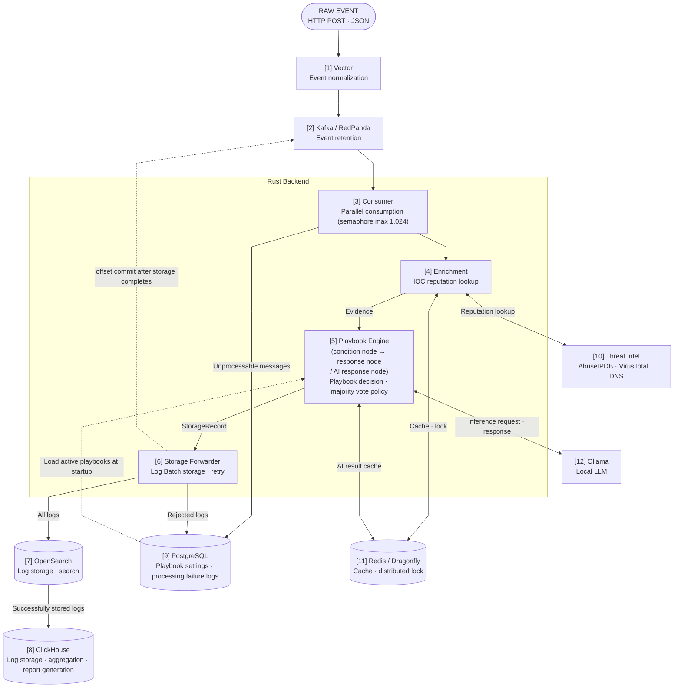

| No. | Component | Role |
|---|---|---|
| [1] | Vector | Receives events over HTTP, normalizes field names, records the collection time (`ingested_at`), then delivers them to the message broker |
| [2] | Kafka / RedPanda | Retains events and keeps them until processing is finished (Kafka/RedPanda can be selected with the environment variable `MESSAGE_BROKER`; Vector's sending target is switched in `vector.toml`) |
| [3] | Consumer | Creates a Task for each event and processes up to 1,024 in parallel |
| [4] | Enrichment | Looks up the reputation of IP·domain·file hash with external threat intelligence to create the decision basis (Evidence); results are stored in the cache and reused for the same target |
| [5] | Playbook Engine | Decides with all active playbooks in parallel; if multiple playbooks produce a decision for one event, the final decision is made by majority vote |
| [6] | Storage Forwarder | Groups logs into Batches and stores them in the order OpenSearch → ClickHouse, and commits only the offsets of logs whose storage is finished (temporary failures are retried, logs rejected by OpenSearch are kept in PostgreSQL) |
| [7] | OpenSearch | Stores original events + playbook results (search·query) |
| [8] | ClickHouse | Stores the same logs as OpenSearch (aggregation·report generation) |
| [9] | PostgreSQL | Table `playbooks`: playbook settings / `storage_failures`: originals of logs rejected by OpenSearch and unprocessable messages |
| [10] | Threat Intel | External lookup targets: AbuseIPDB (IP), DNS (domain), VirusTotal (file hash) |
| [11] | Redis / Dragonfly | Cache for Enrichment and playbook AI response node results (Redis/Dragonfly can be selected with the environment variable `CACHE_BACKEND`) |
| [12] | Ollama | Local LLM for the AI response node (models used: Qwen2.5 14B Instruct, Foundation-Sec 8B Reasoning) |

---

## 🚀 Demo — See It for Yourself

> **You can check how Shire Guard works through event examples, applied playbooks, expected results, and demonstration videos.**

### 🎬 [View Demo · DEMO.en.md](docs/DEMO.en.md)

---

## Monitoring
- **Metric exposure**: The Rust Backend, Vector, and Kafka / RedPanda each provide their own Metric endpoint, and cAdvisor exposes container resource usage
- **Metric collection**: Prometheus collects and stores each target's Metrics every 15 seconds
- **Grafana visualization**: Grafana displays Prometheus Metrics as dashboards
- **Grafana alerts**: If a service outage or a state in which the flow of a section is cut off persists, a Grafana alert is raised
- **Alert history management**: Alert state changes (Pending → Alerting → Normal) are stored in the Loki server (the alert history can be checked in the Grafana dashboard)

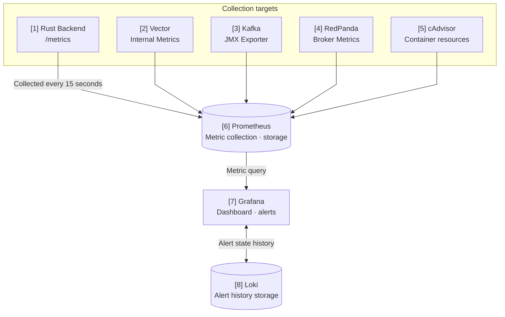

| No. | Component | Role |
|---|---|---|
| [1] | Rust Backend | Exposes application Metrics such as event receive·parse·failure counts, broker connection status, and active broker and cache settings through the `/metrics` endpoint |
| [2] | Vector | Exposes Vector internal Metrics such as the numbers of received·sent·discarded events and buffer usage through the Prometheus Exporter |
| [3] | Kafka |  Exposes Kafka broker and topic related Metrics through the JMX Exporter |
| [4] | RedPanda | Exposes the broker's own Metrics through the `/public_metrics` endpoint |
| [5] | cAdvisor | Provides Metrics so that CPU and memory usage per Docker container can be collected |
| [6] | Prometheus | Collects the Metrics of the configured targets every 15 seconds and stores them as time series data (Prometheus itself is also included as a monitoring target) |
| [7] | Grafana | Visualizes Prometheus Metrics as dashboards and evaluates alert rules (import files are kept in `docker/grafana/imports`) |
| [8] | Loki | Stores and queries Grafana's alert state history |

---

> The dashboard screens can be checked in [Main Features > 6. (Planned Improvement) Grafana Dashboard](#6-planned-improvement-grafana-dashboard).

---

## Main Features

### 1. Event Collection · Normalization

> Related file: [`docker/vector/vector.toml`](docker/vector/vector.toml)

- Vector receives JSON events over HTTP, normalizes them, and then delivers them to the message broker (Kafka / RedPanda)
- Even if field names differ for each event coming from outside, they are converted into standard events that Shire Guard can process
- To prevent loss of received events, a success response (ack) is sent only for events whose storage in the broker is confirmed, and when the buffer is full, events are not discarded but wait (block)
- In this portfolio, only the fields below go through **field name conversion** and **event collection time recording**

| Received Original | Vector Processing | Result Field |
|---|---|---|
| `source_ip` | Remove whitespace, rename field | `src_ip` |
| `destination_domain` | Convert to lowercase, rename field | `dst_domain` |
| `file_sha256` | Convert to lowercase | `file_sha256` |
| (none) | Record collection time | `ingested_at` |

**[Why Vector Was Chosen]**

Unlike the JVM-based Logstash, it is built with Rust, so it uses less CPU·memory, and it is open source, so it can be used freely

---

### 2. Parallel Processing · Backpressure

> Related files: [`kafka.rs`](backend/src/core/consumer/kafka.rs) · [`forwarder.rs`](backend/src/core/storage/forwarder.rs)

- The Consumer creates a Task for each event and processes up to 1,024 at the same time (limited by a Semaphore)
- When DB storage slows down, Kafka consumption automatically stops → backlogged events remain in Kafka, not in process memory, so memory does not grow without limit
- When the DB recovers, it is released in reverse order and automatically resumes

**Backpressure Behavior**

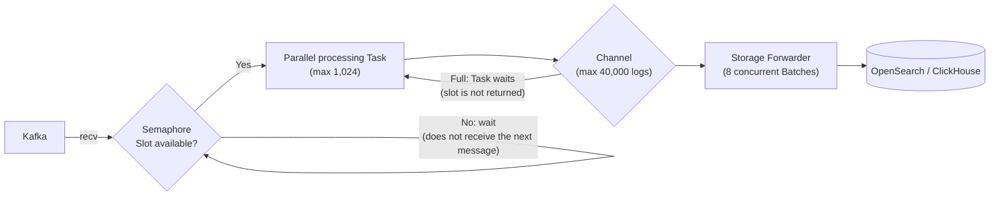

---

### 3. Enrichment (Threat Intelligence Lookup)

> Related files: [`service.rs`](backend/src/core/enrichment/service.rs) · [`circuit_breaker.rs`](backend/src/core/enrichment/circuit_breaker.rs) · [`providers/`](backend/src/core/enrichment/providers)

- Looks up the reputation of IP · domain · file hash fields with external threat intelligence, and caches the results in Redis/Dragonfly
- Selects only the IOCs present in the event and queries the supported Providers at the same time (currently 3)
- Applies a circuit breaker · distributed lock to prevent duplicate lookups of the same IOC and indiscriminate calls to an API that is down
- When the cache fails, it does not call the external API so that requests do not pile up on it, and records `CacheUnavailable`
- The lookup results are attached to the original log as `enrichment_*` fields and used as playbook conditions

| IOC Field | Provider | Result | Cache TTL |
|---|---|---|---:|
| `src_ip` | AbuseIPDB | Abuse confidence score, number of reports | 24 hours |
| `dst_domain` | DNS | List of resolved IP addresses | 1 hour |
| `file_sha256` | VirusTotal | Number of engines with malicious · suspicious · harmless verdicts, Sigma results | 7 days |

Lookup status: `Success` · `NotFound` · `RateLimited` · `Timeout` · `Error` · `CacheUnavailable`

**[Why Enrichment Was Implemented]**
- Actual events from external security devices could not be received, so testing was done with an in-house event generator
- When integrated with actual devices, Enrichment may be removed, but the structure of caching and reusing reputation information in Redis/Dragonfly can be used by referring to the current logic when implementing a reputation lookup feature in a SIEM, so the feature is kept

**[Why Caching in Redis/Dragonfly]**
- Prevents duplicate external API calls for the same IOC (API call limits · response delay)
- The amount to be cached is not small, so a dedicated cache server is used instead of application memory
- The cache is kept even if the Rust server restarts, and multiple processes can share the same cache
- Only `Success` and `NotFound` are cached (targets that do not exist are not looked up repeatedly either); failures are not cached

**Cache Storage Example (key → value)**

```text
// AbuseIPDB example
enrichment:abuseipdb:144.48.243.18
→ {"status":{"status":"Success"},"data":{"abuse_confidence_score":100,"total_reports":3626}}

// DNS example
enrichment:dns:cdn-update-service.net
→ {"status":{"status":"NotFound"},"data":null}

// VirusTotal example
enrichment:virustotal:275a021bbfb6489e54d471899f7db9d1663fc695ec2fe2a2c4538aabf651fd0f
→ {"status":{"status":"Success"},"data":{"malicious":66,"suspicious":0,"harmless":0,"undetected":2,"timeout":0,"confirmed-timeout":0,"failure":0,"type-unsupported":7,"sigma_high":0,"sigma_medium":0,"sigma_critical":0,"sigma_low":1}}

// Distributed lock example: a dedicated key that prevents the external API from being called at the same time for the same target (IOC)
// Created by the first request when there is no result in the cache, and deleted when the processing of the request holding the lock finishes (max 10 seconds)
enrichment:lock:abuseipdb:144.48.243.18
→ 9f1c2e4a-7b3d-4e8f-a1c5-2d6b8e0f3a71
```

**[Original Responses · Lookup Examples by Provider]**
- [sample-provider-response.md](docs/samples/sample-provider-response.md)

#### Lookup Flow

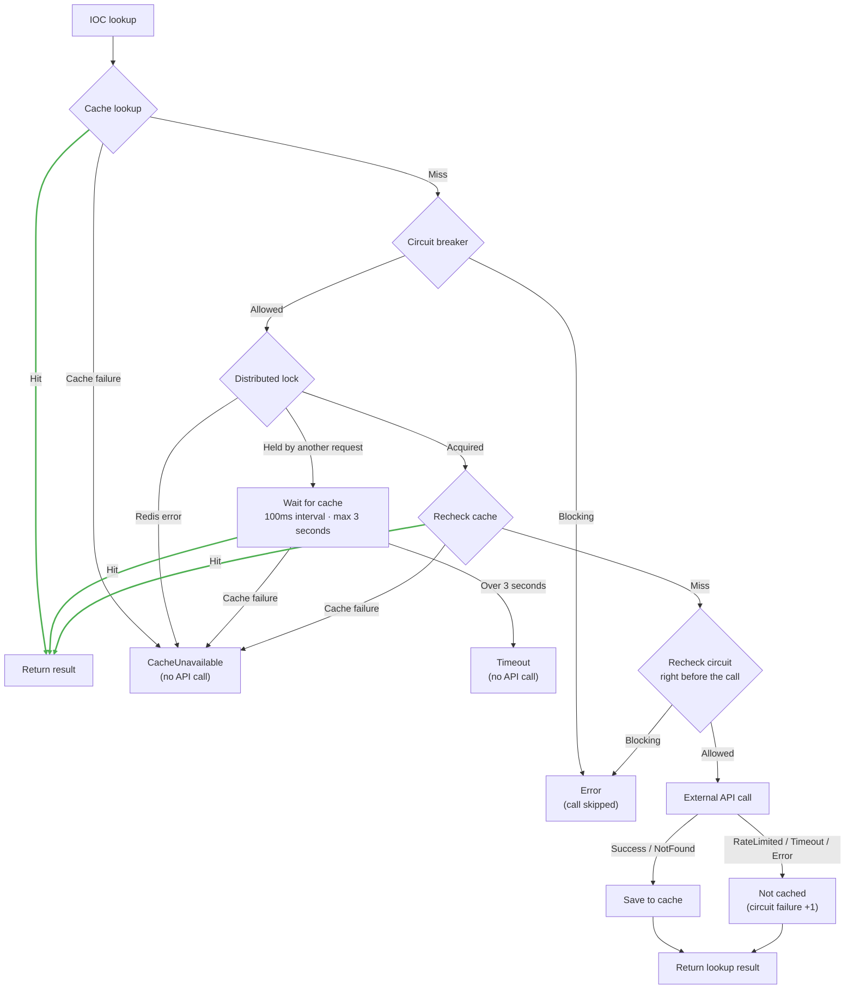

#### 1) Circuit Breaker (Independent per Provider)
- A feature implemented to block calls for a while after consecutive failures, so that requests are not kept being sent to a failed external API, delaying processing or exhausting the call limit
- Works separately for each Provider (e.g., a DNS failure does not block AbuseIPDB lookups)
- `NotFound` is a normal response, so it is not counted as a failure


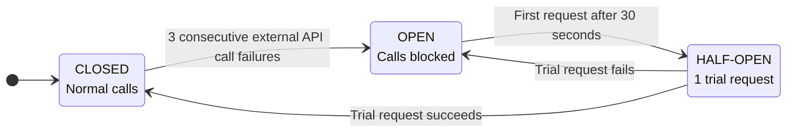

| State | Meaning | External API Calls |
|---|---|---|
| `CLOSED` | Normal state | Calls for all requests; switches to `OPEN` after 3 consecutive failures |
| `OPEN` | Judged as failed and blocked | Does not call and immediately returns `Error`; after 30 seconds, allows the next request as a trial request |
| `HALF-OPEN` | Checking whether it has recovered | Calls only 1 trial request and blocks the rest; on success `CLOSED` · on failure `OPEN` again |

#### 2) Distributed Lock
- A feature implemented so that, when there is no result in the cache and requests for the same IOC rush in at the same time, the external API is not called repeatedly; only one request calls it and the rest reuse that result
- Even if the wait time (3 seconds) is exceeded, waiters do not call the API themselves → prevents a surge in which all waiters call at once when the lock holder fails

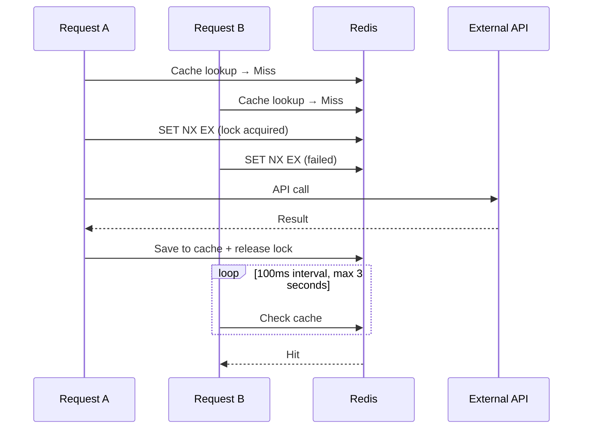

---


### 4. Playbook Automatic Decision

> Related files: [`engine.rs`](backend/src/core/playbook/engine.rs) · [`nodes.rs`](backend/src/core/playbook/nodes.rs) · [`condition.rs`](backend/src/core/playbook/condition.rs) · [`ai.rs`](backend/src/core/playbook/ai.rs) · [`002_seed.sql`](docker/postgres/init/002_seed.sql)
>
> Development notes: [`note-playbook-design.md`](docs/notes/note-playbook-design.md)

- Playbook settings (JSON node arrays) are managed in the PostgreSQL `playbooks` table
- Active playbooks are read and loaded into memory at server startup (kept in memory because the amount is small and they are used for every event)
- For each event, all active playbooks are processed in parallel
- The playbook's decision result is recorded as `action`: `DENY` (block) · `DETECT` (detect) · `HOLD` (hold)
  - **[Note]** Because this is a personal portfolio, actual security device APIs cannot be called, so the decision result is handled by recording it in the log as a string (`DENY`, etc.) (if needed, it can be extended to response features such as calling a device's blocking API for each `action`)
- If multiple playbooks produce a decision, the final decision is made by majority vote
- For an event with a decision, a `playbook_result` field is added to the original log (if there is no decision, only the original is stored)
  - **[Note]** The original log and the playbook log are not managed separately; related logs are grouped together to reduce management overhead. The efficiency of this part is planned to be verified when the original log and playbook log query feature is implemented

**Stored Log Example** (actual document stored in OpenSearch)

```jsonc
{
  // ── Original event (after Vector normalization) ──
  "event_id": "evt-13055464",
  "event_type": "file_download",
  "timestamp": "2026-10-09T20:47:39Z",
  "ingested_at": "2026-10-09T20:47:39.540062018Z",
  "src_ip": "144.48.243.18",
  "dst_domain": "cdn-update-service.net",
  "file_sha256": "275a021bbfb6489e54d471899f7db9d1663fc695ec2fe2a2c4538aabf651fd0f",
  "file_name": "invoice_2026.exe",
  "file_size_bytes": 245760,
  "path": "/",
  "source_type": "http_server",

  // ── Enrichment results ──
  "enrichment_src_ip": {
    "status": { "status": "Success" },
    "data": { "abuse_confidence_score": 100, "total_reports": 3626 }
  },
  "enrichment_dst_domain": {
    "status": { "status": "NotFound" },
    "data": null
  },
  "enrichment_file_sha256": {
    "status": { "status": "Success" },
    "data": {
      "malicious": 66, "suspicious": 0, "harmless": 0, "undetected": 2,
      "timeout": 0, "confirmed-timeout": 0, "failure": 0, "type-unsupported": 7,
      "sigma_high": 0, "sigma_medium": 0, "sigma_critical": 0, "sigma_low": 1
    }
  },

  // ── Playbook decision result (if there is no decision, this field itself does not exist) ──
  "playbook_result": {
    "action": "DENY",
    "evaluated": 2,
    "processed_at": "2026-10-09T20:49:13Z",
    "playbooks": [
      {
        "playbook_id": 2,
        "name": "고위험 IP 차단",       // "High-risk IP blocking"
        "action": "DENY",
        "when": "(enrichment_src_ip.data.abuse_confidence_score gte 80)"
      },
      {
        "playbook_id": 4,
        "name": "고위험 실행파일 차단",  // "High-risk executable file blocking"
        "action": "DENY",
        "when": "(event_type eq file_download) and ((enrichment_file_sha256.data.malicious gte 10) or ((enrichment_src_ip.data.abuse_confidence_score gte 80) and (file_size_bytes gt 100000))) and (file_name ends_with .exe)"
      }
    ]
  }
}
```

#### Execution Model

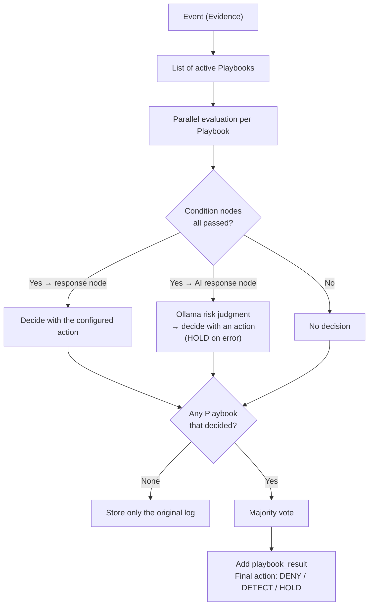

#### 1) Playbook Node Composition

- There are 3 kinds: condition node, response node, AI response node
- Zero or more condition nodes can be used, and condition nodes are connected to each other with AND
- At the very end, exactly 1 of either a response node or an AI response node must be placed

**Node Composition Example**

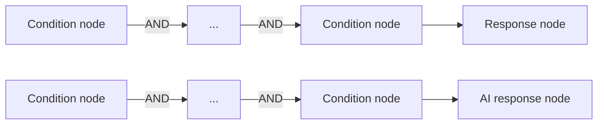

#### 2) Condition Node

- Applies conditions to event fields to filter only the events targeted by the playbook
- One condition consists of = `field` + `op` + `value`; multiple conditions are grouped with `and` / `or` and can be nested
- If the field does not exist or is `null`, all operators except `not_exists` are false
- With an `a.b.c` path, even Enrichment results can be used in conditions (e.g., `enrichment_src_ip.data.abuse_confidence_score`)
- For an event that went through a playbook decision, the condition at the time of the decision is recorded in the log as a `when` string inside `playbook_result` → the basis of the decision can be checked even if the playbook changes later

**Condition Operators**

| Operator | Meaning | Value |
|---|---|---|
| `exists` / `not_exists` | Field exists / does not exist | None |
| `eq` / `ne` | Equal / not equal | Number · string |
| `gt` / `gte` / `lt` / `lte` | > / ≥ / < / ≤ | Number |
| `contains` / `starts_with` / `ends_with` | Contains / starts with / ends with (case-sensitive) | String |
| `in_cidr` / `not_in_cidr` | Inside / outside the CIDR range | CIDR |

**Condition Node Examples (by Operator)**

- `name` is a user-defined name and is kept in Korean as in the original (English meaning in the comment)

```jsonc
// exists: when the file_sha256 field exists (no value) — name: "Has hash"
{ "type": "condition", "name": "해시 있음",
  "when": { "field": "file_sha256", "op": "exists" } }
// playbook_result > playbooks > when example: (file_sha256 exists)

// not_exists: when the approval_id field does not exist (no value) — name: "Not approved"
{ "type": "condition", "name": "미승인",
  "when": { "field": "approval_id", "op": "not_exists" } }
// playbook_result > playbooks > when example: (approval_id not_exists)

// eq: when event_type is file_download — name: "File download"
{ "type": "condition", "name": "파일 다운로드",
  "when": { "field": "event_type", "op": "eq", "value": "file_download" } }
// playbook_result > playbooks > when example: (event_type eq file_download)

// ne: when the VirusTotal lookup status is not CacheUnavailable — name: "Hash lookup available"
{ "type": "condition", "name": "해시 조회 가능",
  "when": { "field": "enrichment_file_sha256.status.status", "op": "ne", "value": "CacheUnavailable" } }
// playbook_result > playbooks > when example: (enrichment_file_sha256.status.status ne CacheUnavailable)

// gt: file size exceeds 100,000 bytes — name: "Large file"
{ "type": "condition", "name": "대용량 파일",
  "when": { "field": "file_size_bytes", "op": "gt", "value": 100000 } }
// playbook_result > playbooks > when example: (file_size_bytes gt 100000)

// gte: AbuseIPDB score is 80 or higher — name: "High-risk IP"
{ "type": "condition", "name": "고위험 IP",
  "when": { "field": "enrichment_src_ip.data.abuse_confidence_score", "op": "gte", "value": 80 } }
// playbook_result > playbooks > when example: (enrichment_src_ip.data.abuse_confidence_score gte 80)

// lt: number of VirusTotal engines with a malicious verdict is less than 10 — name: "Few malicious detections"
{ "type": "condition", "name": "악성 탐지 적음",
  "when": { "field": "enrichment_file_sha256.data.malicious", "op": "lt", "value": 10 } }
// playbook_result > playbooks > when example: (enrichment_file_sha256.data.malicious lt 10)

// lte: number of login attempts is 5 or fewer — name: "Few attempts"
{ "type": "condition", "name": "시도 횟수 적음",
  "when": { "field": "attempt_count", "op": "lte", "value": 5 } }
// playbook_result > playbooks > when example: (attempt_count lte 5)

// contains: when the domain contains update — name: "Domain disguised as an update"
{ "type": "condition", "name": "업데이트 위장 도메인",
  "when": { "field": "dst_domain", "op": "contains", "value": "update" } }
// playbook_result > playbooks > when example: (dst_domain contains update)

// starts_with: when the file name starts with invoice — name: "File disguised as an invoice"
{ "type": "condition", "name": "송장 위장 파일",
  "when": { "field": "file_name", "op": "starts_with", "value": "invoice" } }
// playbook_result > playbooks > when example: (file_name starts_with invoice)

// ends_with: when the file name ends with .exe — name: "Executable file"
{ "type": "condition", "name": "실행 파일",
  "when": { "field": "file_name", "op": "ends_with", "value": ".exe" } }
// playbook_result > playbooks > when example: (file_name ends_with .exe)

// in_cidr: when the source IP is inside the 185.220.101.0/24 range — name: "Suspicious range"
{ "type": "condition", "name": "의심 대역",
  "when": { "field": "src_ip", "op": "in_cidr", "value": "185.220.101.0/24" } }
// playbook_result > playbooks > when example: (src_ip in_cidr 185.220.101.0/24)

// not_in_cidr: when the source IP is outside the internal network (10.0.0.0/8) — name: "External IP"
{ "type": "condition", "name": "외부 IP",
  "when": { "field": "src_ip", "op": "not_in_cidr", "value": "10.0.0.0/8" } }
// playbook_result > playbooks > when example: (src_ip not_in_cidr 10.0.0.0/8)
```

**and / or Combination Example 1**

```jsonc
// (10 or more malicious verdicts) OR (AbuseIPDB score 80 or higher AND file size exceeds 100,000 bytes)
// name: "Malicious detection or large file from a high-risk IP"
{
  "type": "condition",
  "name": "악성 탐지 또는 고위험 IP의 대용량 파일",
  "when": {
    "or": [
      {
        "field": "enrichment_file_sha256.data.malicious",
        "op": "gte",
        "value": 10
      },
      {
        "and": [
          {
            "field": "enrichment_src_ip.data.abuse_confidence_score",
            "op": "gte",
            "value": 80
          },
          {
            "field": "file_size_bytes",
            "op": "gt",
            "value": 100000
          }
        ]
      }
    ]
  }
}
// playbook_result > playbooks > when example:
// ((enrichment_file_sha256.data.malicious gte 10) or ((enrichment_src_ip.data.abuse_confidence_score gte 80) and (file_size_bytes gt 100000)))
```

**and / or Combination Example 2**

```jsonc
// Event type is file_download
// AND ( file extension is .exe OR .dll )
// AND ( number of VirusTotal engines with a malicious verdict is 1~9 OR ( AbuseIPDB score 50 or higher AND src_ip is not included in the 10.0.0.0/8 range ) )
// name: "Ambiguous executable file download"
{
  "type": "condition",
  "name": "애매한 실행 파일 다운로드",
  "when": {
    "and": [
      {
        "field": "event_type",
        "op": "eq",
        "value": "file_download"
      },
      {
        "or": [
          {
            "field": "file_name",
            "op": "ends_with",
            "value": ".exe"
          },
          {
            "field": "file_name",
            "op": "ends_with",
            "value": ".dll"
          }
        ]
      },
      {
        "or": [
          {
            "and": [
              {
                "field": "enrichment_file_sha256.data.malicious",
                "op": "gte",
                "value": 1
              },
              {
                "field": "enrichment_file_sha256.data.malicious",
                "op": "lt",
                "value": 10
              }
            ]
          },
          {
            "and": [
              {
                "field": "enrichment_src_ip.data.abuse_confidence_score",
                "op": "gte",
                "value": 50
              },
              {
                "field": "src_ip",
                "op": "not_in_cidr",
                "value": "10.0.0.0/8"
              }
            ]
          }
        ]
      }
    ]
  }
}
// playbook_result > playbooks > when example:
// ((event_type eq file_download) and ((file_name ends_with .exe) or (file_name ends_with .dll)) and (((enrichment_file_sha256.data.malicious gte 1) and (enrichment_file_sha256.data.malicious lt 10)) or ((enrichment_src_ip.data.abuse_confidence_score gte 50) and (src_ip not_in_cidr 10.0.0.0/8))))
```

#### 3) Response Node

- Located at the very end of the playbook composition; if all preceding condition nodes are passed, the event is decided with the action configured in the response node
- There are 3 kinds of action

| action | Meaning |
|---|---|
| `DENY` | Block |
| `DETECT` | Detect (allow but record) |
| `HOLD` | Hold (requires confirmation by the person in charge) |

```jsonc
// Block
{ "type": "response", "action": "DENY" }

// Detect (allow + record)
{ "type": "response", "action": "DETECT" }

// Hold (requires confirmation by the person in charge)
{ "type": "response", "action": "HOLD" }
```

**Response Node Result Example**

```jsonc
// playbook_result of an actually stored log (when both of 2 playbooks decided DENY)
"playbook_result": {
  "action": "DENY",          // Final decision: the result of aggregating the actions of the playbooks below by majority vote (see 5) Majority Vote, described below)
  "evaluated": 2,            // Number of playbooks that produced a decision
  "processed_at": "2026-10-09T20:49:13Z", // Playbook processing time (UTC) 
  "playbooks": [ // Records the decision of each playbook and the condition at the time of the decision
    {
      "playbook_id": 2,
      "name": "고위험 IP 차단",       // "High-risk IP blocking"
      "action": "DENY",      // Decision of the playbook with playbook_id 2 (the action configured in the response node)
      "when": "(enrichment_src_ip.data.abuse_confidence_score gte 80)" 
    },
    {
      "playbook_id": 4,
      "name": "고위험 실행파일 차단",  // "High-risk executable file blocking"
      "action": "DENY",      // Decision of the playbook with playbook_id 4 (the action configured in the response node)
      "when": "(event_type eq file_download) and ((enrichment_file_sha256.data.malicious gte 10) or ((enrichment_src_ip.data.abuse_confidence_score gte 80) and (file_size_bytes gt 100000))) and (file_name ends_with .exe)"
    }
  ]
}
```

#### 4) AI Response Node

- Like the response node, it is located at the very end of the playbook composition; for events that are hard to define with rules and are expected to be few in number, a local LLM (Ollama) judges the risk level (HIGH / MEDIUM / LOW)
- The judged risk level is converted into the action configured in the playbook (a risk level not in the mapping produces no decision)
- For AI errors · exceeding 60 seconds · cache failures, the action is always decided as HOLD (subject to confirmation by the person in charge)
- There are currently 2 available AI models: `qwen2.5:14b-instruct`, `Foundation-Sec-8B-Reasoning`

```jsonc
{
  "type": "ai_response",

  // Ollama model to use for AI analysis
  "model": "qwen2.5:14b-instruct",

  // Analysis instruction given to the AI
  // The event to be analyzed + Enrichment results are automatically delivered together
  // (The prompt is kept in Korean as in the original. Meaning: "Analyze the security event and the enrichment results and judge the risk level.")
  "prompt": "보안 이벤트와 enrichment 결과를 분석하고 위험도를 판단하라.",

  // Mapping that converts the risk level returned by the AI into the playbook's response (Action)
  // The AI returns one of these risk levels (HIGH / MEDIUM / LOW), and the Action linked to that risk level is used as the final response
  // If a risk level not in the mapping is returned, this playbook produces no decision (e.g., if LOW is removed, LOW is not decided)
  "actions": { "HIGH": "DENY", "MEDIUM": "HOLD", "LOW": "DETECT" }
}
```

**AI Call Handling**

- Calls are made one at a time to match Ollama's default concurrent processing count (`OLLAMA_NUM_PARALLEL=1`)

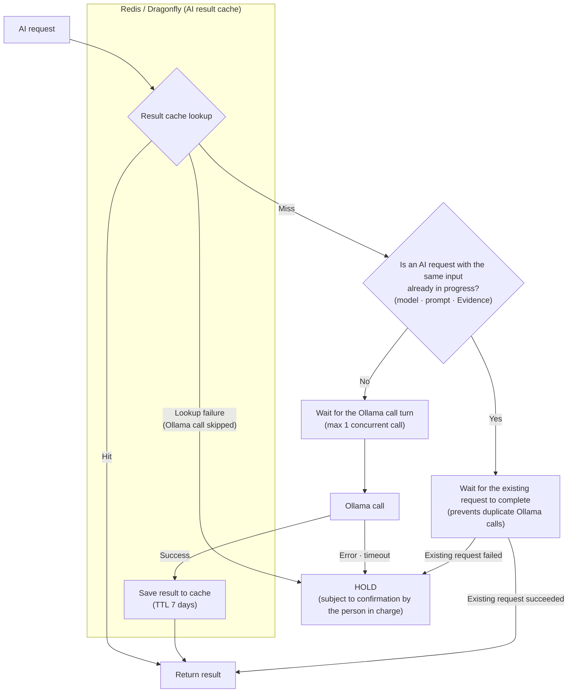

**AI Response Node Result Example** (`playbook_result.playbooks[]` item)

```jsonc
// On success: the risk (HIGH) returned by the AI is decided as DENY according to the actions mapping
{
  "playbook_id": 3,
  "name": "애매한 파일 AI 분석",  // "Ambiguous file AI analysis"
  "action": "DENY",
  "when": "((event_type eq file_download) and (enrichment_file_sha256.data.malicious gte 1) and (enrichment_file_sha256.data.malicious lt 10))",
  "ai_result": {
    "status": "success",
    "risk": "HIGH",
    "reason": "The file name 'invoice.exe' is suspicious because it ends with '.exe' ...",
    "model": "qwen2.5:14b-instruct"
  }
}

// On failure: AI errors · timeouts · cache failures are decided as HOLD regardless of the mapping (error is recorded without risk · reason)
{
  "playbook_id": 3,
  "name": "애매한 파일 AI 분석",  // "Ambiguous file AI analysis"
  "action": "HOLD",
  "when": "((event_type eq file_download) and (enrichment_file_sha256.data.malicious gte 1) and (enrichment_file_sha256.data.malicious lt 10))",
  "ai_result": {
    "status": "error",
    "error": "timeout",
    "model": "qwen2.5:14b-instruct"
  }
}
```

**Original Ollama Response Example**
- The AI response is forced into the `risk` (one of HIGH / MEDIUM / LOW) · `reason` format with a JSON schema (see the `message.content` part of the original response example below)
- Original response example: [sample-ai-response.json](docs/samples/sample-ai-response.json)

#### 5) Playbook Majority Vote

- When multiple playbooks produce a decision for one event, a final decision is needed
- Each playbook that produced a decision in a response node or an AI response node has one vote (HOLD is also one vote)
- Playbooks that did not pass the conditions have no vote

**Majority Vote Formula**

```text
(number of a specific action / total number of actions) > 0.5 → decided as that action
Otherwise (no majority, tie)                                   → decided as HOLD to prompt confirmation by the person in charge
```
**Majority Vote Behavior Example**

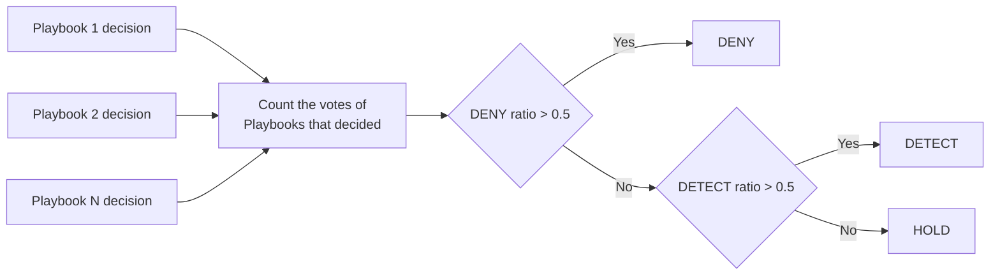

| Playbook Decisions | Final Decision | Reason |
|---|---|---|
| DENY · DENY · HOLD | DENY | 2/3 |
| DETECT · DETECT · DENY | DETECT | 2/3 |
| DENY · DETECT · HOLD | HOLD | No majority |
| DENY · DENY · DETECT · DETECT | HOLD | Tie |

---

### 5. Log Storage (Relay Batch Storage)

> Related files: [`forwarder.rs`](backend/src/core/storage/forwarder.rs) · [`record.rs`](backend/src/core/storage/record.rs) · [`failures.rs`](backend/src/core/storage/failures.rs) · [`offset.rs`](backend/src/core/consumer/offset.rs)

- Processed event logs are stored identically in OpenSearch and ClickHouse
- Temporary storage failures are retried until they succeed
- Logs that OpenSearch rejected due to a problem with the doc itself and messages that cannot be processed are kept as originals in PostgreSQL `storage_failures`
- Kafka/RedPanda offset commit only for logs whose storage is fully finished
- Even if the same log is stored again due to reprocessing, it is deduplicated by `log_id`

#### 1) Relay Batch Storage

- A storage method devised by the Shire Guard developer
- A method that groups logs into Batches, stores each Batch in OpenSearch first, and **passes only the logs stored in OpenSearch to ClickHouse for storage**
- If logs are stored in both DBs at the same time, the logs of the two DBs can differ when only one side succeeds → by passing them in order, the same logs always remain in both DBs

**[Why OpenSearch Is Stored First]**

- OpenSearch Bulk returns a storage result for each document, so only the logs rejected due to a problem with the document itself can be picked out
- ClickHouse INSERT succeeds or fails for the entire Batch, so if a problematic document is mixed in, the entire Batch fails
- Only the logs filtered by OpenSearch are passed to ClickHouse so that the ClickHouse INSERT does not fail
- Failed logs are stored separately in PostgreSQL and can be used for root cause analysis
- ClickHouse has faster INSERT performance than OpenSearch (about 210,000~260,000/s vs about 112,000/s at the time of testing), so it was judged that ClickHouse would not become a bottleneck even when placed after OpenSearch

> The numbers in the diagram are set by the constants at the top of [`forwarder.rs`](backend/src/core/storage/forwarder.rs)

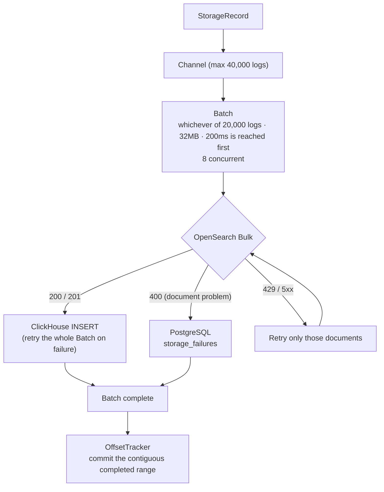

#### 2) Deduplication

- If the process dies or the partition assignment changes before a commit, Kafka redelivers from the commit position → logs that were already stored can be stored again
- A `log_id` that identifies the same log is created and used as the key in each storage → only 1 copy remains no matter how many times it is stored again
- `log_id = sha256(event_id | ingested_at)`: even if events with the same `event_id` come in multiple times, they are distinguished as different logs by the collection time (`ingested_at`)
  - For messages that cannot be parsed, `event_id` · `ingested_at` cannot be known, so it is created from the Kafka position: `kafka-{topic}-{partition}-{offset}` (the same value even if reprocessed)

| Storage | Method |
|---|---|
| OpenSearch | Used as `_id` → the same log is overwritten |
| ClickHouse | ReplacingMergeTree → only 1 copy remains on merge (use `FINAL` for exact queries) |
| PostgreSQL | PRIMARY KEY → `ON CONFLICT DO NOTHING` |

#### 3) Keeping Failure Originals (`storage_failures`)

- Discarding a log that cannot be processed is a loss, and retrying until it succeeds blocks the commit of subsequent logs because of that log
- The original and the reason are kept in PostgreSQL and then marked as complete → the next logs proceed without loss, and the person in charge can check the cause with the kept original

| Failure | log_id | payload |
|---|---|---|
| OpenSearch rejection (400) | `sha256(event_id \| ingested_at)` | The sent document |
| Empty message · deserialization failure | `kafka-{topic}-{partition}-{offset}` | Kafka original bytes (stored as the PostgreSQL BYTEA type) |

#### 4) Kafka/RedPanda Offset commit

- If the Consumer commits as soon as it receives an event, when the process dies before DB storage, that log is not processed again and can be lost
- Events are processed in parallel and Batches are also stored concurrently, so the order of storage completion differs from the order of receipt
- Therefore, it is implemented to commit only up to the **contiguous range** in which storage in OpenSearch · ClickHouse · (if there are rejected logs) PostgreSQL is all finished
- Automatic offset storing is turned off (`enable.auto.offset.store=false`), and only the calculated position is stored
- When a partition assignment is revoked by a rebalance, the offset records of that partition are deleted, and when it is assigned again, the Offset is recorded anew

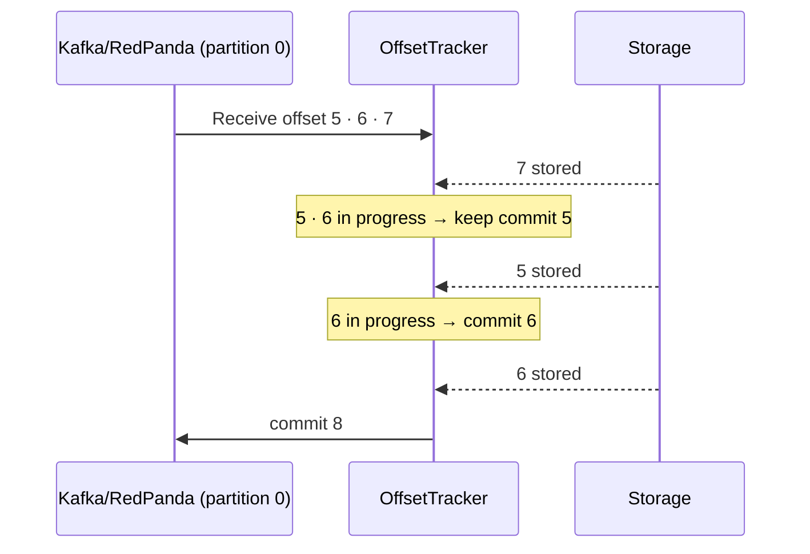

**Offset Handling Example**

| Event | In Progress | Commit Position (means the offset to read next) |
|---|---|---|
| 7 completed | 5, 6 | Keep 5 |
| 5 completed | 6 | 6 |
| 6 completed | None | 8 |

---

### 6. (Planned Improvement) Grafana Dashboard

- Displays each service's Metrics collected by Prometheus and Loki's alert history in Grafana dashboards

<details>
<summary><b>View Dashboard Screens (Initial Version)</b></summary>

> [!NOTE]
> These screens were captured in the initial version. They include screens from when Vector stored directly to OpenSearch / ClickHouse, and the latest screens matching the current storage structure (Rust → direct storage to OpenSearch / ClickHouse) are planned to be done later. (Considering whether to replace them with FE code)

#### Axum Server Enabled

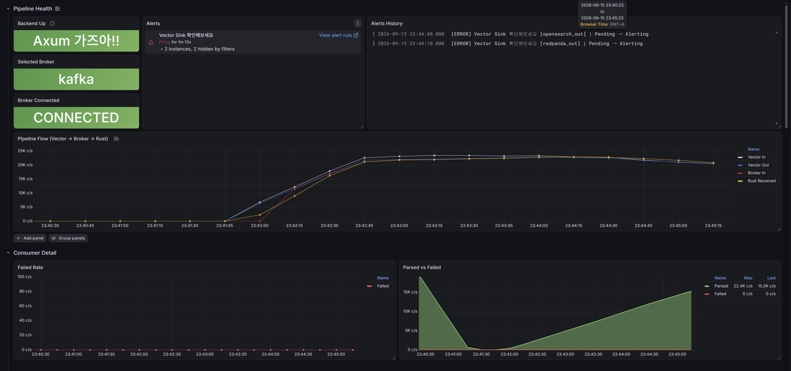
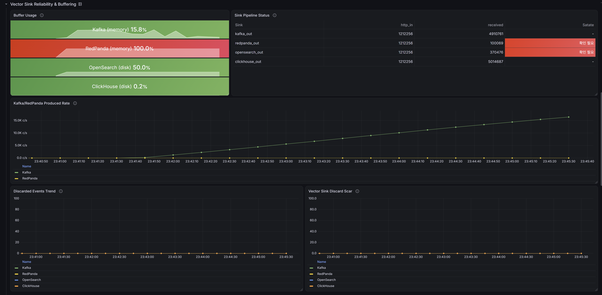
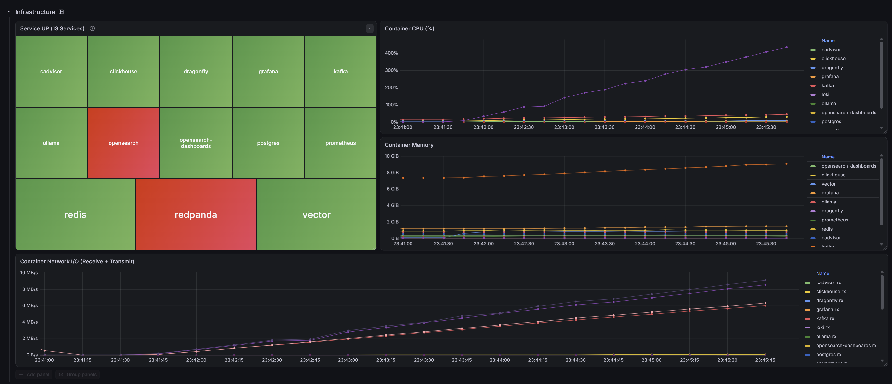
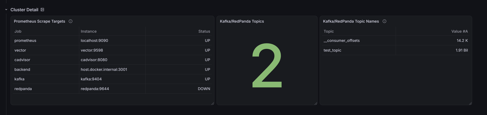

#### Axum Server Disabled

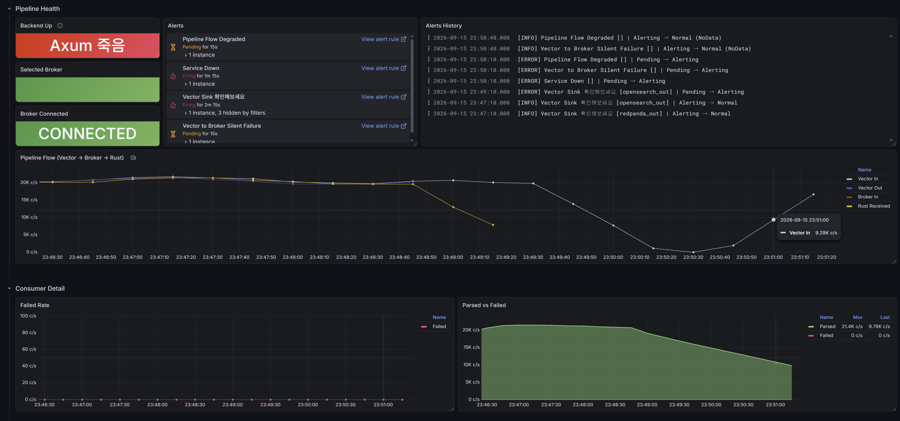
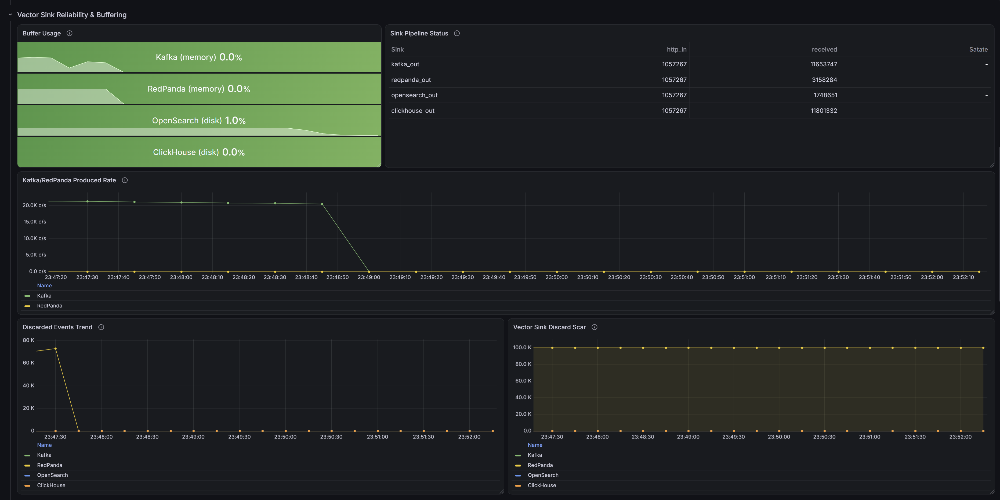
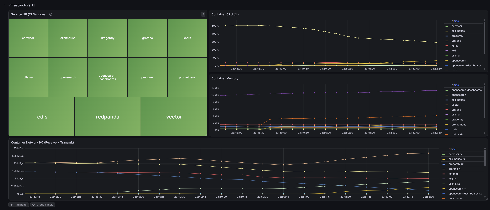
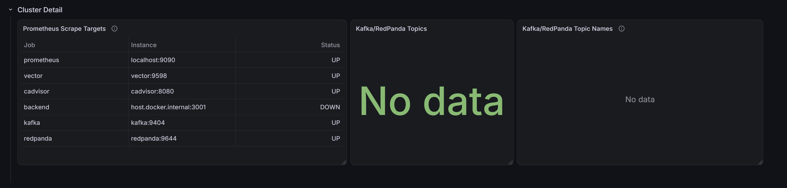

</details>

---

### 7. (Planned) Event · Playbook Log Query

- Query · conditional search of original events and playbook decision results stored in OpenSearch

---

### 8. (Planned) Report Generation

- Generate HWPX · DOCX report files with ClickHouse aggregation

---

## Performance

### Test Environment

| Item | Specification |
|---|---|
| Device | 1 laptop (all services running simultaneously) |
| CPU | Intel Core Ultra 9 285HX (24 cores / 24 threads) |
| Memory | 96GB (about 47GB allocated to Docker) |
| OS | Windows + Docker Desktop (WSL2) |
| Build | Rust release (`lto = "fat"`, `codegen-units = 1`) |
| GPU | RTX 5090 Laptop 24GB (for the Ollama AI node, not used when measuring throughput) |

### Throughput Measurement Results

| Section | Throughput | Notes |
|---|---|---|
| Rust processing (Enrichment → Playbook) | about 110,000/s | Enrichment cache hit condition |
| Storage (OpenSearch → ClickHouse complete) | about 89,000~109,000/s | Based on storage completion in both DBs |
| └ OpenSearch | about 112,000/s | Empty index, 8GB heap, measured while the Rust server was running simultaneously |
| └ ClickHouse | about 210,000~260,000/s | |
| **Overall (Kafka consumption → storage complete)** | **about 66,000~71,000/s** | Processing 1 million events accumulated in Kafka |

<!-- Standalone measurement (Rust Backend stopped, dbbench), 2026-10-27
./dbbench.exe os 1000000 --batch 20000 --concurrency 8   # empty index, 147,250 docs/s
./dbbench.exe ch 1000000 --batch 20000 --concurrency 8   # 325,155 docs/s
-->

### Measurement Results and Interpretation

- **Throughput per section**: measured by applying maximum load to each section, confirming about 100,000 events per second
- **Overall throughput**: lower than the individual sections because all services share the CPU of 1 laptop
- **Loss rate**: 0% in the test of forced termination during processing of 1 million events followed by a restart

---

## Roadmap

- [ ] **Playbook create / update / delete API**: when a playbook create/update/delete occurs, replace the entire list of active playbooks with a write Lock (events being evaluated keep using the existing list, so processing does not stop)
- [ ] **Query API**: support full query / conditional search of event logs and playbook logs in OpenSearch
- [ ] **Report generation**: generate HWPX / DOCX reports with ClickHouse aggregation
- [ ] **Review jev / Laya**
