# Shire Guard

```text
┌─────────────────────────────────────────────────────┐
│                     SHIRE  GUARD                    │
│   AI-assisted Security Event Detection Pipeline     │
└─────────────────────────────────────────────────────┘
```

보안 이벤트를 실시간으로 수집하고 **조사(Enrichment) → 판정(Playbook) → 저장(OpenSearch / ClickHouse)** 까지 처리하는 Rust 기반 보안 이벤트 처리 파이프라인이다.

이벤트의 IOC(IP, 도메인, 파일 해시)를 외부 위협 정보(AbuseIPDB, DNS, VirusTotal)로 조사하고,
사용자가 정의한 Playbook(조건 노드 / 대응 노드 / AI 대응 노드)으로 판정한 결과를 원본 로그에 붙여 **유실 없이** 저장한다.

> **Project goal**
>
> 대량의 보안 이벤트를 사람이 아닌 Playbook과 AI로 자동 판정하고, 판정 결과를 유실 없이 저장해 로그 조회 또는 보고서로 활용

> **Project context**
>
> - 개발 기간: 약 2개월
> - 개발 방식: AI 페어 프로그래밍(설계 대안 비교/코드 리뷰에 AI를 활용하고, 모든 코드는 직접 검토 및 테스트 후 반영)
> - 사용 AI 도구: Claude Pro(Main), ChatGPT Free(Sub), Grok, Google AI 검색
> - 프로젝트 성격: Rust/Axum 학습 후 보안 이벤트 처리 서버를 직접 설계·구현한 취업용 개인 프로젝트(2번째 프로젝트)
> - 현재 수준: 구간별 초당 약 10만 건, 전체 약 6.6만~7.1만/s (단일 노트북, Docker 전체 동시 실행)

---
## Tech Stack

| 분류 | 기술 |
|---|---|
| Language / Runtime | Rust (edition 2024), Tokio |
| Web | Axum |
| Collector | Vector |
| Message Broker | Apache Kafka (KRaft) / RedPanda |
| Cache / Lock | Redis / Dragonfly |
| Storage | OpenSearch, ClickHouse, PostgreSQL (SQLx) |
| AI | Ollama (Qwen2.5 14B Instruct, Foundation-Sec 8B Reasoning) |
| Threat Intelligence | AbuseIPDB, VirusTotal, DNS |
| Monitoring | Prometheus, Grafana, Loki, cAdvisor, JMX Exporter |
| Infra | Docker Compose |
| CI | GitHub Actions (fmt / clippy / build / test) |
| Test Tools | loadgen (부하 테스트), dbbench (DB 저장 성능) 직접 제작 |

---
## Architecture
- **수집**: Vector가 이벤트를 정규화해 Kafka에 전달
- **처리**: Consumer가 이벤트를 병렬로 꺼내 Enrichment(평판 조회) → Playbook(이벤트 판정) 순서로 처리
- **저장**: OpenSearch에 먼저 저장하고, 성공한 로그만 ClickHouse에 저장 → 두 DB에 같은 로그가 남음
- **실패**: OpenSearch가 거절한 로그와 처리할 수 없는 메시지는 PostgreSQL에 원문 보관
- **offset commit**: 저장이 끝난 연속 구간까지만 Kafka에 commit → 중간에 죽어도 재시작하면 저장 안 된 로그부터 다시 처리 가능, 다시 저장된 로그는 `log_id`(OpenSearch `_id`, ClickHouse 정렬 키)로 중복 제거됨

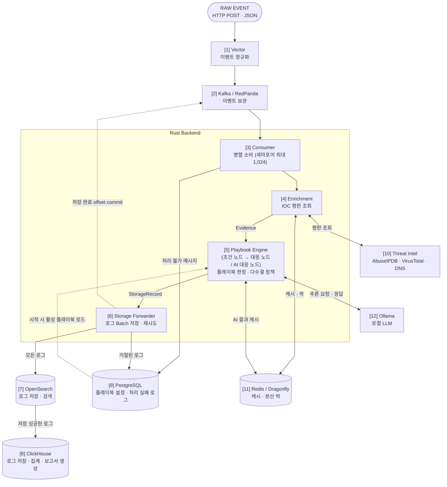

| 번호 | 구성 요소 | 역할 |
|---|---|---|
| [1] | Vector | HTTP로 이벤트 수신, 필드명 정규화, 수집 시각(`ingested_at`) 기록 후 메시지 브로커로 전달 |
| [2] | Kafka / RedPanda | 이벤트 보관, 처리가 끝날 때까지 유지 (환경변수 `MESSAGE_BROKER`로 Kafka/RedPanda 선택 가능, Vector 전송 대상은 `vector.toml`에서 전환) |
| [3] | Consumer | 이벤트마다 Task를 만들어 최대 1,024개 병렬 처리 |
| [4] | Enrichment | IP·도메인·파일 해시를 외부 위협 정보로 평판 조회해 판정 근거(Evidence) 생성, 결과는 캐시에 저장해 같은 대상은 재사용 |
| [5] | Playbook Engine | 활성 플레이북 전체를 병렬 판정, 하나의 이벤트에 여러 플레이북이 판정을 낸 경우 다수결로 최종 판정 |
| [6] | Storage Forwarder | 로그를 Batch로 묶어 OpenSearch → ClickHouse 순으로 저장, 저장이 끝난 로그의 offset만 commit (일시적 실패는 재시도, OpenSearch가 거절한 로그는 PostgreSQL에 보관) |
| [7] | OpenSearch | 원본 이벤트 + 플레이북 결과 저장 (검색·조회) |
| [8] | ClickHouse | OpenSearch와 같은 로그 저장 (집계·보고서 생성) |
| [9] | PostgreSQL | 테이블 `playbooks`: 플레이북 설정 / `storage_failures`: OpenSearch가 거절한 로그와 처리 불가 메시지 원문 |
| [10] | Threat Intel | AbuseIPDB(IP), DNS(도메인), VirusTotal(파일 해시) 외부 조회 대상 |
| [11] | Redis / Dragonfly | Enrichment와 플레이북 AI 대응 노드 결과 캐시 (환경변수 `CACHE_BACKEND`로 Redis/Dragonfly 선택 가능) |
| [12] | Ollama | AI 대응 노드용 로컬 LLM (사용 모델: Qwen2.5 14B Instruct, Foundation-Sec 8B Reasoning) |

---

<!-- TODO 시연 데모영상 추가 예정 -->

## Monitoring
- **Metric 노출**: Rust Backend, Vector, Kafka / RedPanda가 각자의 Metric 엔드포인트를 제공하고, cAdvisor가 컨테이너 리소스 사용량을 노출
- **Metric 수집**: Prometheus가 15초마다 각 대상의 Metric을 수집하여 저장
- **Grafana 시각화**: Grafana가 Prometheus Metric을 대시보드로 표시
- **Grafana 알림**: 서비스 중단이나 구간 흐름이 끊기는 상태가 지속되면 Grafana 알림 발생
- **알림 이력 관리**: 알림 상태 변화(Pending → Alerting → Normal)는 Loki 서버에 저장 (Grafana 대시보드에서 알림 이력을 확인 가능)

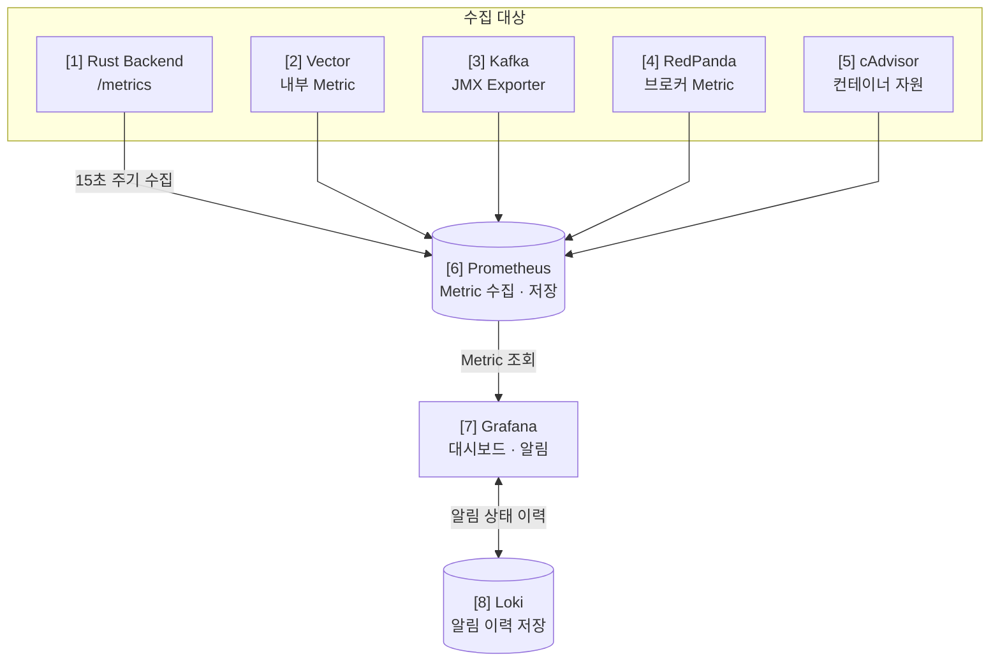

| 번호 | 구성 요소 | 역할 |
|---|---|---|
| [1] | Rust Backend | `/metrics` 엔드포인트로 이벤트 수신·파싱·실패 건수, 브로커 연결 상태, 활성 브로커 및 캐시 설정 등의 애플리케이션 Metric을 노출 |
| [2] | Vector | Prometheus Exporter를 통해 이벤트 수신·전송·버림(discard) 이벤트 수, 버퍼 사용량 등 Vector 내부 Metric을 노출 |
| [3] | Kafka |  JMX Exporter를 통해 Kafka 브로커 및 토픽 관련 Metric을 노출 |
| [4] | RedPanda | `/public_metrics` 엔드포인트를 통해 브로커 자체 Metric을 노출 |
| [5] | cAdvisor | Docker 컨테이너별 CPU 및 메모리 사용량을 수집할 수 있도록 Metric을 제공 |
| [6] | Prometheus | 설정된 대상의 Metric을 15초마다 수집하고 시계열 데이터로 저장 (Prometheus 자체도 모니터링 대상으로 포함) |
| [7] | Grafana | Prometheus Metric을 대시보드로 시각화하고 알림 규칙을 평가 (import 파일은 `docker/grafana/imports`에 JSON으로 보관 중) |
| [8] | Loki | Grafana의 알림 상태 이력을 저장하고 조회 |

---

<!-- TODO 대시보드 및 알림 스크린샷 추가 예정 -->

---

## 주요 기능

### 1. 이벤트 수집 · 정규화

> 연관 파일: [`docker/vector/vector.toml`](docker/vector/vector.toml)

- Vector가 HTTP로 JSON 이벤트를 받아 정규화한 뒤 메시지 브로커(Kafka / RedPanda)로 전달
- 외부에서 들어오는 이벤트마다 필드 이름이 달라도, Shire Guard가 처리할 수 있는 표준 이벤트로 변환
- 수신된 이벤트의 유실을 방지하기 위해 브로커 저장이 확인된 이벤트만 성공 응답(ack)하고, 버퍼가 가득 차면 버리지 않고 대기(block)
- 포트폴리오에서는 아래 필드만 **필드명 변환**과 **이벤트 수집 시각 기록** 처리함

| 수신 원본 | Vector 처리 | 결과 필드 |
|---|---|---|
| `source_ip` | 공백 제거, 필드명 변경 | `src_ip` |
| `destination_domain` | 소문자 변환, 필드명 변경 | `dst_domain` |
| `file_sha256` | 소문자 변환 | `file_sha256` |
| (없음) | 수집 시각 기록 | `ingested_at` |

**[Vector를 선택한 이유]**

JVM 기반 Logstash와 달리 Rust로 만들어져 CPU·메모리 사용량이 적고, 오픈소스라 자유롭게 사용 가능

---

### 2. 병렬 처리 · Backpressure

> 연관 파일: [`kafka.rs`](backend/src/core/consumer/kafka.rs) · [`forwarder.rs`](backend/src/core/storage/forwarder.rs)

- Consumer가 이벤트마다 Task를 만들어 최대 1,024개를 동시에 처리 (Semaphore로 제한)
- DB 저장이 느려지면 Kafka 소비가 자동으로 멈춤 → 밀린 이벤트는 프로세스 메모리가 아니라 Kafka에 남아 메모리가 무한히 늘지 않음
- DB가 회복되면 역순으로 풀리며 자동 재개

**Backpressure 동작**

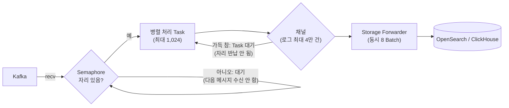

---

### 3. Enrichment (위협 정보 조회)

> 연관 파일: [`service.rs`](backend/src/core/enrichment/service.rs) · [`circuit_breaker.rs`](backend/src/core/enrichment/circuit_breaker.rs) · [`providers/`](backend/src/core/enrichment/providers)

- IP · 도메인 · 파일 해시 필드를 외부 위협 정보로 평판 조회하고, 결과를 Redis/Dragonfly에 캐싱
- 이벤트에 있는 IOC만 골라 지원 중인 Provider를 동시에 조회(현재 3개)
- 같은 IOC의 중복 조회, 장애 중인 API로의 무분별한 호출을 막기 위해 서킷 브레이커 · 분산 락 적용
- 캐시 장애 시에는 외부 API로 요청이 몰리지 않도록 호출하지 않고 `CacheUnavailable`로 기록
- 조회 결과는 원본 로그에 `enrichment_*` 필드로 붙어 플레이북 조건으로 사용

| IOC 필드 | Provider | 결과 | 캐시 TTL |
|---|---|---|---:|
| `src_ip` | AbuseIPDB | 악성 신뢰도 점수, 신고 수 | 24시간 |
| `dst_domain` | DNS | 해석된 IP 주소 목록 | 1시간 |
| `file_sha256` | VirusTotal | 악성 · 의심 · 정상 판정 엔진 수, Sigma 결과 | 7일 |

조회 상태: `Success` · `NotFound` · `RateLimited` · `Timeout` · `Error` · `CacheUnavailable`

**[Enrichment를 구현한 이유]**
- 외부 보안 장비의 실제 이벤트를 받을 수 없어, 자체 이벤트 생성기로 테스트함
- 실제 장비와 연동하면 Enrichment는 빠질 수 있지만, 평판 정보를 Redis/Dragonfly에 캐싱하고 재사용하는 구조는 SIEM에서 평판 조회 기능을 구현할 때 현재 로직을 참고하여 활용 가능하기에 해당 기능을 유지함

**[Redis/Dragonfly에 캐싱하는 이유]**
- 같은 IOC에 대한 외부 API 중복 호출 방지 (API 호출 제한 · 응답 지연)
- 캐싱될 양이 작지 않아 애플리케이션 메모리 대신 전용 캐시 서버 사용
- Rust 서버를 재시작해도 캐시 유지, 여러 프로세스가 같은 캐시 공유 가능
- `Success`와 `NotFound`만 캐싱 (없는 대상도 반복 조회하지 않음), 실패는 캐싱하지 않음

**캐시 저장 예시 (key → value)**

```text
// AbuseIPDB 예시
enrichment:abuseipdb:144.48.243.18
→ {"status":{"status":"Success"},"data":{"abuse_confidence_score":100,"total_reports":3626}}

// DNS 예시
enrichment:dns:cdn-update-service.net
→ {"status":{"status":"NotFound"},"data":null}

// VirusTotal 예시
enrichment:virustotal:275a021bbfb6489e54d471899f7db9d1663fc695ec2fe2a2c4538aabf651fd0f
→ {"status":{"status":"Success"},"data":{"malicious":66,"suspicious":0,"harmless":0,"undetected":2,"timeout":0,"confirmed-timeout":0,"failure":0,"type-unsupported":7,"sigma_high":0,"sigma_medium":0,"sigma_critical":0,"sigma_low":1}}

// 분산 락 예시: 같은 대상(IOC)으로 외부 API를 동시에 호출하지 않도록 막는 전용 키
// 캐시에 결과가 없을 때 첫 요청이 생성하고, 락을 잡은 요청의 처리가 끝나면 삭제 (최대 10초)
enrichment:lock:abuseipdb:144.48.243.18
→ 9f1c2e4a-7b3d-4e8f-a1c5-2d6b8e0f3a71
```

#### 조회 흐름

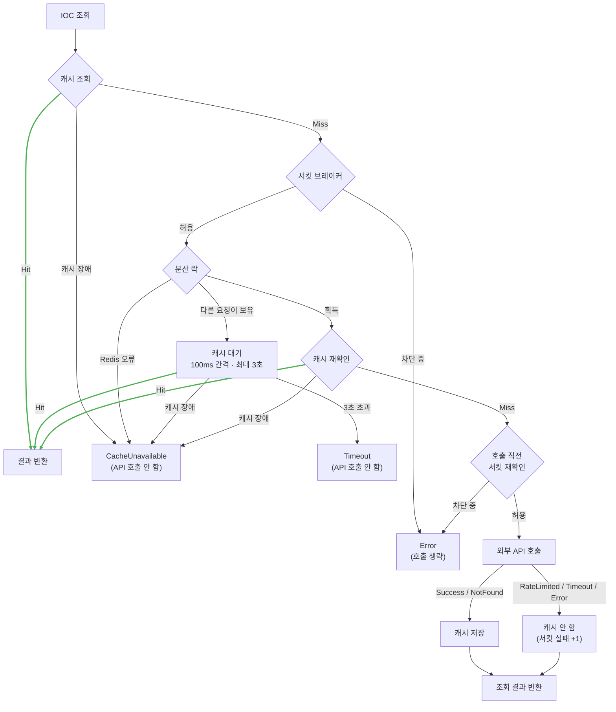

#### 1) 서킷 브레이커 (Provider별 독립)
- 장애가 난 외부 API에 요청을 계속 보내 처리가 지연되거나 호출 제한을 소진하지 않도록, 연속 실패 시 호출을 잠시 차단하기 위해 구현한 기능
- Provider마다 따로 동작 (예: DNS 장애가 AbuseIPDB 조회를 막지 않음)
- `NotFound`는 정상 응답이므로 실패로 세지 않음


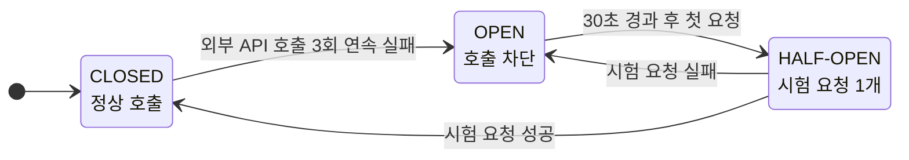

| 상태 | 의미 | 외부 API 호출 |
|---|---|---|
| `CLOSED` | 정상 상태 | 모든 요청을 호출, 3회 연속 실패하면 `OPEN`으로 전환 |
| `OPEN` | 장애로 판단해 차단 | 호출하지 않고 즉시 `Error` 반환, 30초가 지나면 다음 요청을 시험 요청으로 허용 |
| `HALF-OPEN` | 복구 여부 확인 중 | 시험 요청 1개만 호출하고 나머지는 차단, 성공하면 `CLOSED` · 실패하면 다시 `OPEN` |

#### 2) 분산 락
- 캐시에 결과가 없을 때 같은 IOC 요청이 동시에 몰리면 외부 API를 중복 호출하게 되므로, 한 요청만 호출하고 나머지는 그 결과를 재사용하도록 구현한 기능
- 대기 시간(3초)을 넘겨도 대기자가 직접 API를 호출하지 않음 → 락 보유자가 실패했을 때 대기자 전체가 한꺼번에 호출하는 폭주 방지

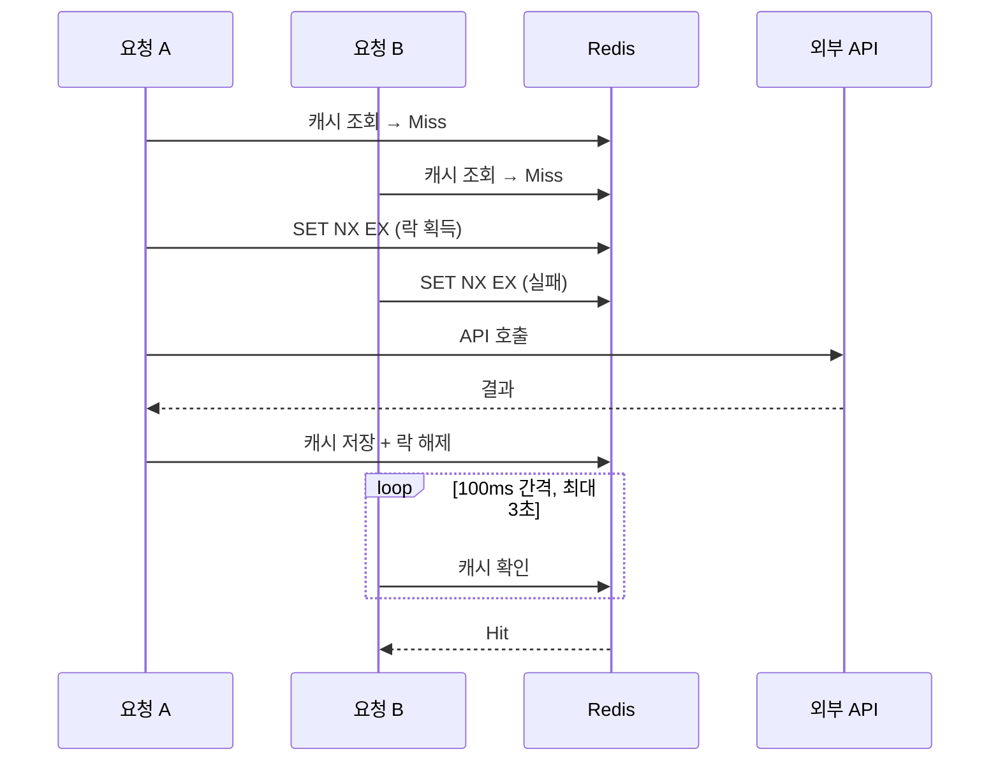

---

### 4. Playbook 자동 판정

> 연관 파일: [`engine.rs`](backend/src/core/playbook/engine.rs) · [`nodes.rs`](backend/src/core/playbook/nodes.rs) · [`condition.rs`](backend/src/core/playbook/condition.rs) · [`ai.rs`](backend/src/core/playbook/ai.rs) · [`002_seed.sql`](docker/postgres/init/002_seed.sql)

- PostgreSQL `playbooks` 테이블에서 플레이북 설정(JSON 노드 배열) 관리
- 서버 시작 시 활성 플레이북을 읽어 메모리에 적재 (양이 적고 이벤트마다 사용하므로 메모리에 보관)
- 이벤트마다 활성 플레이북 전체를 병렬로 처리 진행
- 플레이북의 판정 결과는 `action`으로 기록: `DENY`(차단) · `DETECT`(탐지) · `HOLD`(보류)
  - **[참고 사항]** 개인 포트폴리오이므로 실제 보안 장비 API를 호출할 수 없어 판정 결과를 로그에 문자열(`DENY` 등)로 기록하는 것으로 조치함 (필요 시 `action`별로 장비 차단 API 호출 등 대응 기능으로 확장 가능)
- 여러 플레이북이 판정을 낸 경우 다수결로 최종 판정
- 판정이 있는 이벤트는 원본 로그에 `playbook_result` 필드가 추가됨 (판정이 없으면 원본만 저장)
  - **[참고사항]** 원본 로그와 플레이북 로그를 별도로 관리하지 않고 연관된 로그끼리 묶어 관리 요소를 줄임, 원본 로그와 플레이북 로그 조회 기능 구현 시 해당 부분에 대한 효율성 검증 예정

**저장된 로그 예시** (실제 OpenSearch 저장 문서)

```jsonc
{
  // ── 원본 이벤트 (Vector 정규화 후) ──
  "event_id": "evt-13055464",
  "event_type": "file_download",
  "timestamp": "2026-10-09T20:47:39Z",
  "ingested_at": "2026-10-09T20:47:39.540062018Z",
  "src_ip": "144.48.243.18",
  "dst_domain": "cdn-update-service.net",
  "file_sha256": "275a021bbfb6489e54d471899f7db9d1663fc695ec2fe2a2c4538aabf651fd0f",
  "file_name": "invoice_2026.exe",
  "file_size_bytes": 245760,
  "path": "/",
  "source_type": "http_server",

  // ── Enrichment 결과 ──
  "enrichment_src_ip": {
    "status": { "status": "Success" },
    "data": { "abuse_confidence_score": 100, "total_reports": 3626 }
  },
  "enrichment_dst_domain": {
    "status": { "status": "NotFound" },
    "data": null
  },
  "enrichment_file_sha256": {
    "status": { "status": "Success" },
    "data": {
      "malicious": 66, "suspicious": 0, "harmless": 0, "undetected": 2,
      "timeout": 0, "confirmed-timeout": 0, "failure": 0, "type-unsupported": 7,
      "sigma_high": 0, "sigma_medium": 0, "sigma_critical": 0, "sigma_low": 1
    }
  },

  // ── 플레이북 판정 결과 (판정이 없으면 이 필드 자체가 없음) ──
  "playbook_result": {
    "action": "DENY",
    "evaluated": 2,
    "processed_at": "2026-10-09T20:49:13Z",
    "playbooks": [
      {
        "playbook_id": 2,
        "name": "파일 다운로드 차단",
        "action": "DENY",
        "when": "(event_type eq file_download)"
      },
      {
        "playbook_id": 4,
        "name": "고위험 실행파일 차단",
        "action": "DENY",
        "when": "(event_type eq file_download) and ((enrichment_file_sha256.data.malicious gte 10) or ((enrichment_src_ip.data.abuse_confidence_score gte 80) and (file_size_bytes gt 100000))) and (file_name ends_with .exe)"
      }
    ]
  }
}
```

#### 실행 모델

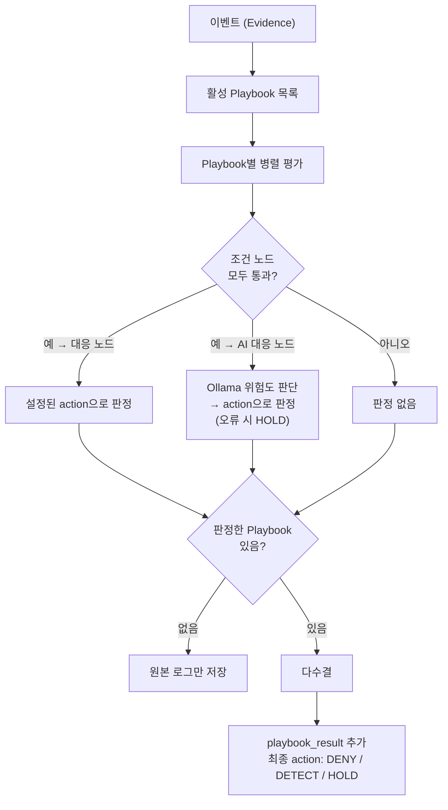

#### 1) 플레이북 노드 구성

- 조건 노드, 대응 노드, AI 대응 노드 3종류 존재
- 조건 노드는 0개 이상 사용 가능하고, 조건 노드끼리는 AND로 연결
- 맨 끝에는 반드시 대응 노드 또는 AI 대응 노드 중 1개가 위치해야 함

**노드 구성 예시**

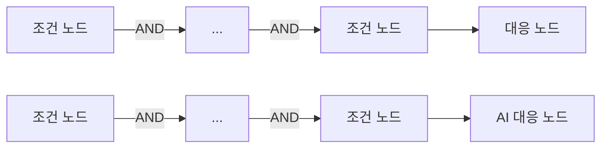

#### 2) 조건 노드

- 이벤트 필드에 조건을 적용해 해당 플레이북의 대상 이벤트만 걸러냄
- 조건 하나 구성 = `field` + `op` + `value`, 여러 조건은 `and` / `or`로 묶고 중첩 가능
- 필드가 없거나 `null`이면 `not_exists`를 제외한 모든 연산자는 거짓
- `a.b.c` 경로로 Enrichment 결과까지 조건에 사용 가능 (예: `enrichment_src_ip.data.abuse_confidence_score`)
- 플레이북 판정을 거친 이벤트의 경우 `playbook_result` 내부에 판정 당시의 조건을 `when` 문자열로 로그에 기록함 → 플레이북이 나중에 바뀌어도 판정 근거 확인 가능

**조건 연산자**

| 연산자 | 의미 | 값 |
|---|---|---|
| `exists` / `not_exists` | 필드 있음 / 없음 | 없음 |
| `eq` / `ne` | 같음 / 다름 | 숫자 · 문자열 |
| `gt` / `gte` / `lt` / `lte` | > / ≥ / < / ≤ | 숫자 |
| `contains` / `starts_with` / `ends_with` | 포함 / 시작 / 끝 (대소문자 구분) | 문자열 |
| `in_cidr` / `not_in_cidr` | CIDR 대역 안 / 밖 | CIDR |

**조건 노드 예시 (연산자별)**

```jsonc
// exists: file_sha256 필드가 있는 경우 (value 없음)
{ "type": "condition", "name": "해시 있음",
  "when": { "field": "file_sha256", "op": "exists" } }
// playbook_result > playbooks > when 예시: (file_sha256 exists)

// not_exists: approval_id 필드가 없는 경우 (value 없음)
{ "type": "condition", "name": "미승인",
  "when": { "field": "approval_id", "op": "not_exists" } }
// playbook_result > playbooks > when 예시: (approval_id not_exists)

// eq: event_type이 file_download인 경우
{ "type": "condition", "name": "파일 다운로드",
  "when": { "field": "event_type", "op": "eq", "value": "file_download" } }
// playbook_result > playbooks > when 예시: (event_type eq file_download)

// ne: VirusTotal 조회 상태가 CacheUnavailable이 아닌 경우
{ "type": "condition", "name": "해시 조회 가능",
  "when": { "field": "enrichment_file_sha256.status.status", "op": "ne", "value": "CacheUnavailable" } }
// playbook_result > playbooks > when 예시: (enrichment_file_sha256.status.status ne CacheUnavailable)

// gt: 파일 크기가 100,000바이트 초과
{ "type": "condition", "name": "대용량 파일",
  "when": { "field": "file_size_bytes", "op": "gt", "value": 100000 } }
// playbook_result > playbooks > when 예시: (file_size_bytes gt 100000)

// gte: AbuseIPDB 점수가 80 이상
{ "type": "condition", "name": "고위험 IP",
  "when": { "field": "enrichment_src_ip.data.abuse_confidence_score", "op": "gte", "value": 80 } }
// playbook_result > playbooks > when 예시: (enrichment_src_ip.data.abuse_confidence_score gte 80)

// lt: VirusTotal 악성 판정 엔진 수가 10 미만
{ "type": "condition", "name": "악성 탐지 적음",
  "when": { "field": "enrichment_file_sha256.data.malicious", "op": "lt", "value": 10 } }
// playbook_result > playbooks > when 예시: (enrichment_file_sha256.data.malicious lt 10)

// lte: 로그인 시도 횟수가 5 이하
{ "type": "condition", "name": "시도 횟수 적음",
  "when": { "field": "attempt_count", "op": "lte", "value": 5 } }
// playbook_result > playbooks > when 예시: (attempt_count lte 5)

// contains: 도메인에 update가 포함된 경우
{ "type": "condition", "name": "업데이트 위장 도메인",
  "when": { "field": "dst_domain", "op": "contains", "value": "update" } }
// playbook_result > playbooks > when 예시: (dst_domain contains update)

// starts_with: 파일 이름이 invoice로 시작하는 경우
{ "type": "condition", "name": "송장 위장 파일",
  "when": { "field": "file_name", "op": "starts_with", "value": "invoice" } }
// playbook_result > playbooks > when 예시: (file_name starts_with invoice)

// ends_with: 파일 이름이 .exe로 끝나는 경우
{ "type": "condition", "name": "실행 파일",
  "when": { "field": "file_name", "op": "ends_with", "value": ".exe" } }
// playbook_result > playbooks > when 예시: (file_name ends_with .exe)

// in_cidr: 출발지 IP가 185.220.101.0/24 대역 안인 경우
{ "type": "condition", "name": "의심 대역",
  "when": { "field": "src_ip", "op": "in_cidr", "value": "185.220.101.0/24" } }
// playbook_result > playbooks > when 예시: (src_ip in_cidr 185.220.101.0/24)

// not_in_cidr: 출발지 IP가 내부망(10.0.0.0/8) 밖인 경우
{ "type": "condition", "name": "외부 IP",
  "when": { "field": "src_ip", "op": "not_in_cidr", "value": "10.0.0.0/8" } }
// playbook_result > playbooks > when 예시: (src_ip not_in_cidr 10.0.0.0/8)
```

**and / or 조합 예시 1**

```jsonc
// (악성 판정 10개 이상) OR (AbuseIPDB 80점 이상 AND 파일 크기 100,000바이트 초과)
{
  "type": "condition",
  "name": "악성 탐지 또는 고위험 IP의 대용량 파일",
  "when": {
    "or": [
      {
        "field": "enrichment_file_sha256.data.malicious",
        "op": "gte",
        "value": 10
      },
      {
        "and": [
          {
            "field": "enrichment_src_ip.data.abuse_confidence_score",
            "op": "gte",
            "value": 80
          },
          {
            "field": "file_size_bytes",
            "op": "gt",
            "value": 100000
          }
        ]
      }
    ]
  }
}
// playbook_result > playbooks > when 예시:
// ((enrichment_file_sha256.data.malicious gte 10) or ((enrichment_src_ip.data.abuse_confidence_score gte 80) and (file_size_bytes gt 100000)))
```

**and / or 조합 예시 2**

```jsonc
// 이벤트 타입이 file_download
// AND ( 파일 확장자가 .exe OR .dll )
// AND ( VirusTotal 악성 판정 엔진 수가 1~9개 OR ( AbuseIPDB 점수 50점 이상 AND src_ip가 10.0.0.0/8 대역에 포함되지 않음 ) )
{
  "type": "condition",
  "name": "애매한 실행 파일 다운로드",
  "when": {
    "and": [
      {
        "field": "event_type",
        "op": "eq",
        "value": "file_download"
      },
      {
        "or": [
          {
            "field": "file_name",
            "op": "ends_with",
            "value": ".exe"
          },
          {
            "field": "file_name",
            "op": "ends_with",
            "value": ".dll"
          }
        ]
      },
      {
        "or": [
          {
            "and": [
              {
                "field": "enrichment_file_sha256.data.malicious",
                "op": "gte",
                "value": 1
              },
              {
                "field": "enrichment_file_sha256.data.malicious",
                "op": "lt",
                "value": 10
              }
            ]
          },
          {
            "and": [
              {
                "field": "enrichment_src_ip.data.abuse_confidence_score",
                "op": "gte",
                "value": 50
              },
              {
                "field": "src_ip",
                "op": "not_in_cidr",
                "value": "10.0.0.0/8"
              }
            ]
          }
        ]
      }
    ]
  }
}
// playbook_result > playbooks > when 예시:
// ((event_type eq file_download) and ((file_name ends_with .exe) or (file_name ends_with .dll)) and (((enrichment_file_sha256.data.malicious gte 1) and (enrichment_file_sha256.data.malicious lt 10)) or ((enrichment_src_ip.data.abuse_confidence_score gte 50) and (src_ip not_in_cidr 10.0.0.0/8))))
```

#### 3) 대응 노드

- 플레이북 구성에서 맨 끝에 위치하며, 앞의 조건 노드를 모두 통과하면 대응 노드에 설정된 action으로 이벤트 판정함
- action은 3종류

| action | 의미 |
|---|---|
| `DENY` | 차단 |
| `DETECT` | 탐지 (허용하되 기록) |
| `HOLD` | 보류 (담당자 확인 필요) |

```jsonc
// 차단
{ "type": "response", "action": "DENY" }

// 탐지 (허용 + 기록)
{ "type": "response", "action": "DETECT" }

// 보류 (담당자 확인 필요)
{ "type": "response", "action": "HOLD" }
```

**대응 노드 결과 예시**

```jsonc
// 실제 저장된 로그의 playbook_result (플레이북 2개가 모두 DENY로 판정한 경우)
"playbook_result": {
  "action": "DENY",          // 최종 판정: 아래 playbooks의 action들을 다수결로 집계한 결과 (아래에서 설명될 5) 다수결 참고)
  "evaluated": 2,            // 판정을 낸 플레이북 수
  "processed_at": "2026-10-09T20:49:13Z", // 플레이북 처리 시각 (UTC) 
  "playbooks": [ // 플레이북별 판정과 판정 당시 조건을 기록
    {
      "playbook_id": 2,
      "name": "파일 다운로드 차단",
      "action": "DENY",      // playbook_id 2 플레이북의 판정 (대응 노드에 설정된 action)
      "when": "(event_type eq file_download)"
    },
    {
      "playbook_id": 4,
      "name": "고위험 실행파일 차단",
      "action": "DENY",      // playbook_id 4 플레이북의 판정 (대응 노드에 설정된 action)
      "when": "(event_type eq file_download) and ((enrichment_file_sha256.data.malicious gte 10) or ((enrichment_src_ip.data.abuse_confidence_score gte 80) and (file_size_bytes gt 100000))) and (file_name ends_with .exe)"
    }
  ]
}
```

#### 4) AI 대응 노드

- 대응 노드와 마찬가지로 플레이북 구성 맨 끝에 위치하며, 규칙으로 정하기 어렵고 건수가 적을 것으로 예상되는 이벤트를 로컬 LLM(Ollama)이 위험도(HIGH / MEDIUM / LOW)로 판단
- 판단된 위험도를 플레이북에 설정한 action으로 변환 (매핑에 없는 위험도는 판정 없음)
- AI 오류 · 60초 초과 · 캐시 장애에 대한 action은 모두 HOLD로 판정 (담당자 확인 대상)
- 사용 가능한 AI 모델은 현재 2개: `qwen2.5:14b-instruct`, `Foundation-Sec-8B-Reasoning`

```jsonc
{
  "type": "ai_response",

  // AI 분석에 사용할 Ollama 모델
  "model": "qwen2.5:14b-instruct",

  // AI에게 주는 분석 지시문
  // 분석 대상인 이벤트 + Enrichment 결과는 자동으로 함께 전달됨
  "prompt": "보안 이벤트와 enrichment 결과를 분석하고 위험도를 판단하라.",

  // AI가 반환한 위험도를 플레이북의 대응(Action)으로 변환하는 매핑
  // AI는 이 중 하나의 위험도(HIGH / MEDIUM / LOW)를 반환하며, 해당 위험도에 연결된 Action을 최종 대응으로 사용함
  // 매핑에 없는 위험도가 반환되면 이 플레이북은 판정 없음 (예: LOW를 빼면 LOW는 판정하지 않음)
  "actions": { "HIGH": "DENY", "MEDIUM": "HOLD", "LOW": "DETECT" }
}
```

**AI 호출 처리**

- Ollama 기본 동시 처리 수(`OLLAMA_NUM_PARALLEL=1`)에 맞춰 한 번에 하나씩 호출

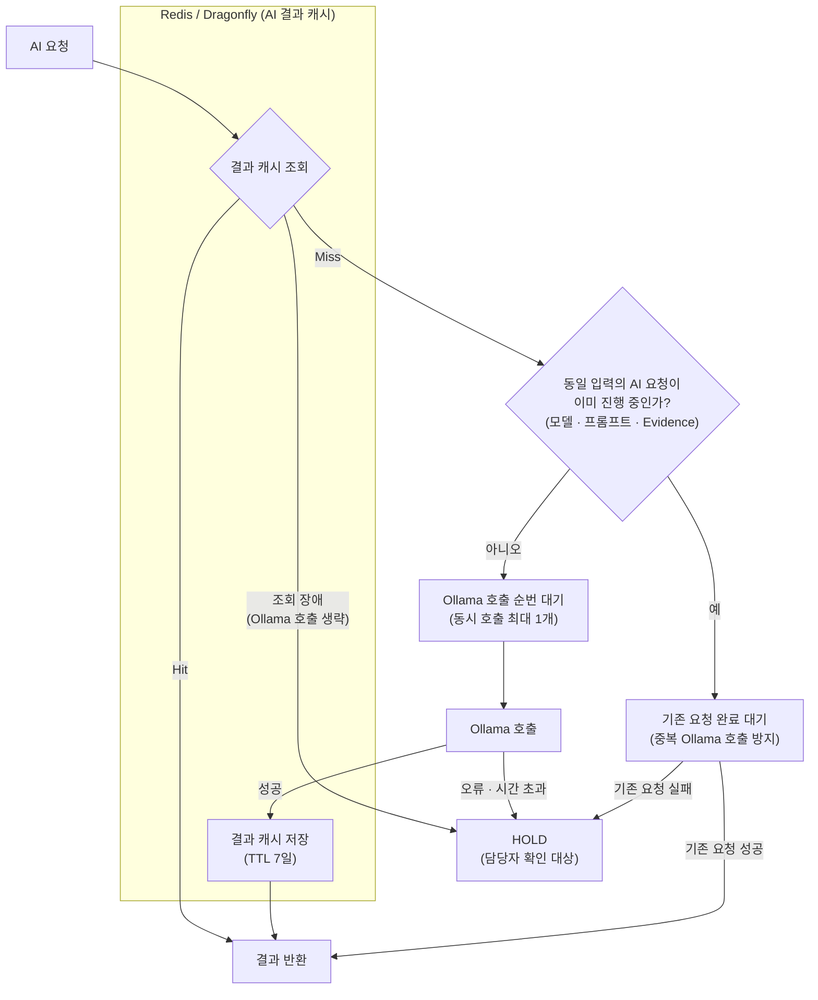

**AI 대응 노드 결과 예시** (`playbook_result.playbooks[]` 항목)

```jsonc
// 성공한 경우: AI가 반환한 risk(HIGH)를 actions 매핑에 따라 DENY로 판정
{
  "playbook_id": 3,
  "name": "애매한 파일 AI 분석",
  "action": "DENY",
  "when": "((event_type eq file_download) and (enrichment_file_sha256.data.malicious gte 1) and (enrichment_file_sha256.data.malicious lt 10))",
  "ai_result": {
    "status": "success",
    "risk": "HIGH",
    "reason": "The file name 'invoice.exe' is suspicious because it ends with '.exe' ...",
    "model": "qwen2.5:14b-instruct"
  }
}

// 실패한 경우: AI 오류 · 시간 초과 · 캐시 장애는 매핑과 관계없이 HOLD로 판정 (risk · reason 없이 error 기록)
{
  "playbook_id": 3,
  "name": "애매한 파일 AI 분석",
  "action": "HOLD",
  "when": "((event_type eq file_download) and (enrichment_file_sha256.data.malicious gte 1) and (enrichment_file_sha256.data.malicious lt 10))",
  "ai_result": {
    "status": "error",
    "error": "timeout",
    "model": "qwen2.5:14b-instruct"
  }
}
```

**Ollama 응답 원본 예시**
- AI 응답은 JSON 스키마로 `risk`(HIGH / MEDIUM / LOW 중 하나) · `reason` 형식을 강제함 (아래 content 부분 참고)

```json
{
  "model": "qwen2.5:14b-instruct",
  "created_at": "2026-09-26T12:39:09.55915638Z",
  "message": {
    "role": "assistant",
    "content": "{\"risk\":\"HIGH\",\"reason\":\"The file name 'invoice.exe' is suspicious because it ends with '.exe', which is an executable file type. Executable files can potentially run harmful programs on your computer if they are downloaded from untrusted sources. The name 'invoice' is generic and does not provide any specific information about the file's origin or purpose, making it easy to disguise malicious intent.\"}"
  },
  "done": true,
  "done_reason": "stop",
  "total_duration": 38329905745,
  "load_duration": 22066337603,
  "prompt_eval_count": 50,
  "prompt_eval_duration": 13758529000,
  "eval_count": 82,
  "eval_duration": 2500710000
}
```

#### 5) 플레이북 다수결

- 하나의 이벤트에 여러 플레이북이 판정을 낸 경우 최종 판정이 필요
- 대응 노드 또는 AI 대응 노드에서 판정을 낸 플레이북마다 하나의 표를 가짐 (HOLD도 한 표)
- 조건을 통과하지 못한 플레이북은 표가 없음

**다수결 공식**

```text
(특정 action 수 / 전체 action 수) > 0.5 → 해당 action으로 판정
그 외 (과반 없음, 동률)                 → HOLD로 판정하여 담당자 확인을 유도
```
**다수결 동작 예시**

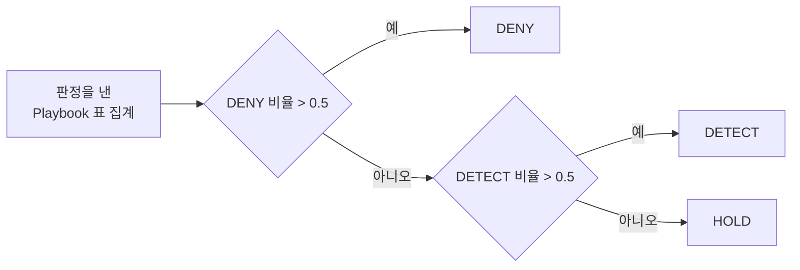

| 플레이북 판정 | 최종 판정 | 이유 |
|---|---|---|
| DENY · DENY · HOLD | DENY | 2/3 |
| DETECT · DETECT · DENY | DETECT | 2/3 |
| DENY · DETECT · HOLD | HOLD | 과반 없음 |
| DENY · DENY · DETECT · DETECT | HOLD | 동률 |

---

### 5. 로그 저장 (릴레이 배치 저장)

> 연관 파일: [`forwarder.rs`](backend/src/core/storage/forwarder.rs) · [`record.rs`](backend/src/core/storage/record.rs) · [`failures.rs`](backend/src/core/storage/failures.rs) · [`offset.rs`](backend/src/core/consumer/offset.rs)

- 처리된 이벤트 로그를 OpenSearch와 ClickHouse에 동일하게 저장
- 일시적인 저장 실패는 성공할 때까지 재시도
- OpenSearch가 doc 자체 문제로 거절한 로그와 처리할 수 없는 메시지는 PostgreSQL `storage_failures`에 원문 보관
- 저장이 모두 끝난 로그만 Kafka/RedPanda offset commit
- 재처리로 같은 로그가 다시 저장되어도 `log_id`로 중복 제거

#### 1) 릴레이 배치 저장

- Shire Guard 개발자가 고안한 저장 방식
- 로그를 Batch로 묶어 Batch 하나당 OpenSearch에 먼저 저장하고, **OpenSearch에 저장된 로그만 ClickHouse로 넘겨 저장**하는 방식
- 두 DB에 동시에 저장하면 한쪽만 성공하는 경우 두 DB의 로그가 달라질 수 있음 → 순서대로 넘겨서 두 DB에 항상 같은 로그가 남도록 함

**[OpenSearch를 먼저 저장하는 이유]**

- OpenSearch Bulk는 문서마다 저장 결과를 돌려줘서, 문서 자체 문제로 거절된 로그만 골라낼 수 있음
- ClickHouse INSERT는 Batch 전체가 성공 또는 실패하므로, 문제 문서가 섞이면 Batch 전체가 실패함
- OpenSearch에서 걸러진 로그만 ClickHouse로 넘겨 ClickHouse INSERT가 실패하지 않도록 함
- 실패한 로그는 별도로 PostgreSQL에 저장하여 원인 분석에 활용 가능
- ClickHouse가 OpenSearch보다 INSERT 성능이 빨라(테스트 당시 약 21만~26만/s vs 약 11.2만/s), OpenSearch 뒤에 두어도 ClickHouse가 병목이 되지 않을 거라 판단

> 그림의 수치는 [`forwarder.rs`](backend/src/core/storage/forwarder.rs) 상단 상수로 설정

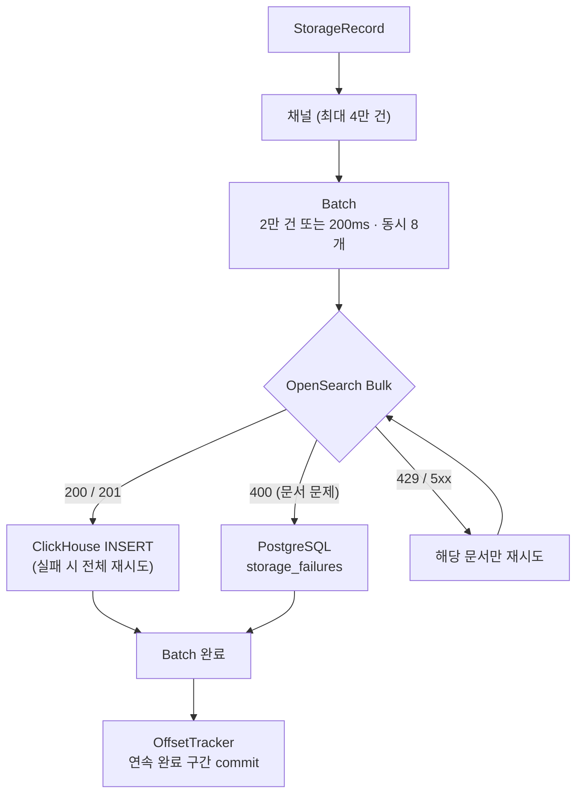

#### 2) 중복 제거

- Kafka는 commit 전에 프로세스가 죽거나 partition 할당이 바뀌면, commit 위치부터 다시 전달 → 이미 저장한 로그가 다시 저장될 수 있음
- 같은 로그임을 식별하는 `log_id`를 만들어 각 저장소의 키로 사용 → 몇 번 다시 저장해도 1건만 남게 함
- `log_id = sha256(event_id | ingested_at)`: 같은 `event_id`의 이벤트가 여러 번 들어와도 수집 시각(`ingested_at`)으로 서로 다른 로그로 구분
  - 파싱할 수 없는 메시지는 `event_id` · `ingested_at`을 알 수 없어 Kafka 위치로 생성: `kafka-{topic}-{partition}-{offset}` (재처리돼도 같은 값)

| 저장소 | 방식 |
|---|---|
| OpenSearch | `_id`로 사용 → 같은 로그는 덮어씀 |
| ClickHouse | ReplacingMergeTree → 병합 시 1건만 남김 (정확한 조회는 `FINAL`) |
| PostgreSQL | PRIMARY KEY → `ON CONFLICT DO NOTHING` |

#### 3) 실패 원문 보관 (`storage_failures`)

- 처리할 수 없는 로그를 버리면 유실이고, 성공할 때까지 재시도하면 그 로그 때문에 뒤의 로그까지 commit이 막힘
- 원문과 사유를 PostgreSQL에 보관한 뒤 완료 처리 → 유실 없이 다음 로그 진행하고, 담당자는 보관된 원문으로 원인 확인 가능

| 실패 | log_id | payload |
|---|---|---|
| OpenSearch 거절 (400) | `sha256(event_id \| ingested_at)` | 전송한 문서 |
| 빈 메시지 · 역직렬화 실패 | `kafka-{topic}-{partition}-{offset}` | Kafka 원본 바이트(PostgreSQL BYTEA 타입으로 저장) |

#### 4) Kafka/RedPanda Offset commit

- Consumer가 이벤트를 받는 즉시 commit하면, DB 저장 전에 프로세스가 죽었을 때 그 로그는 다시 처리되지 않아 유실 가능
- 이벤트를 병렬로 처리하고 Batch도 동시에 저장하므로 저장 완료 순서가 수신 순서와 다름
- 그래서 OpenSearch · ClickHouse · (거절 로그가 있으면) PostgreSQL 저장이 모두 끝난 **연속 구간**까지만 commit 하도록 구현
- 자동 offset 저장은 끄고(`enable.auto.offset.store=false`), 계산된 위치만 저장하게 함
- rebalance로 partition 할당이 해제되면 해당 partition의 offset 기록을 삭제하고, 다시 할당되면 Offset 새로 기록

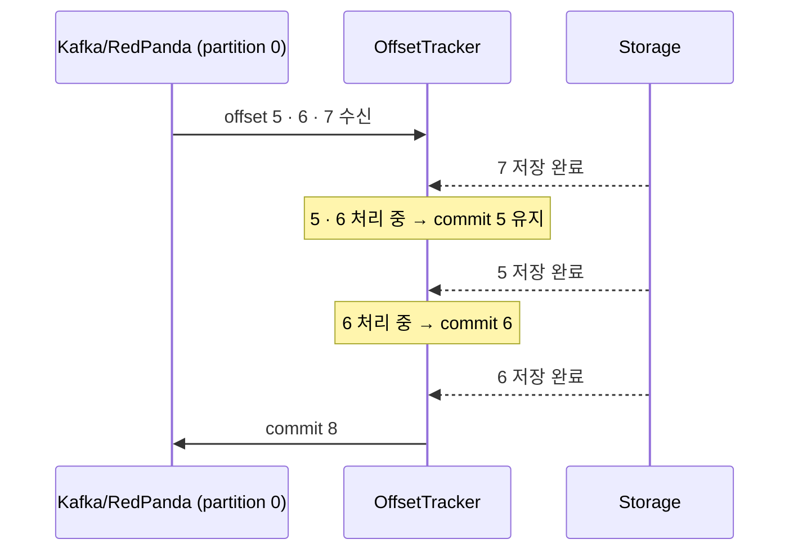

**Offset 처리 예시**

| 이벤트 | 처리 중 | commit 위치(다음에 읽을 offset을 의미) |
|---|---|---|
| 7 완료 | 5, 6 | 5 유지 |
| 5 완료 | 6 | 6 |
| 6 완료 | 없음 | 8 |

---

### 6. Grafana 대시보드

- Prometheus로 수집한 각 서비스의 Metric과 Loki의 알림 이력을 Grafana 대시보드로 표시

---

### 7. (구현 예정) 이벤트 · 플레이북 로그 조회

- OpenSearch에 저장된 원본 이벤트와 플레이북 판정 결과 조회 · 조건 검색

---

### 8. (구현 예정) 보고서 생성

- ClickHouse 집계로 HWPX · DOCX 보고서 파일 생성

---

## 성능

### 테스트 환경

| 항목 | 사양 |
|---|---|
| 장비 | 노트북 1대 (모든 서비스 동시 실행) |
| CPU | Intel Core Ultra 9 285HX (24코어 / 24스레드) |
| 메모리 | 96GB (Docker 할당 약 47GB) |
| OS | Windows + Docker Desktop (WSL2) |
| 빌드 | Rust release (`lto = "fat"`, `codegen-units = 1`) |
| GPU | RTX 5090 Laptop 24GB (Ollama AI 노드용, 처리량 측정 시 미사용) |

### 처리량 측정 결과

| 구간 | 처리량 | 비고 |
|---|---|---|
| Rust 처리 (Enrichment → Playbook) | 약 11만/s | Enrichment 캐시 히트 조건 |
| 저장 (OpenSearch → ClickHouse 완료) | 약 8.9만~10.9만/s | 양쪽 DB 저장 완료 기준 |
| └ OpenSearch | 약 11.2만/s | 빈 인덱스, 힙 8GB, Rust 서버 동시 실행 중 측정 |
| └ ClickHouse | 약 21만~26만/s | |
| **전체 (Kafka 소비 → 저장 완료)** | **약 6.6만~7.1만/s** | Kafka에 쌓아둔 100만 건 처리 |

### 측정 결과 및 해석

- **구간별 처리량**: 각 구간에 최대 부하를 걸어 측정하여 초당 약 10만 건 전후 확인
- **전체 처리량**: 모든 서비스가 노트북 1대의 CPU를 나눠 쓰므로 개별 구간보다 낮음
- **유실률**: 100만 건 처리 중 강제 종료 후 재시작 테스트에서 0%

---

## 로드맵

- [ ] **플레이북 생성 / 수정 / 삭제 API**: 플레이북 생성/수정/삭제 발생 시 쓰기 Lock으로 활성 플레이북 목록을 전체 교체 (평가 중인 이벤트는 기존 목록을 계속 사용하므로 처리가 멈추지 않음)
- [ ] **조회 API**: OpenSearch에서 이벤트 로그와 플레이북 로그로 전체 조회 / 조건 검색 지원
- [ ] **보고서 생성**: ClickHouse 집계로 HWPX / DOCX 보고서 생성
- [ ] **jev / Laya 검토**
