# Shire-Guard Demo Scenarios

[한국어](DEMO.md) | **English**

- A document that summarizes Shire-Guard event processing, including demonstration videos

## Table of Contents
- [Arbitrarily Created Event Types Used in the Demo](#arbitrarily-created-event-types-used-in-the-demo)
- [Playbook Policies Used in the Demo](#playbook-policies-used-in-the-demo)
- [Tests by Scenario](#tests-by-scenario)
  - [1. Backlog Processing Performance](#1-backlog-processing-performance-batch-processing-of-1-million-events-accumulated-while-the-rust-server-was-stopped)
  - [2. Failure Recovery](#2-failure-recovery-no-loss-even-after-stopping-and-recovering-kafka--the-rust-server)
  - [3. Real-time Processing](#3-real-time-processing-processing-immediately-upon-receipt)
- [AI Response Node Tests by Scenario](#ai-response-node-tests-by-scenario)
  - [4. AI Response Node](#4-ai-response-node-only-8-actual-ollama-calls-for-1-million-events)
  - [5. AI Failure Recovery](#5-ai-response-node-failure-recovery-5-million-events--no-loss-after-stopping-kafka--rust)

## Arbitrarily Created Event Types Used in the Demo
1) file_download (dangerous case)
- source_ip: AbuseIPDB score 100 (API response result as of 2026-10)
- file_sha256: 66 VirusTotal engines detected it as malicious (API response result as of 2026-10)
```json
{
  "event_id": "loadgen-1",
  "event_type": "file_download",
  "timestamp": "2026-10-28T10:00:00Z",
  "source_ip": "144.48.243.18",
  "destination_domain": "cdn-update-service.net",
  "file_name": "invoice_2026.exe",
  "file_sha256": "275a021bbfb6489e54d471899f7db9d1663fc695ec2fe2a2c4538aabf651fd0f",
  "file_size_bytes": 245760
}
```

2) login_failure (safe case)
- source_ip: AbuseIPDB score 0 (API response result as of 2026-10)
```json
{
  "event_id": "loadgen-1000001",
  "event_type": "login_failure",
  "timestamp": "2026-10-28T10:00:00Z",
  "source_ip": "118.25.6.39",
  "username": "admin",
  "attempt_count": 12,
  "target_service": "ssh"
}
```

3) dns_beacon (safe case)
- source_ip: AbuseIPDB score 0 (API response result as of 2026-10)
- destination_domain: a domain that the Playbook under test will not block
```json
{
  "event_id": "loadgen-2000001",
  "event_type": "dns_beacon",
  "timestamp": "2026-10-28T10:00:00Z",
  "source_ip": "118.25.6.39",
  "destination_domain": "nexon.com",
  "hostname": "WKS-1183",
  "request_interval_seconds": 60
}
```

<a id="parse-failure-event"></a>
4) Rust parsing failure event
- An event that has no event_id, so it fails to parse on the Rust server and is stored in PostgreSQL, which stores processing failure logs
```json
{
  "loadgen_id": "loadgen-failure-<number>",
  "event_type": "login_failure",
  "timestamp": "2026-10-28T10:00:00Z",
  "source_ip": "144.48.243.18",
  "username": "admin",
  "attempt_count": 12,
  "target_service": "ssh"
}
```

5) OpenSearch rejection event
- An event whose object field is a string, so OpenSearch rejects it and it is stored in PostgreSQL, which stores processing failure logs
```json
{
  "event_id": "loadgen-reject-<number>",
  "event_type": "login_failure",
  "timestamp": "2026-10-28T10:00:00Z",
  "source_ip": "144.48.243.18",
  "username": "admin",
  "attempt_count": 12,
  "target_service": "ssh",
  "enrichment_dst_domain": "x"
}
```

## Playbook Policies Used in the Demo
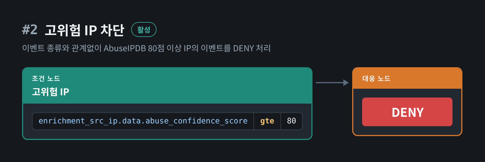

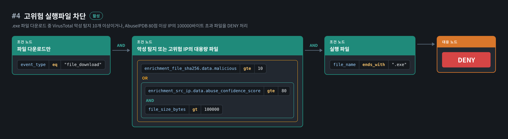

## Tests by Scenario
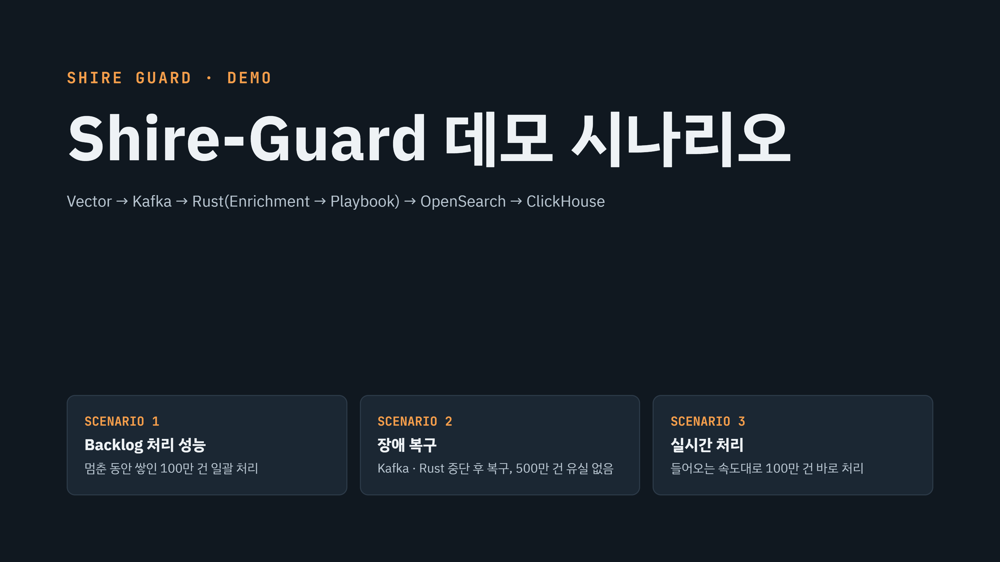

> Before every test, the docker services were stopped, the data was deleted, and the services were started again.

<!-- 
cd docker
docker compose down

# grafana/data is not deleted (keeps data sources and dashboards)
rm -rf kafka/data opensearch/data clickhouse/data postgres/data vector/data loki/data

docker compose up -d --scale redpanda=0 --scale dragonfly=0
-->

### 1. Backlog Processing Performance: Batch Processing of 1 Million Events Accumulated While the Rust Server Was Stopped

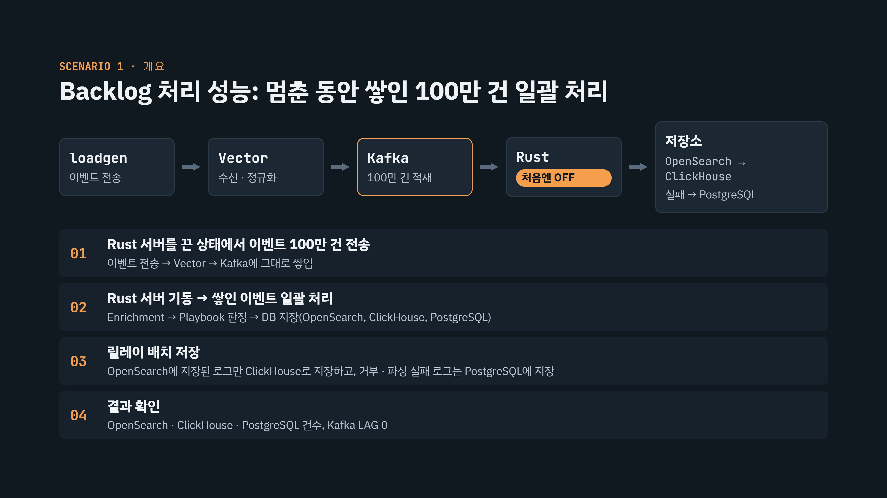

- A scenario in which 1 million events are accumulated in Kafka while the Rust server is turned off, and then the Rust server is started to process them all at once.

#### Expected Results
- 1 million Kafka events are processed without loss,
- 998,900 identical event logs are stored in both OpenSearch and ClickHouse
- 1,100 event logs that failed processing are stored in PostgreSQL


## 🎬 Demonstration Video

> ▶ Click an image to watch the video (mp4)

<!--
./loadgen.exe file_download 1 400000 500 --fail 1000 --reject 100 &
./loadgen.exe login_failure 1000001 300000 400 --case safe &
./loadgen.exe dns_beacon 2000001 298900 400 --case safe &
wait
-->

| Processing | Result Verification |
|:---:|:---:|
| <a href="assets/scenario-1-demo.mp4">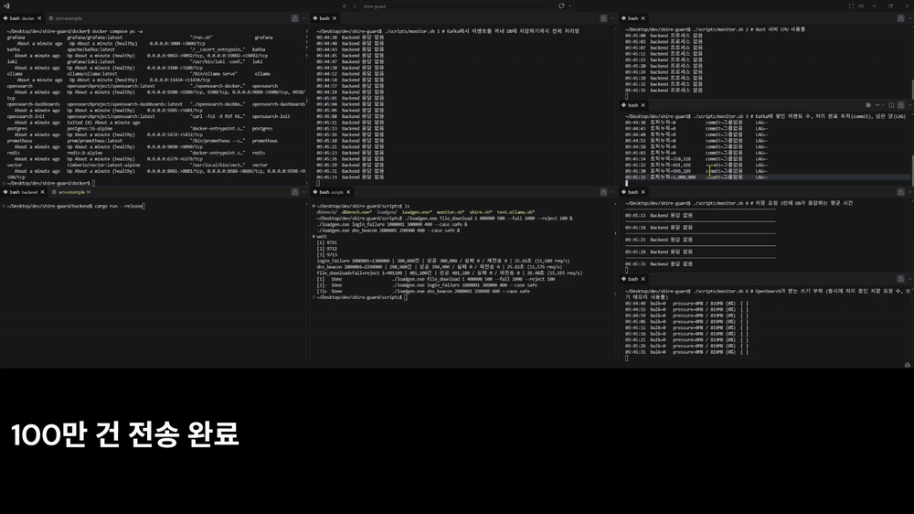</a> | <a href="assets/scenario-1-verification.mp4">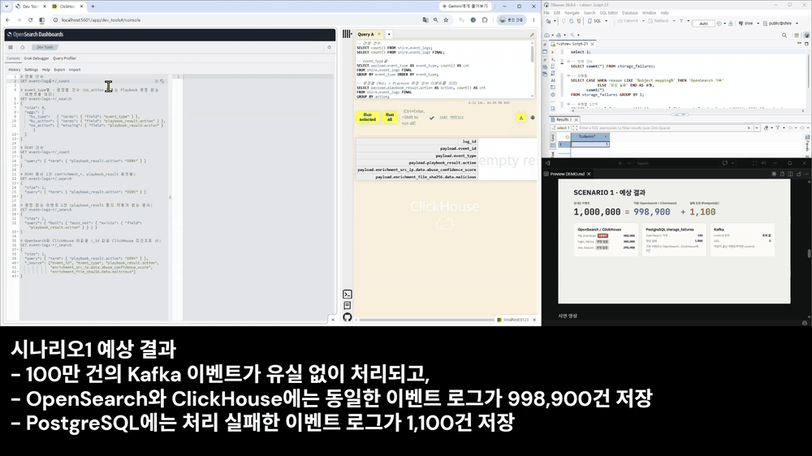</a> |

---

### 2. Failure Recovery: No Loss Even After Stopping and Recovering Kafka · the Rust Server

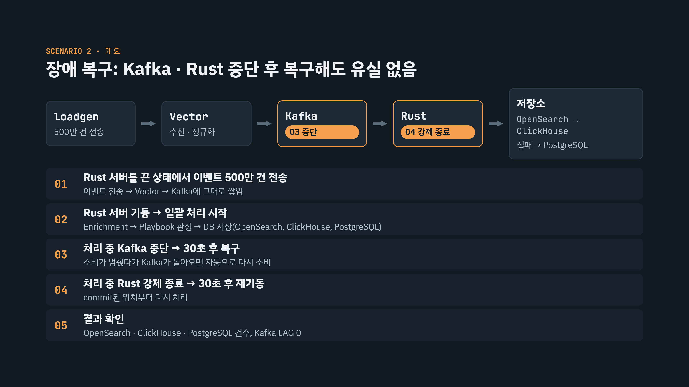

- 5 million events are accumulated in Kafka while the Rust server is turned off, and then the Rust server is started to process them all at once.

- A scenario in which, during processing, the Kafka service is stopped and recovered -> the Rust server is stopped and recovered, and the 5 million events are processed without loss.

#### Expected Results
- 5 million Kafka events are processed without loss,
- 4,994,500 identical event logs are stored in both OpenSearch and ClickHouse
- 5,500 event logs that failed processing are stored in PostgreSQL

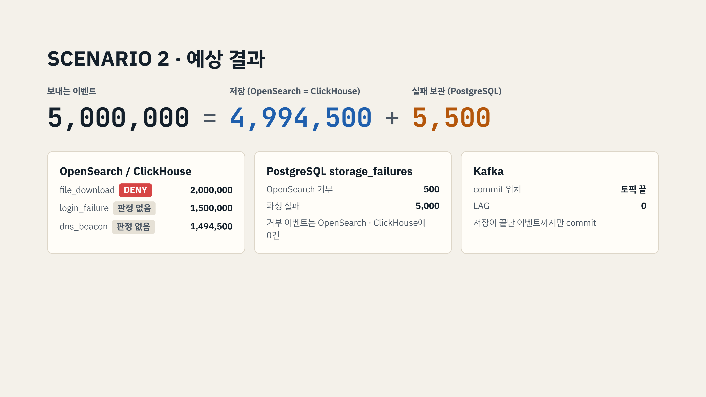

## 🎬 Demonstration Video

> ▶ Click an image to watch the video (mp4)

<!--
./loadgen.exe file_download 1 2000000 500 --fail 5000 --reject 500 &
./loadgen.exe login_failure 10000001 1500000 400 --case safe &
./loadgen.exe dns_beacon 20000001 1494500 400 --case safe &
wait
-->

| Processing | Result Verification |
|:---:|:---:|
| <a href="assets/scenario-2-demo.mp4">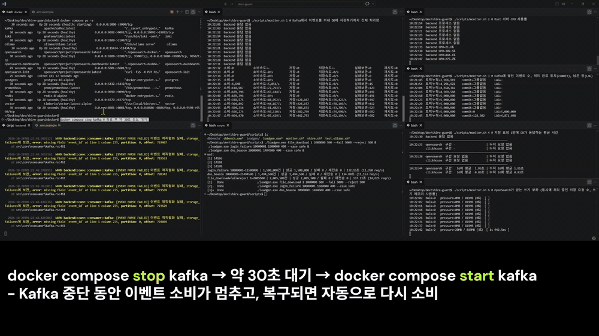</a> | <a href="assets/scenario-2-verification.mp4">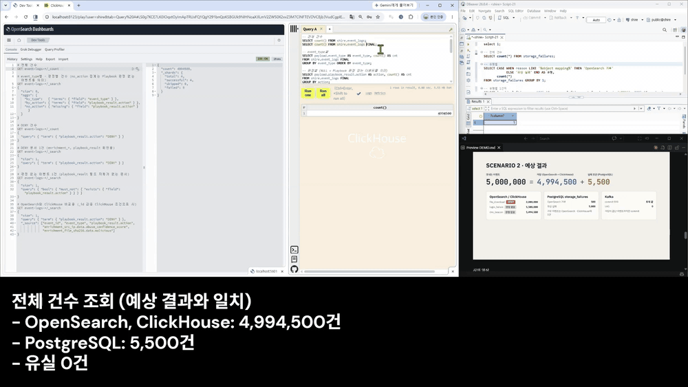</a> |

---

### 3. Real-time Processing: Processing Immediately Upon Receipt

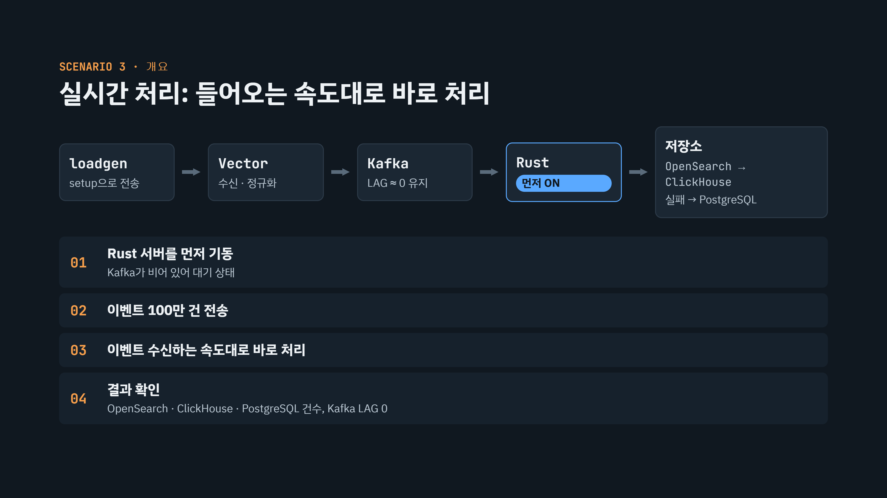

- A scenario in which 1 million events are sent while the Rust server is running, and they are processed in real time.

#### Expected Results
- 1 million Kafka events are processed without loss,
- 998,900 identical event logs are stored in both OpenSearch and ClickHouse
- 1,100 event logs that failed processing are stored in PostgreSQL

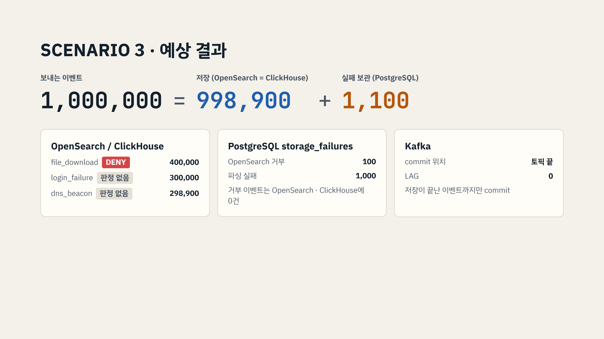

## 🎬 Demonstration Video

> ▶ Click an image to watch the video (mp4)

<!--
./loadgen.exe setup
1        # [1] Add event
1        # file_download
2        # Case: dangerous
400000   # Count
1        # [1] Add event
2        # login_failure
1        # Case: safe
300000   # Count
1        # [1] Add event
3        # dns_beacon
1        # Case: safe
298900   # Count
1        # [1] Add event
4        # Failure event (no case question)
1000     # Count
1        # [1] Add event
5        # Rejection event (no case question)
100      # Count
3        # [3] Finish setup
1300     # Concurrency (same value as the command version 500 + 400 + 400)
Enter    # Start number: default 1
Enter    # Repeat count: default 1
1        # [1] Run
-->

| Processing | Result Verification |
|:---:|:---:|
| <a href="assets/scenario-3-demo.mp4">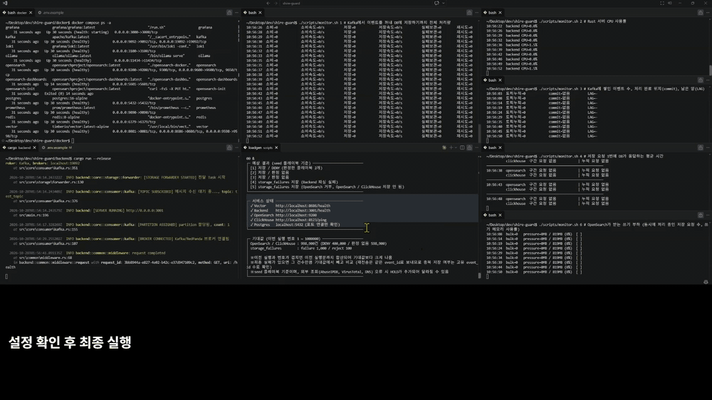</a> | <a href="assets/scenario-3-verification.mp4">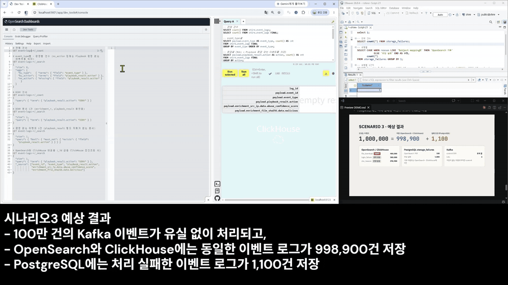</a> |

---
---
---

## AI Response Node Tests by Scenario

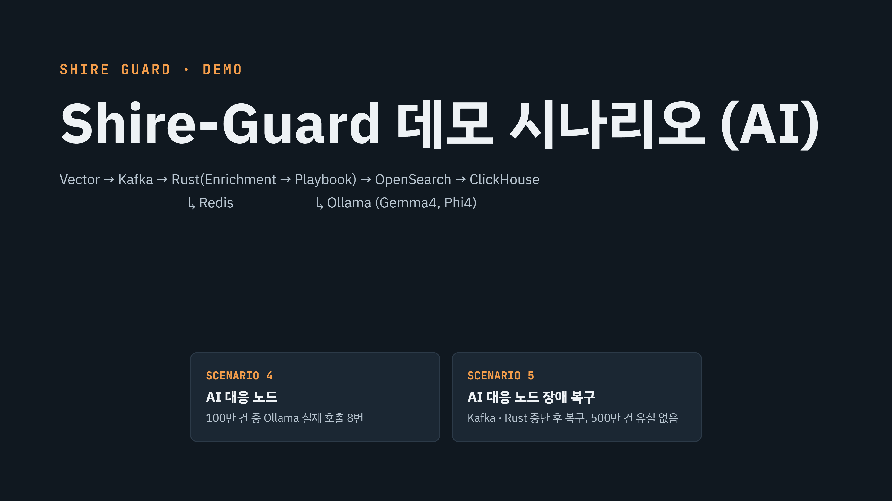

> Before every test, the docker services were stopped, the data was deleted, and the services were started again.

<!-- 
Same reset method as scenarios 1-3
-->

> These tests were run separately from scenarios 1-3 above. All existing Playbooks were disabled, and only the 8 `[TEST-AI]` Playbooks for testing the AI Response Node were enabled.

<!--
PostgreSQL query used
  UPDATE playbooks SET enabled = (name LIKE '[TEST-AI]%');
-->

- Events of the same type pass the same input to the AI, so the verdict is reused from the cache. Even when a large number of events is processed, Ollama is called only 8 times in total, once for each of the 8 AI test Playbooks.

- Also, since identical events must receive identical AI verdicts, each test event_type must end up with exactly one action.

<details>
<summary><b>AI Test Events (10 types + about 1% parsing failures)</b></summary>

- The 10 event types and parsing failure events (about 1%) are mixed by the hash of the event number and sent
- `test_ai` field: the name of the `[TEST-AI]` Playbook

#### Event Summary
| event_type field | test_ai field | AI Response Node AI model | Key IOCs |
|---|---|---|---|
| file_download | G1 | gemma4 | AbuseIPDB score 0 IP, hash detected as malicious by 3 VirusTotal engines |
| process_execution | G2 | gemma4 | hash detected as malicious by 1 VirusTotal engine |
| email_attachment | G3 | gemma4 | AbuseIPDB score 100 IP, nonexistent domain |
| login_failure | P1 | phi4 | AbuseIPDB score 100 IP |
| port_scan | P2 | phi4 | AbuseIPDB score 100 IP |
| privilege_escalation | G4,P3,P4 | 1 gemma4 <br>2 phi4 <br> => majority vote of 3 | AbuseIPDB score 0 IP, hash detected as malicious by 66 VirusTotal engines (conflicting evidence) |
| login_success · vpn_disconnect · password_change · software_update | NONE | No verdict | - |

#### JSON by Event

1) file_download (G1, single gemma4 verdict)
- source_ip: AbuseIPDB score 0
- file_sha256: 3 VirusTotal engines detected it as malicious

```json
{
  "event_id": "loadgen-<number>",
  "event_type": "file_download",
  "timestamp": "2026-11-05T10:00:00Z",
  "source_ip": "118.25.6.39",
  "destination_domain": "cdn-update-service.net",
  "file_name": "setup_helper.exe",
  "file_sha256": "784c88f2297ffe774b9b1330f12690d59f9d08ce89e97a74debd687de9ed2cd7",
  "file_size_bytes": 512000,
  "test_ai": "G1"
}
```

2) process_execution (G2, single gemma4 verdict)
- file_sha256: 1 VirusTotal engine detected it as malicious
```json
{
  "event_id": "loadgen-<number>",
  "event_type": "process_execution",
  "timestamp": "2026-11-05T10:00:00Z",
  "hostname": "WKS-2041",
  "user": "kim",
  "process_name": "update_agent.exe",
  "parent_process": "winword.exe",
  "file_sha256": "1dce02aae98c0a48c2644abd1849fb90406296d4e0c95e239f95242ee8480ff8",
  "test_ai": "G2"
}
```

3) email_attachment (G3, single gemma4 verdict)
- source_ip: AbuseIPDB score 100
- destination_domain: a nonexistent domain (DNS lookup result: NotFound)
```json
{
  "event_id": "loadgen-<number>",
  "event_type": "email_attachment",
  "timestamp": "2026-11-05T10:00:00Z",
  "source_ip": "144.48.243.18",
  "sender": "billing@partner-mail.example",
  "destination_domain": "invoice-share.example",
  "file_name": "invoice_2026.zip",
  "test_ai": "G3"
}
```

4) login_failure (P1, single phi4 verdict)
- source_ip: AbuseIPDB score 100
```json
{
  "event_id": "loadgen-<number>",
  "event_type": "login_failure",
  "timestamp": "2026-11-05T10:00:00Z",
  "source_ip": "144.48.243.18",
  "username": "admin",
  "attempt_count": 12,
  "target_service": "ssh",
  "test_ai": "P1"
}
```

5) port_scan (P2, single phi4 verdict)
- source_ip: AbuseIPDB score 100
```json
{
  "event_id": "loadgen-<number>",
  "event_type": "port_scan",
  "timestamp": "2026-11-05T10:00:00Z",
  "source_ip": "144.48.243.18",
  "scanned_port_count": 1024,
  "scan_type": "syn",
  "duration_seconds": 30,
  "test_ai": "P2"
}
```

6) privilege_escalation (G4 · P3 · P4 majority vote)
- source_ip: AbuseIPDB score 0
- file_sha256: 66 VirusTotal engines detected it as malicious (an event where the IP and file evidence conflict)
```json
{
  "event_id": "loadgen-<number>",
  "event_type": "privilege_escalation",
  "timestamp": "2026-11-05T10:00:00Z",
  "source_ip": "118.25.6.39",
  "hostname": "SRV-DB01",
  "user": "svc_backup",
  "method": "sudo",
  "file_name": "escalate.bin",
  "file_sha256": "275a021bbfb6489e54d471899f7db9d1663fc695ec2fe2a2c4538aabf651fd0f",
  "test_ai": "G4,P3,P4"
}
```

7) login_success (no verdict)
```json
{
  "event_id": "loadgen-<number>",
  "event_type": "login_success",
  "timestamp": "2026-11-05T10:00:00Z",
  "source_ip": "118.25.6.39",
  "username": "kim",
  "target_service": "vpn",
  "test_ai": "NONE"
}
```

8) vpn_disconnect (no verdict)
```json
{
  "event_id": "loadgen-<number>",
  "event_type": "vpn_disconnect",
  "timestamp": "2026-11-05T10:00:00Z",
  "source_ip": "118.25.6.39",
  "username": "kim",
  "session_seconds": 3600,
  "test_ai": "NONE"
}
```

9) password_change (no verdict)
```json
{
  "event_id": "loadgen-<number>",
  "event_type": "password_change",
  "timestamp": "2026-11-05T10:00:00Z",
  "hostname": "WKS-1183",
  "username": "lee",
  "test_ai": "NONE"
}
```

10) software_update (no verdict)
```json
{
  "event_id": "loadgen-<number>",
  "event_type": "software_update",
  "timestamp": "2026-11-05T10:00:00Z",
  "hostname": "WKS-1183",
  "destination_domain": "nexon.com",
  "package": "office-update",
  "version": "16.0.1",
  "test_ai": "NONE"
}
```

- Parsing failure events use the same format as [4) Rust parsing failure event](#parse-failure-event) above

</details>

<details>
<summary><b>AI Test Playbooks (8 [TEST-AI] Playbooks)</b></summary>

![#12 [TEST-AI] G1](assets/playbook-12.png)

![#13 [TEST-AI] G2](assets/playbook-13.png)

![#14 [TEST-AI] G3](assets/playbook-14.png)

![#15 [TEST-AI] G4](assets/playbook-15.png)

![#16 [TEST-AI] P1](assets/playbook-16.png)

![#17 [TEST-AI] P2](assets/playbook-17.png)

![#18 [TEST-AI] P3](assets/playbook-18.png)

![#19 [TEST-AI] P4](assets/playbook-19.png)

</details>

### 4. AI Response Node: Only 8 Actual Ollama Calls for 1 Million Events

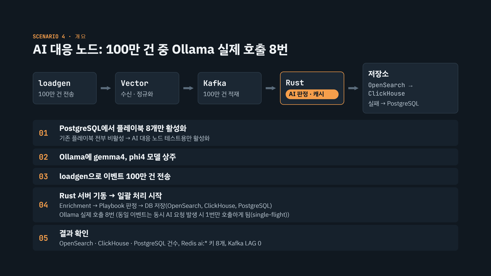

- 1 million events are accumulated in Kafka while the Rust server is turned off, and then the Rust server is started to process them all at once.

- The AI Response Nodes configured in the 8 `[TEST-AI]` Playbooks judge the 1 million test events.

- A scenario that checks that when the same input is passed to the same AI Response Node, the first verdict is stored in the Redis cache, and when the same event arrives again, the cached result is reused without calling Ollama again, so the events are processed quickly.

#### Expected Results
- 1 million Kafka events are processed without loss,
- 989,922 identical event logs are stored in both OpenSearch and ClickHouse
  <br>(single AI verdict 493,776 / AI majority vote 99,332 / no verdict 396,814)
- 10,078 parsing failure logs are stored in PostgreSQL
- 8 Redis AI cache keys (`ai:*`) = 8 actual Ollama calls
- Only one AI verdict per event_type, proving consistent responses

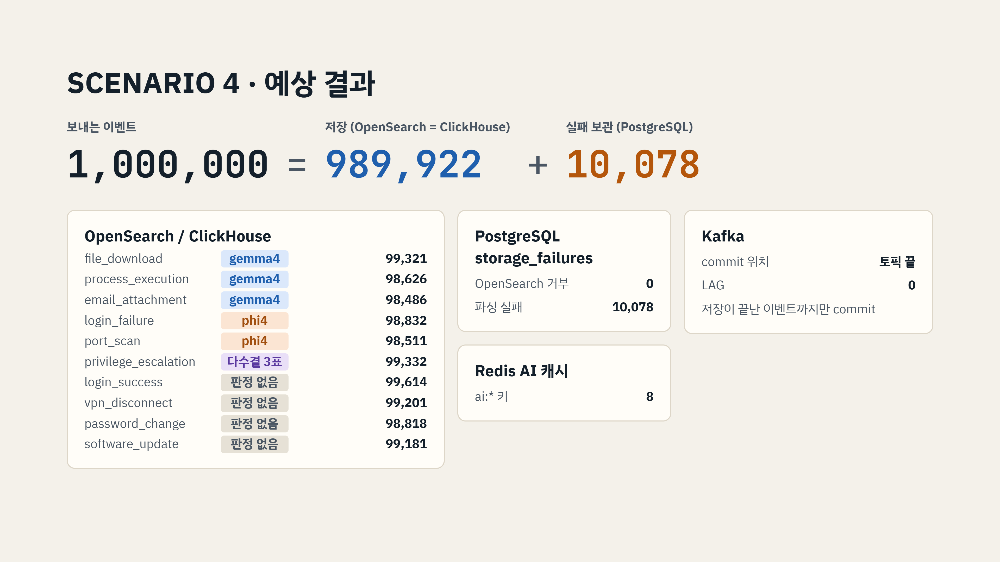

## 🎬 Demonstration Video

> ▶ Click an image to watch the video (mp4)

<!--
./loadgen.exe ai 1 1000000 1000
-->

| Processing | Result Verification |
|:---:|:---:|
| <a href="assets/scenario-4-demo.mp4">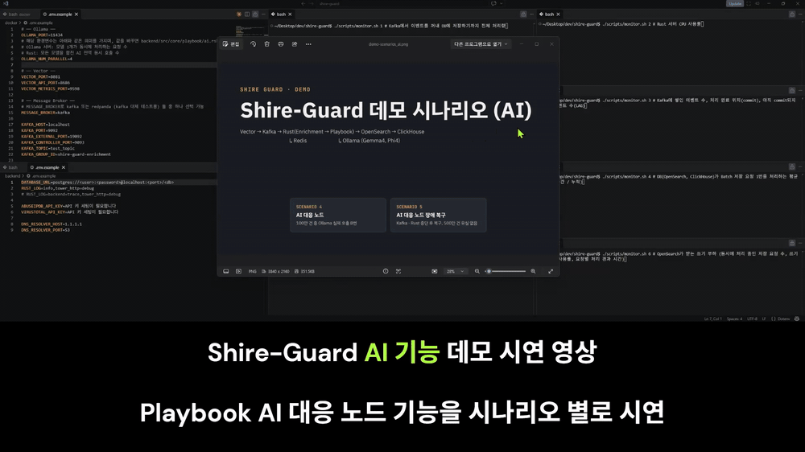</a> | <a href="assets/scenario-4-verification.mp4">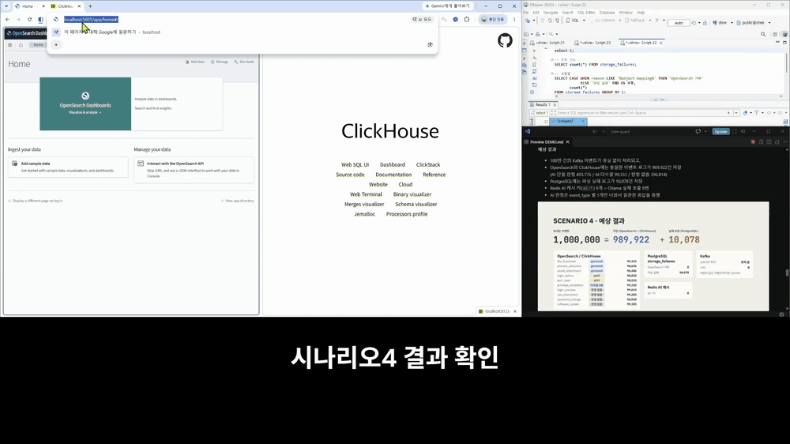</a> |

---

### 5. AI Response Node Failure Recovery: 5 Million Events · No Loss After Stopping Kafka · Rust

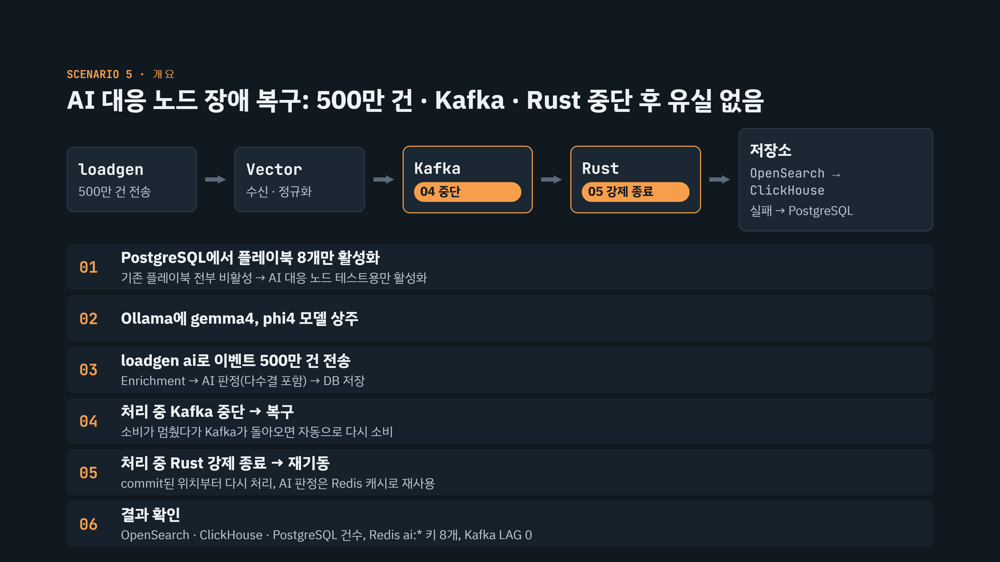

- 5 million events are accumulated in Kafka while the Rust server is turned off, and then the Rust server is started to process them all at once.

- The AI Response Nodes configured in the 8 `[TEST-AI]` Playbooks judge the 5 million test events.

- The AI Response Node behaves the same as in scenario 4.

- A scenario in which, during event processing, the Kafka service is stopped and recovered -> the Rust server is stopped and recovered, and the 5 million events are processed without loss.

#### Expected Results
- 5 million Kafka events are processed without loss,
- 4,949,804 identical event logs are stored in both OpenSearch and ClickHouse
  <br>(single AI verdict 2,474,195 / AI majority vote 495,545 / no verdict 1,980,064)
- 50,196 parsing failure logs are stored in PostgreSQL
- 8 Redis AI cache keys (`ai:*`) = 8 actual Ollama calls
- Only one AI verdict per event_type, proving consistent responses

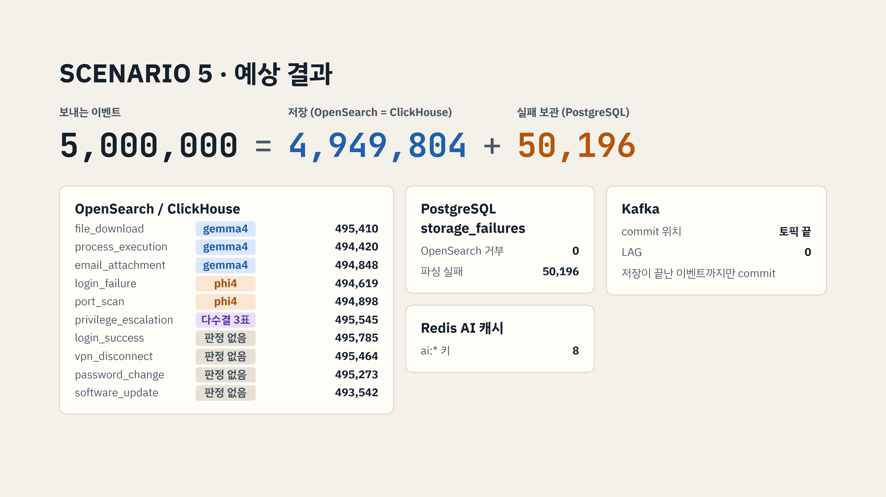

## 🎬 Demonstration Video

> ▶ Click an image to watch the video (mp4)

<!--
./loadgen.exe ai 1 5000000 1000
-->

| Processing | Result Verification |
|:---:|:---:|
| <a href="assets/scenario-5-demo.mp4">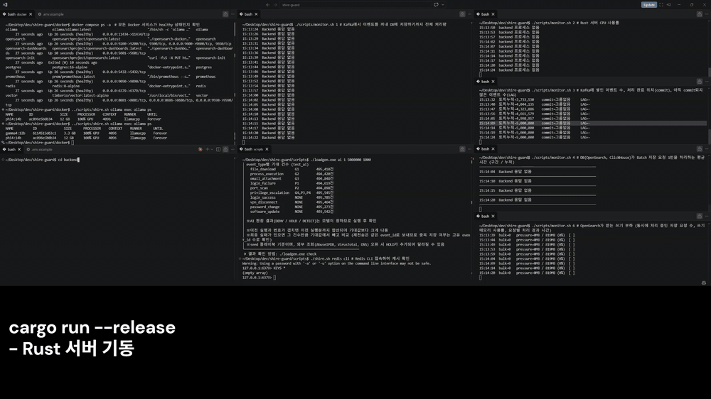</a> | <a href="assets/scenario-5-verification.mp4">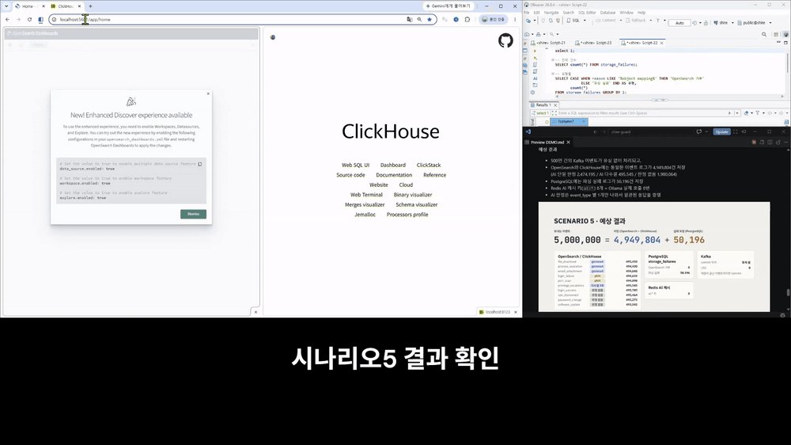</a> |