# Shire-Guard 데모 시나리오

**한국어** | [English](DEMO.en.md)

- Shire-Guard 이벤트 처리 시연영상을 포함하여 정리한 문서

## 목차
- [데모에 사용될 임의로 제작한 Event 종류](#데모에-사용될-임의로-제작한-event-종류)
- [데모에 사용될 Playbook 정책](#데모에-사용될-playbook-정책)
- [시나리오 별 테스트](#시나리오-별-테스트)
  - [1. Backlog 처리 성능](#1-backlog-처리-성능-rust-서버가-멈춘-동안-쌓인-100만-건-일괄-처리)
  - [2. 장애 복구](#2-장애-복구-kafka--rust-서버-중단-후-복구해도-유실-없음)
  - [3. 실시간 처리](#3-실시간-처리-수신-즉시-처리)
- [AI 대응 노드 시나리오별 테스트](#ai-대응-노드-시나리오별-테스트)
  - [4. AI 대응 노드](#4-ai-대응-노드-100만-건-중-ollama-실제-호출-8번)
  - [5. AI 장애 복구](#5-ai-대응-노드-장애-복구-500만-건--kafka--rust-중단-후-유실-없음)

## 데모에 사용될 임의로 제작한 Event 종류
1) file_download (위험 케이스)
- source_ip: AbuseIPDB 100점 (2026-10 기준 API 응답 결과)
- file_sha256: VirusTotal 악성 판정 엔진 66개 (2026-10 기준 API 응답 결과)
```json
{
  "event_id": "loadgen-1",
  "event_type": "file_download",
  "timestamp": "2026-10-28T10:00:00Z",
  "source_ip": "144.48.243.18",
  "destination_domain": "cdn-update-service.net",
  "file_name": "invoice_2026.exe",
  "file_sha256": "275a021bbfb6489e54d471899f7db9d1663fc695ec2fe2a2c4538aabf651fd0f",
  "file_size_bytes": 245760
}
```

2) login_failure (안전 케이스)
- source_ip: AbuseIPDB 0점 (2026-10 기준 API 응답 결과)
```json
{
  "event_id": "loadgen-1000001",
  "event_type": "login_failure",
  "timestamp": "2026-10-28T10:00:00Z",
  "source_ip": "118.25.6.39",
  "username": "admin",
  "attempt_count": 12,
  "target_service": "ssh"
}
```

3) dns_beacon (안전 케이스)
- source_ip: AbuseIPDB 0점 (2026-10 기준 API 응답 결과)
- destination_domain: 테스트할 Playbook에서 차단하지 않을 도메인 
```json
{
  "event_id": "loadgen-2000001",
  "event_type": "dns_beacon",
  "timestamp": "2026-10-28T10:00:00Z",
  "source_ip": "118.25.6.39",
  "destination_domain": "nexon.com",
  "hostname": "WKS-1183",
  "request_interval_seconds": 60
}
```

<a id="parse-failure-event"></a>
4) Rust 파싱 실패 이벤트
- event_id가 없어 Rust 서버에서 파싱 실패하여 처리 실패 로그를 저장하는 PostgreSQL에 저장될 이벤트
```json
{
  "loadgen_id": "loadgen-failure-번호",
  "event_type": "login_failure",
  "timestamp": "2026-10-28T10:00:00Z",
  "source_ip": "144.48.243.18",
  "username": "admin",
  "attempt_count": 12,
  "target_service": "ssh"
}
```

5) OpenSearch 거부 이벤트
- 객체 필드가 문자열이므로 OpenSearch에서 거부하여 처리 실패 로그를 저장하는 PostgreSQL에 저장될 이벤트
```json
{
  "event_id": "loadgen-reject-번호",
  "event_type": "login_failure",
  "timestamp": "2026-10-28T10:00:00Z",
  "source_ip": "144.48.243.18",
  "username": "admin",
  "attempt_count": 12,
  "target_service": "ssh",
  "enrichment_dst_domain": "x"
}
```

## 데모에 사용될 Playbook 정책
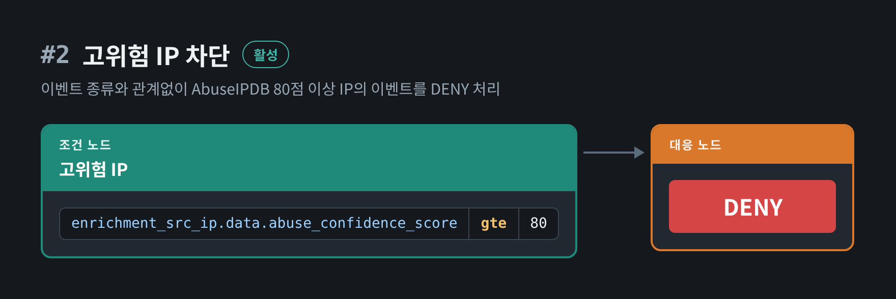

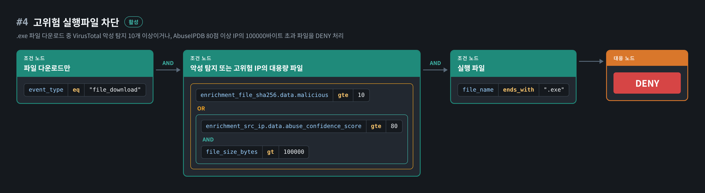

## 시나리오 별 테스트
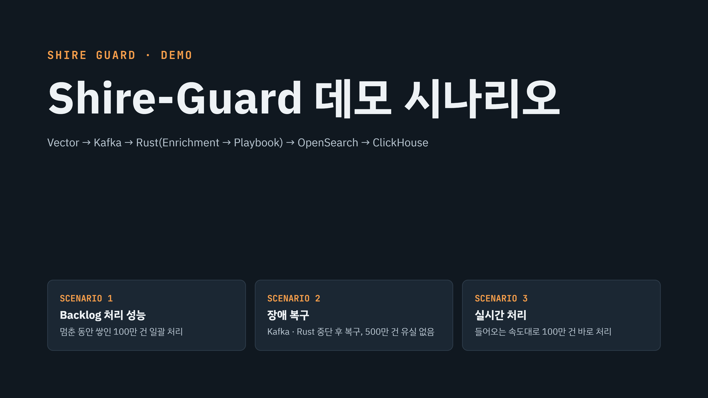

> 매 테스트 전 docker 서비스를 종료하고 데이터를 삭제한 뒤 다시 시작하여 진행하였습니다.

<!-- 
cd docker
docker compose down

# grafana/data는 지우지 않음 (데이터소스·대시보드 유지)
rm -rf kafka/data opensearch/data clickhouse/data postgres/data vector/data loki/data

docker compose up -d --scale redpanda=0 --scale dragonfly=0
-->

### 1. Backlog 처리 성능: Rust 서버가 멈춘 동안 쌓인 100만 건 일괄 처리

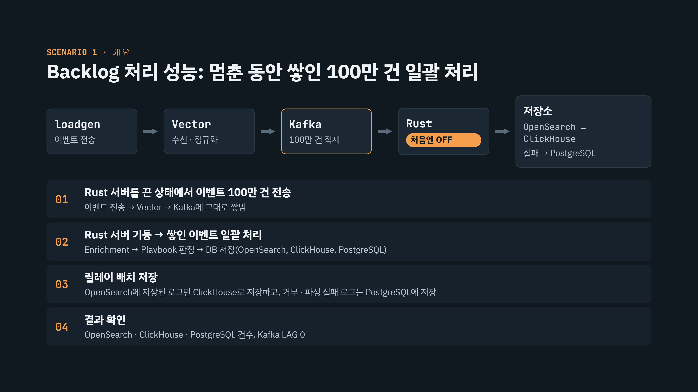

- Rust 서버를 끈 상태에서 100만 건의 이벤트를 Kafka에 쌓은 후 Rust 서버를 기동시켜 일괄처리하는 시나리오입니다.

#### 예상 결과
- 100만 건의 Kafka 이벤트가 유실 없이 처리되고,
- OpenSearch와 ClickHouse에는 동일한 이벤트 로그가 998,900건 저장
- PostgreSQL에는 처리 실패한 이벤트 로그가 1,100건 저장


## 🎬 시연 영상

> ▶ 이미지를 클릭하면 영상(mp4) 시청 가능

<!--
./loadgen.exe file_download 1 400000 500 --fail 1000 --reject 100 &
./loadgen.exe login_failure 1000001 300000 400 --case safe &
./loadgen.exe dns_beacon 2000001 298900 400 --case safe &
wait
-->

| 처리 과정 | 결과 확인 |
|:---:|:---:|
| <a href="assets/scenario-1-demo.mp4">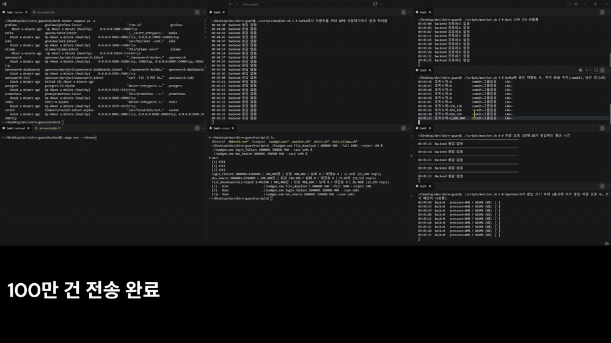</a> | <a href="assets/scenario-1-verification.mp4">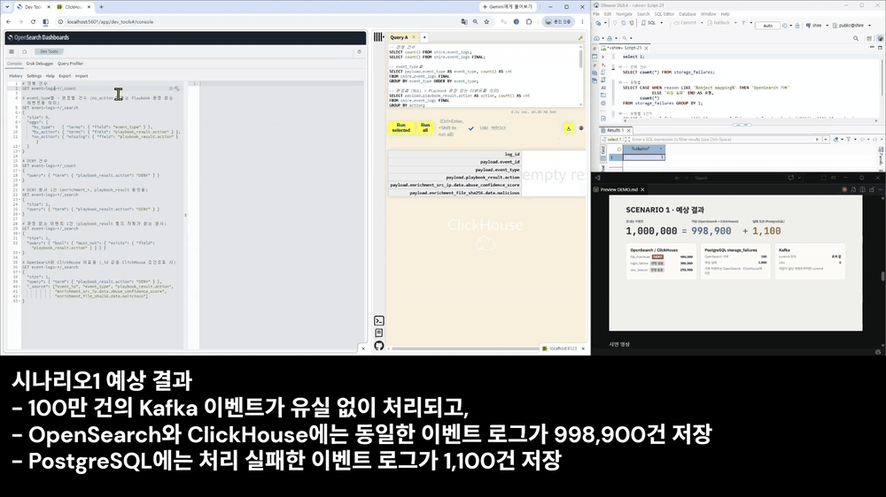</a> |

---

### 2. 장애 복구: Kafka · Rust 서버 중단 후 복구해도 유실 없음

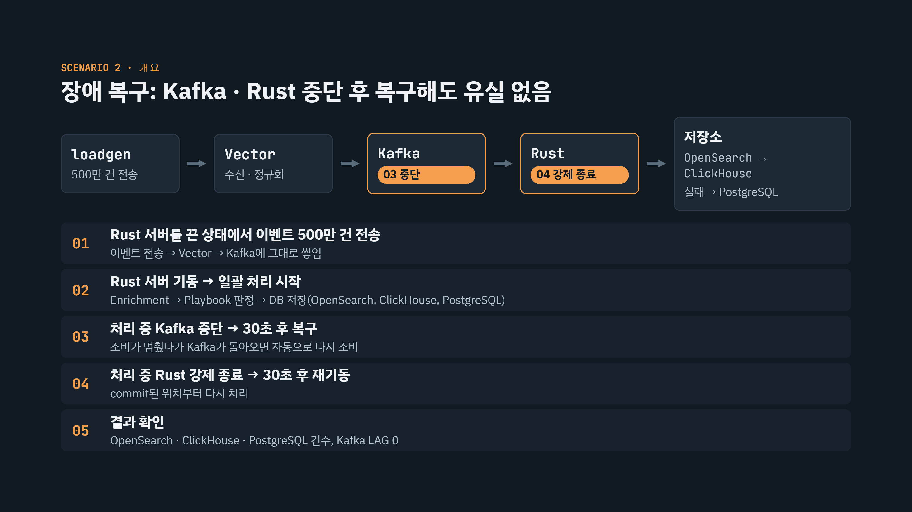

- Rust 서버를 끈 상태에서 500만 건의 이벤트를 Kafka에 쌓은 후 Rust 서버를 기동시켜 일괄처리합니다.

- 처리 도중 Kafka 서비스를 종료 후 복구 -> Rust 서버를 종료 후 복구하여 유실 없이 500만 건 이벤트를 처리하는 시나리오입니다.

#### 예상 결과
- 500만 건의 Kafka 이벤트가 유실 없이 처리되고,
- OpenSearch와 ClickHouse에는 동일한 이벤트 로그가 4,994,500건 저장
- PostgreSQL에는 처리 실패한 이벤트 로그가 5,500건 저장

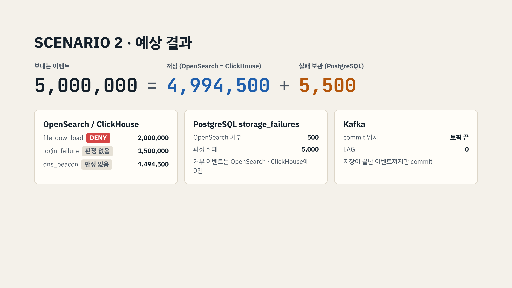

## 🎬 시연 영상

> ▶ 이미지를 클릭하면 영상(mp4) 시청 가능

<!--
./loadgen.exe file_download 1 2000000 500 --fail 5000 --reject 500 &
./loadgen.exe login_failure 10000001 1500000 400 --case safe &
./loadgen.exe dns_beacon 20000001 1494500 400 --case safe &
wait
-->

| 처리 과정 | 결과 확인 |
|:---:|:---:|
| <a href="assets/scenario-2-demo.mp4">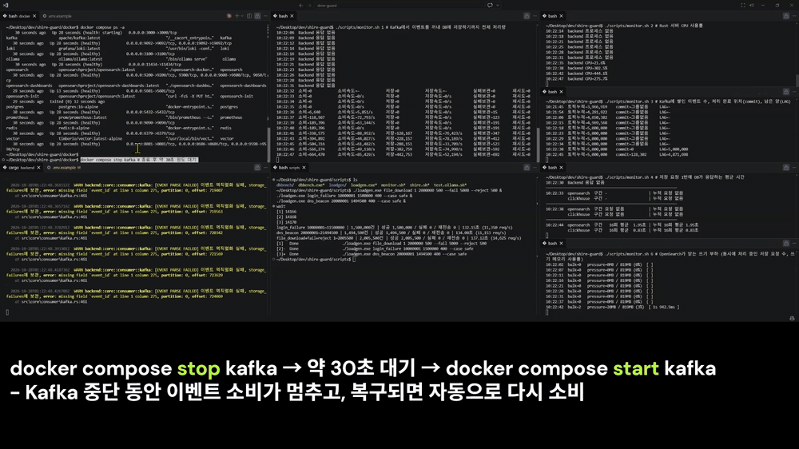</a> | <a href="assets/scenario-2-verification.mp4">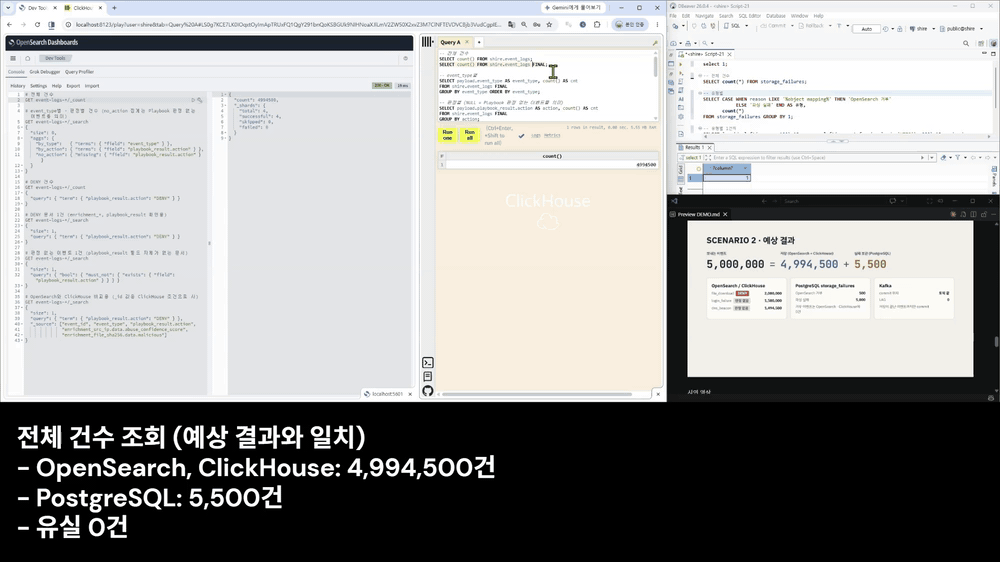</a> |

---

### 3. 실시간 처리: 수신 즉시 처리

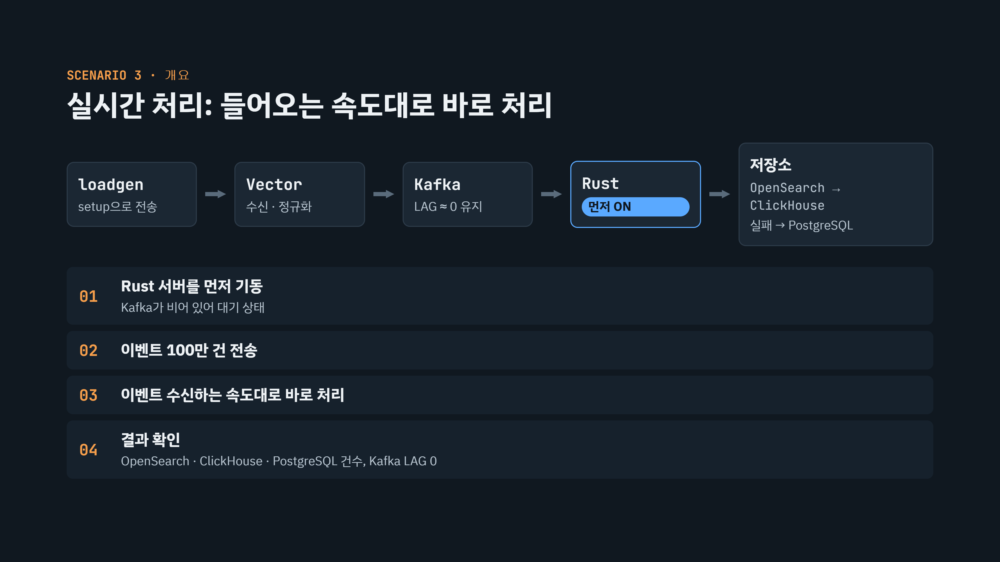

- Rust 서버를 기동한 상태에서 100만 건의 이벤트를 보내, 실시간 처리하는 시나리오입니다.

#### 예상 결과
- 100만 건의 Kafka 이벤트가 유실 없이 처리되고,
- OpenSearch와 ClickHouse에는 동일한 이벤트 로그가 998,900건 저장
- PostgreSQL에는 처리 실패한 이벤트 로그가 1,100건 저장

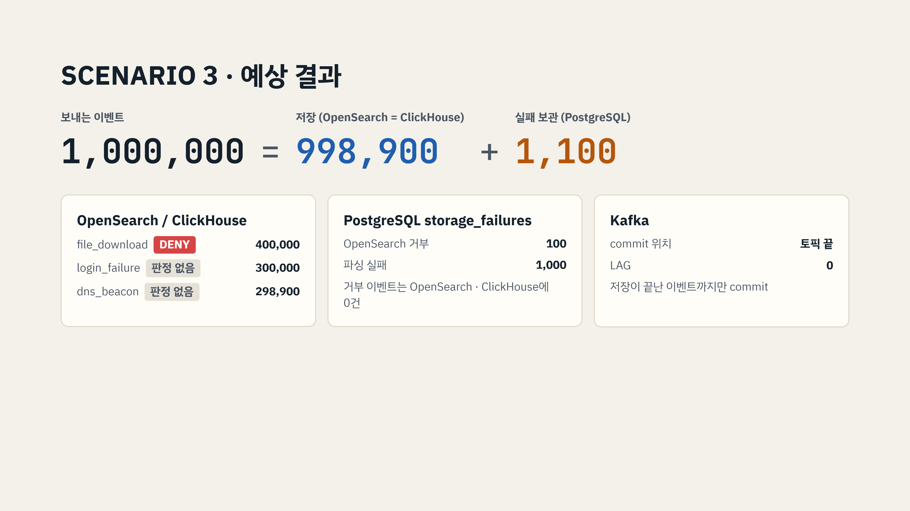

## 🎬 시연 영상

> ▶ 이미지를 클릭하면 영상(mp4) 시청 가능

<!--
./loadgen.exe setup
1        # [1] 이벤트 추가
1        # file_download
2        # 케이스: 위험
400000   # 건수
1        # [1] 이벤트 추가
2        # login_failure
1        # 케이스: 안전
300000   # 건수
1        # [1] 이벤트 추가
3        # dns_beacon
1        # 케이스: 안전
298900   # 건수
1        # [1] 이벤트 추가
4        # 실패 이벤트 (케이스 질문 없음)
1000     # 건수
1        # [1] 이벤트 추가
5        # 거부 이벤트 (케이스 질문 없음)
100      # 건수
3        # [3] 설정 완료
1300     # 동시성 (명령어 버전 500 + 400 + 400과 같은 값)
Enter    # 시작 번호: 기본값 1
Enter    # 반복 횟수: 기본값 1
1        # [1] 실행
-->

| 처리 과정 | 결과 확인 |
|:---:|:---:|
| <a href="assets/scenario-3-demo.mp4">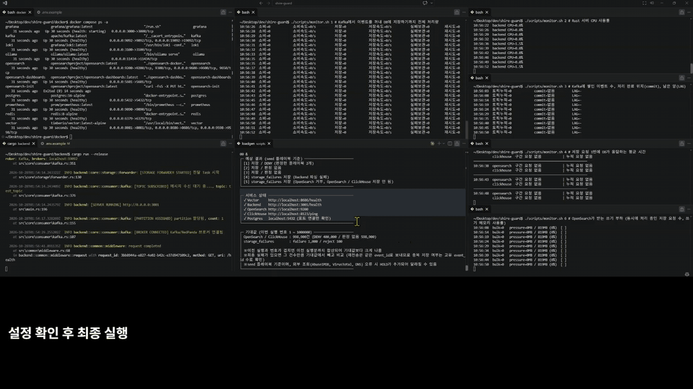</a> | <a href="assets/scenario-3-verification.mp4">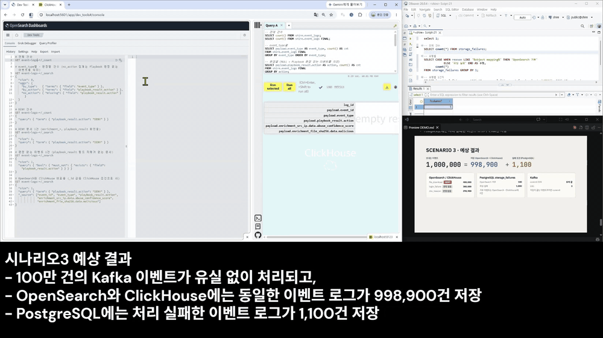</a> |

---
---
---

## AI 대응 노드 시나리오별 테스트

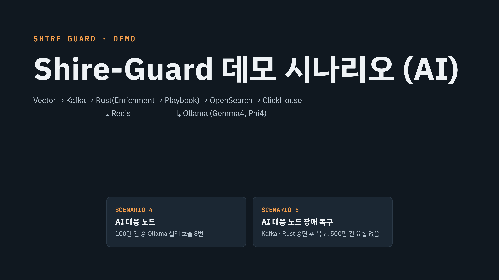

> 매 테스트 전 docker 서비스를 종료하고 데이터를 삭제한 뒤 다시 시작하여 진행하였습니다.

<!-- 
시나리오 1~3 초기화랑 동일한 방법 사용
-->

> 위 시나리오(1~3)와 별도로 진행한 테스트입니다. 기존 Playbook을 모두 비활성화하고, AI 대응 노드 테스트용 `[TEST-AI]` Playbook 8개만 활성화한 상태에서 진행하였습니다.

<!--
사용된 PostgreSQL 쿼리문
  UPDATE playbooks SET enabled = (name LIKE '[TEST-AI]%');
-->

- 같은 종류의 이벤트는 AI에 전달되는 내용이 같아 판정을 캐시에서 재사용하므로, 대량의 이벤트를 처리해도 Ollama는 AI 테스트 전용 Playbook 8개에 대하여 총 8번만 호출됩니다.

- 또한, 동일한 이벤트는 동일한 AI 판정이 이루어져야 하므로 최종적으론 테스트 이벤트마다 event_type 별로 1개의 action만 존재해야 합니다. 

<details>
<summary><b>AI 테스트용 Event (10종 + 파싱 실패 약 1%)</b></summary>

- 10종 이벤트와 파싱 실패 이벤트(약 1%)를 이벤트 번호의 해시값으로 섞어서 전송
- `test_ai` 필드: `[TEST-AI]` Playbook 이름

#### 이벤트 요약
| event_type 필드 | test_ai 필드 | AI 대응 노드 AI 모델  | 주요 IOC |
|---|---|---|---|
| file_download | G1 | gemma4 | AbuseIPDB 0점 IP, VirusTotal 악성 3개 해시 |
| process_execution | G2 | gemma4 | VirusTotal 악성 1개 해시 |
| email_attachment | G3 | gemma4 | AbuseIPDB 100점 IP, 존재하지 않는 도메인 |
| login_failure | P1 | phi4 | AbuseIPDB 100점 IP |
| port_scan | P2 | phi4 | AbuseIPDB 100점 IP |
| privilege_escalation | G4,P3,P4 | gemma4 1개 <br>phi4 2개 <br> => 다수결 3개 | AbuseIPDB 0점 IP, VirusTotal 악성 66개 해시 (근거가 서로 엇갈림) |
| login_success · vpn_disconnect · password_change · software_update | NONE | 판정 없음 | - |

#### 이벤트별 JSON

1) file_download (G1, gemma4 단일 판정)
- source_ip: AbuseIPDB 0점
- file_sha256: VirusTotal 악성 판정 엔진 3개

```json
{
  "event_id": "loadgen-번호",
  "event_type": "file_download",
  "timestamp": "2026-11-05T10:00:00Z",
  "source_ip": "118.25.6.39",
  "destination_domain": "cdn-update-service.net",
  "file_name": "setup_helper.exe",
  "file_sha256": "784c88f2297ffe774b9b1330f12690d59f9d08ce89e97a74debd687de9ed2cd7",
  "file_size_bytes": 512000,
  "test_ai": "G1"
}
```

2) process_execution (G2, gemma4 단일 판정)
- file_sha256: VirusTotal 악성 판정 엔진 1개
```json
{
  "event_id": "loadgen-번호",
  "event_type": "process_execution",
  "timestamp": "2026-11-05T10:00:00Z",
  "hostname": "WKS-2041",
  "user": "kim",
  "process_name": "update_agent.exe",
  "parent_process": "winword.exe",
  "file_sha256": "1dce02aae98c0a48c2644abd1849fb90406296d4e0c95e239f95242ee8480ff8",
  "test_ai": "G2"
}
```

3) email_attachment (G3, gemma4 단일 판정)
- source_ip: AbuseIPDB 100점
- destination_domain: 존재하지 않는 도메인 (DNS 조회 결과 NotFound)
```json
{
  "event_id": "loadgen-번호",
  "event_type": "email_attachment",
  "timestamp": "2026-11-05T10:00:00Z",
  "source_ip": "144.48.243.18",
  "sender": "billing@partner-mail.example",
  "destination_domain": "invoice-share.example",
  "file_name": "invoice_2026.zip",
  "test_ai": "G3"
}
```

4) login_failure (P1, phi4 단일 판정)
- source_ip: AbuseIPDB 100점
```json
{
  "event_id": "loadgen-번호",
  "event_type": "login_failure",
  "timestamp": "2026-11-05T10:00:00Z",
  "source_ip": "144.48.243.18",
  "username": "admin",
  "attempt_count": 12,
  "target_service": "ssh",
  "test_ai": "P1"
}
```

5) port_scan (P2, phi4 단일 판정)
- source_ip: AbuseIPDB 100점
```json
{
  "event_id": "loadgen-번호",
  "event_type": "port_scan",
  "timestamp": "2026-11-05T10:00:00Z",
  "source_ip": "144.48.243.18",
  "scanned_port_count": 1024,
  "scan_type": "syn",
  "duration_seconds": 30,
  "test_ai": "P2"
}
```

6) privilege_escalation (G4 · P3 · P4 다수결)
- source_ip: AbuseIPDB 0점
- file_sha256: VirusTotal 악성 판정 엔진 66개 (IP와 파일의 근거가 서로 엇갈리는 이벤트)
```json
{
  "event_id": "loadgen-번호",
  "event_type": "privilege_escalation",
  "timestamp": "2026-11-05T10:00:00Z",
  "source_ip": "118.25.6.39",
  "hostname": "SRV-DB01",
  "user": "svc_backup",
  "method": "sudo",
  "file_name": "escalate.bin",
  "file_sha256": "275a021bbfb6489e54d471899f7db9d1663fc695ec2fe2a2c4538aabf651fd0f",
  "test_ai": "G4,P3,P4"
}
```

7) login_success (판정 없음)
```json
{
  "event_id": "loadgen-번호",
  "event_type": "login_success",
  "timestamp": "2026-11-05T10:00:00Z",
  "source_ip": "118.25.6.39",
  "username": "kim",
  "target_service": "vpn",
  "test_ai": "NONE"
}
```

8) vpn_disconnect (판정 없음)
```json
{
  "event_id": "loadgen-번호",
  "event_type": "vpn_disconnect",
  "timestamp": "2026-11-05T10:00:00Z",
  "source_ip": "118.25.6.39",
  "username": "kim",
  "session_seconds": 3600,
  "test_ai": "NONE"
}
```

9) password_change (판정 없음)
```json
{
  "event_id": "loadgen-번호",
  "event_type": "password_change",
  "timestamp": "2026-11-05T10:00:00Z",
  "hostname": "WKS-1183",
  "username": "lee",
  "test_ai": "NONE"
}
```

10) software_update (판정 없음)
```json
{
  "event_id": "loadgen-번호",
  "event_type": "software_update",
  "timestamp": "2026-11-05T10:00:00Z",
  "hostname": "WKS-1183",
  "destination_domain": "nexon.com",
  "package": "office-update",
  "version": "16.0.1",
  "test_ai": "NONE"
}
```

- 파싱 실패 이벤트는 위 [4) Rust 파싱 실패 이벤트](#parse-failure-event)와 같은 형식

</details>

<details>
<summary><b>AI 테스트용 Playbook ([TEST-AI] 8개)</b></summary>

![#12 [TEST-AI] G1](assets/playbook-12.png)

![#13 [TEST-AI] G2](assets/playbook-13.png)

![#14 [TEST-AI] G3](assets/playbook-14.png)

![#15 [TEST-AI] G4](assets/playbook-15.png)

![#16 [TEST-AI] P1](assets/playbook-16.png)

![#17 [TEST-AI] P2](assets/playbook-17.png)

![#18 [TEST-AI] P3](assets/playbook-18.png)

![#19 [TEST-AI] P4](assets/playbook-19.png)

</details>

### 4. AI 대응 노드: 100만 건 중 Ollama 실제 호출 8번

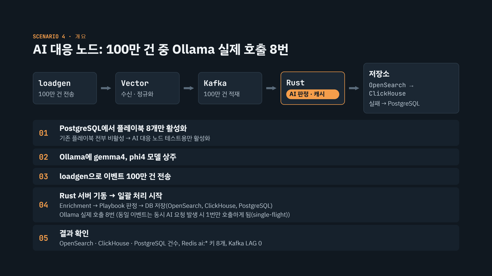

- Rust 서버를 끈 상태에서 100만 건의 이벤트를 Kafka에 쌓은 후 Rust 서버를 기동시켜 일괄처리합니다.

- 테스트용 이벤트 100만 건을 8개의 `[TEST-AI]` Playbook에 구성된 AI 대응 노드가 이벤트를 판정하도록 합니다.

- 동일한 AI 대응 노드에 동일한 입력이 전달되면, 최초 판정 결과를 Redis 캐시에 저장하고 이후에 동일한 이벤트가 다시 전달되면 Ollama를 다시 호출하지 않고 캐시된 결과를 재사용하면서 빠르게 처리되는지 확인하는 시나리오입니다.

#### 예상 결과
- 100만 건의 Kafka 이벤트가 유실 없이 처리되고,
- OpenSearch와 ClickHouse에는 동일한 이벤트 로그가 989,922건 저장
  <br>(AI 단일 판정 493,776 / AI 다수결 99,332 / 판정 없음 396,814)
- PostgreSQL에는 파싱 실패 로그가 10,078건 저장
- Redis AI 캐시 키(`ai:*`) 8개 = Ollama 실제 호출 8번
- AI 판정은 event_type 별 1개만 나와서 일관된 응답을 증명

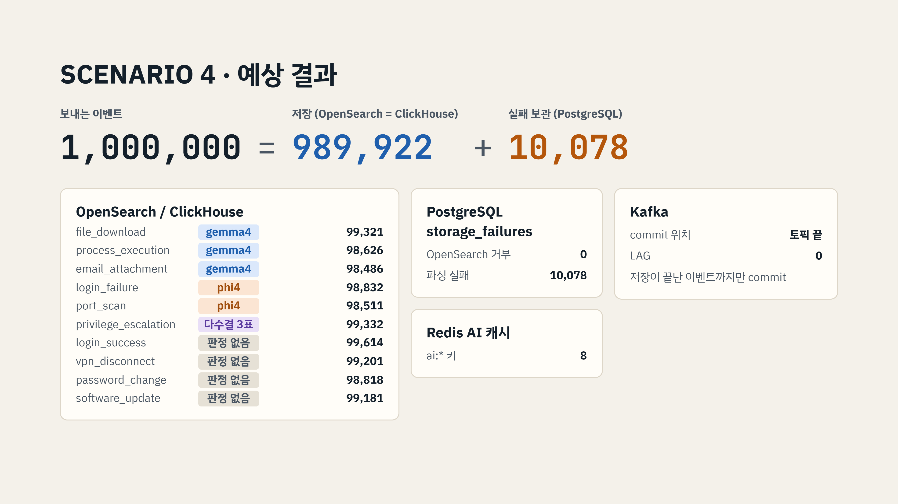

## 🎬 시연 영상

> ▶ 이미지를 클릭하면 영상(mp4) 시청 가능

<!--
./loadgen.exe ai 1 1000000 1000
-->

| 처리 과정 | 결과 확인 |
|:---:|:---:|
| <a href="assets/scenario-4-demo.mp4">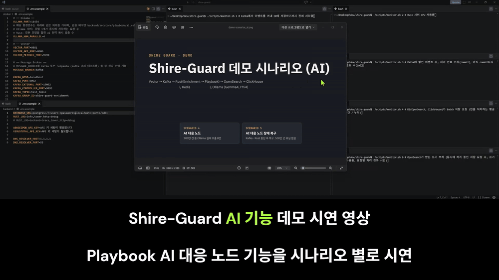</a> | <a href="assets/scenario-4-verification.mp4">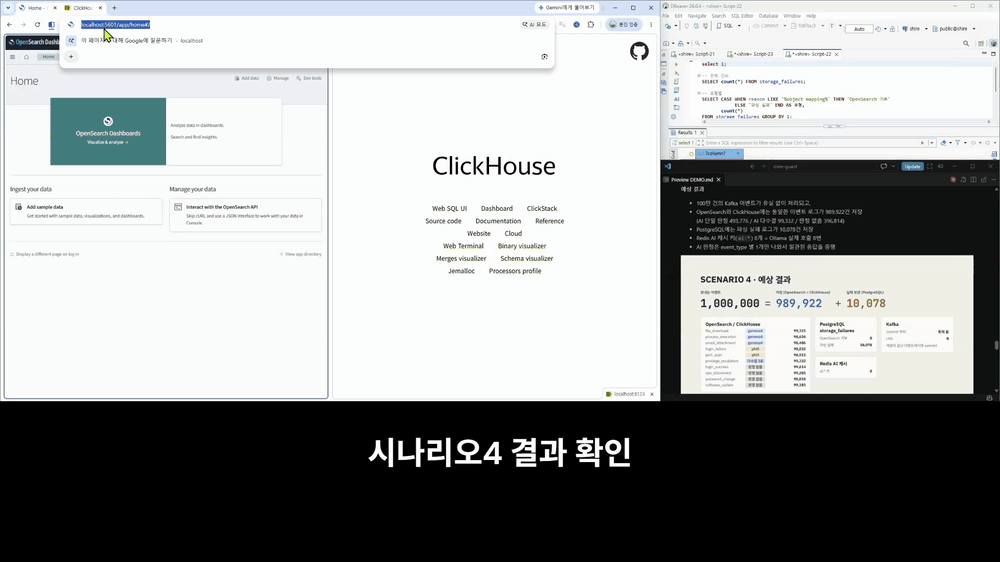</a> |

---

### 5. AI 대응 노드 장애 복구: 500만 건 · Kafka · Rust 중단 후 유실 없음

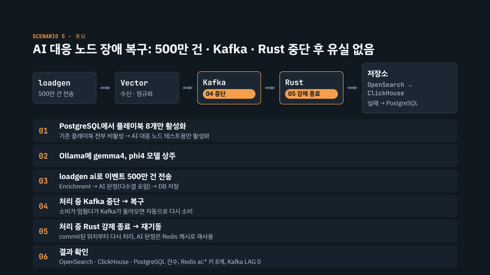

- Rust 서버를 끈 상태에서 500만 건의 이벤트를 Kafka에 쌓은 후 Rust 서버를 기동시켜 일괄처리합니다.

- 테스트용 이벤트 500만 건을 8개의 `[TEST-AI]` Playbook에 구성된 AI 대응 노드가 이벤트를 판정하도록 합니다.

- AI 대응 노드 동작은 시나리오 4와 동일합니다.

- 이벤트 처리 도중 Kafka 서비스를 종료 후 복구 -> Rust 서버를 종료 후 복구하여 유실 없이 500만 건 이벤트를 처리하는 시나리오입니다.

#### 예상 결과
- 500만 건의 Kafka 이벤트가 유실 없이 처리되고,
- OpenSearch와 ClickHouse에는 동일한 이벤트 로그가 4,949,804건 저장
  <br>(AI 단일 판정 2,474,195 / AI 다수결 495,545 / 판정 없음 1,980,064)
- PostgreSQL에는 파싱 실패 로그가 50,196건 저장
- Redis AI 캐시 키(`ai:*`) 8개 = Ollama 실제 호출 8번
- AI 판정은 event_type 별 1개만 나와서 일관된 응답을 증명

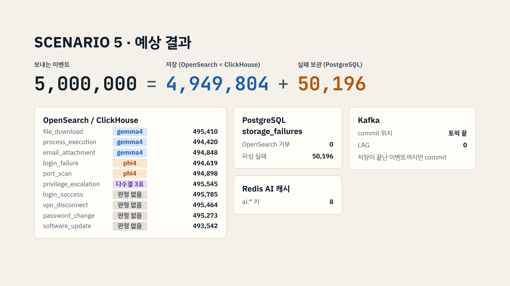

## 🎬 시연 영상

> ▶ 이미지를 클릭하면 영상(mp4) 시청 가능

<!--
./loadgen.exe ai 1 5000000 1000
-->

| 처리 과정 | 결과 확인 |
|:---:|:---:|
| <a href="assets/scenario-5-demo.mp4">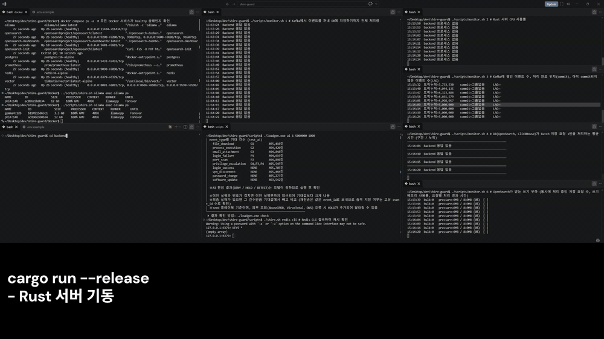</a> | <a href="assets/scenario-5-verification.mp4">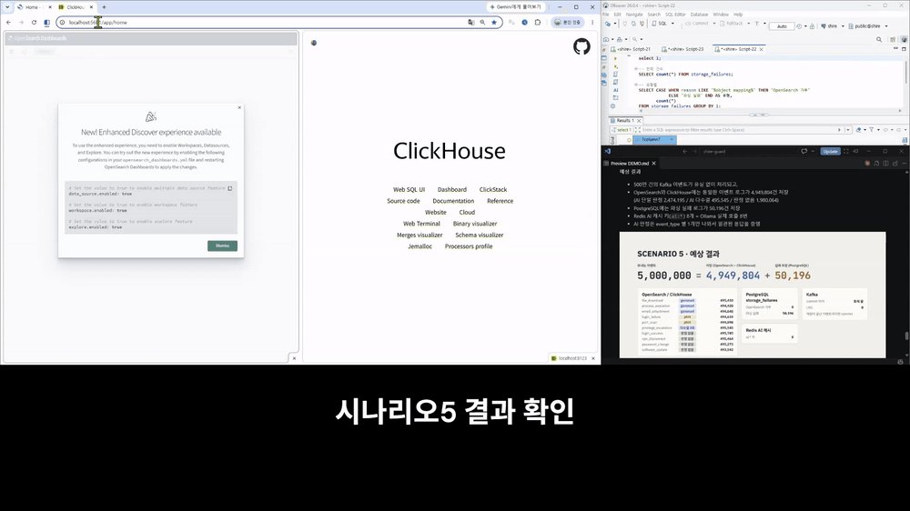</a> |