# Shire-Guard 데모 시나리오

**한국어** | [English](DEMO.en.md)

- Shire-Guard 이벤트 처리 시연영상을 포함하여 정리한 문서

## 목차
- [데모에 사용될 임의로 제작한 Event 종류](#데모에-사용될-임의로-제작한-event-종류)
- [데모에 사용될 Playbook 정책](#데모에-사용될-playbook-정책)
- [시나리오 별 테스트](#시나리오-별-테스트)
  - [1. Backlog 처리 성능](#1-backlog-처리-성능-rust-서버가-멈춘-동안-쌓인-100만-건-일괄-처리)
  - [2. 장애 복구](#2-장애-복구-kafka--rust-서버-중단-후-복구해도-유실-없음)
  - [3. 실시간 처리](#3-실시간-처리-수신-즉시-처리)

## 데모에 사용될 임의로 제작한 Event 종류
1) file_download (위험 케이스)
- source_ip: AbuseIPDB 100점 (2026-10 기준 API 응답 결과)
- file_sha256: VirusTotal 악성 판정 엔진 66개 (2026-10 기준 API 응답 결과)
```json
{
  "event_id": "loadgen-1",
  "event_type": "file_download",
  "timestamp": "2026-10-28T10:00:00Z",
  "source_ip": "144.48.243.18",
  "destination_domain": "cdn-update-service.net",
  "file_name": "invoice_2026.exe",
  "file_sha256": "275a021bbfb6489e54d471899f7db9d1663fc695ec2fe2a2c4538aabf651fd0f",
  "file_size_bytes": 245760
}
```

2) login_failure (안전 케이스)
- source_ip: AbuseIPDB 0점 (2026-10 기준 API 응답 결과)
```json
{
  "event_id": "loadgen-1000001",
  "event_type": "login_failure",
  "timestamp": "2026-10-28T10:00:00Z",
  "source_ip": "118.25.6.39",
  "username": "admin",
  "attempt_count": 12,
  "target_service": "ssh"
}
```

3) dns_beacon (안전 케이스)
- source_ip: AbuseIPDB 0점 (2026-10 기준 API 응답 결과)
- destination_domain: 테스트할 Playbook에서 차단하지 않을 도메인 
```json
{
  "event_id": "loadgen-2000001",
  "event_type": "dns_beacon",
  "timestamp": "2026-10-28T10:00:00Z",
  "source_ip": "118.25.6.39",
  "destination_domain": "nexon.com",
  "hostname": "WKS-1183",
  "request_interval_seconds": 60
}
```

4) Rust 파싱 실패 이벤트
- event_id가 없어 Rust 서버에서 파싱 실패하여 처리 실패 로그를 저장하는 PostgreSQL에 저장될 이벤트
```json
{
  "loadgen_id": "loadgen-failure-번호",
  "event_type": "login_failure",
  "timestamp": "2026-10-28T10:00:00Z",
  "source_ip": "144.48.243.18",
  "username": "admin",
  "attempt_count": 12,
  "target_service": "ssh"
}
```

5) OpenSearch 거부 이벤트
- 객체 필드가 문자열이므로 OpenSearch에서 거부하여 처리 실패 로그를 저장하는 PostgreSQL에 저장될 이벤트
```json
{
  "event_id": "loadgen-reject-번호",
  "event_type": "login_failure",
  "timestamp": "2026-10-28T10:00:00Z",
  "source_ip": "144.48.243.18",
  "username": "admin",
  "attempt_count": 12,
  "target_service": "ssh",
  "enrichment_dst_domain": "x"
}
```

## 데모에 사용될 Playbook 정책
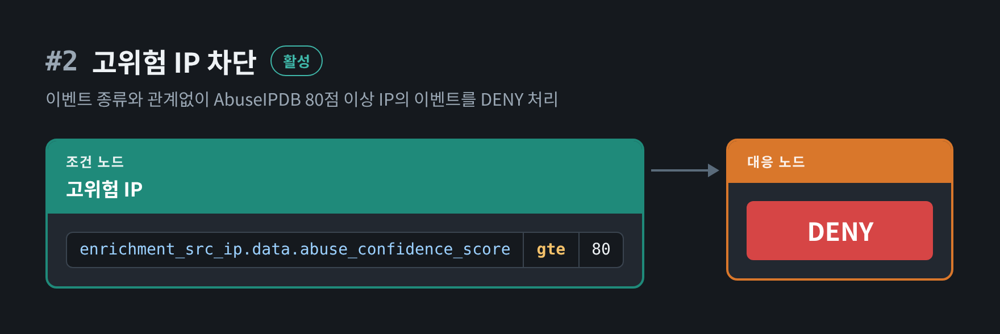

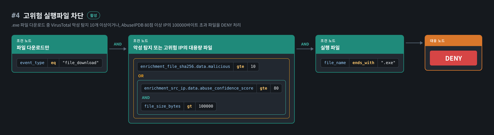

## 시나리오 별 테스트
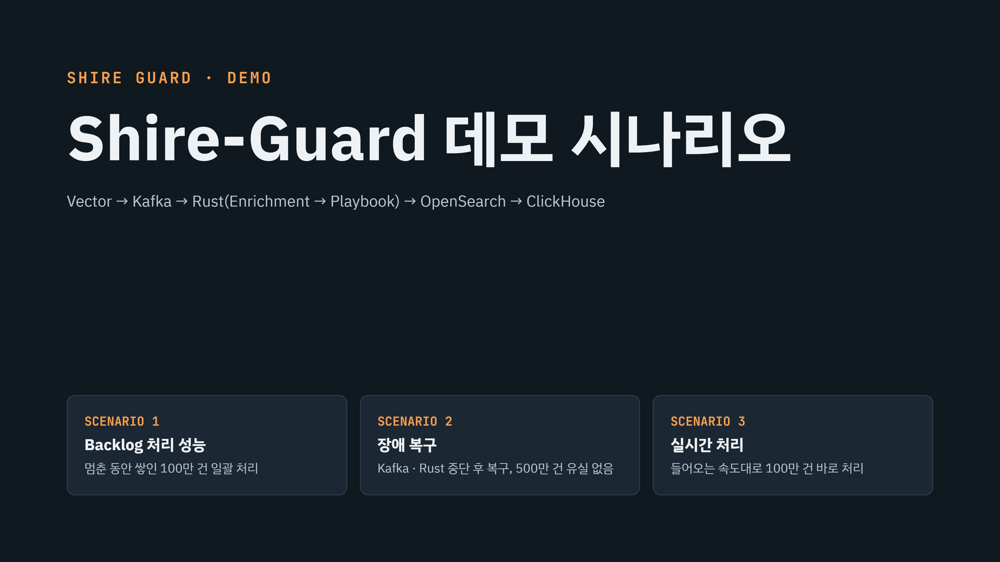

> 매 테스트 전 docker 서비스를 종료하고 데이터를 삭제한 뒤 다시 시작하여 진행하였습니다.

<!-- 
cd docker
docker compose down

# grafana/data는 지우지 않음 (데이터소스·대시보드 유지)
rm -rf kafka/data opensearch/data clickhouse/data postgres/data vector/data loki/data postgres/data

docker compose up -d --scale redpanda=0 --scale dragonfly=0
-->

### 1. Backlog 처리 성능: Rust 서버가 멈춘 동안 쌓인 100만 건 일괄 처리

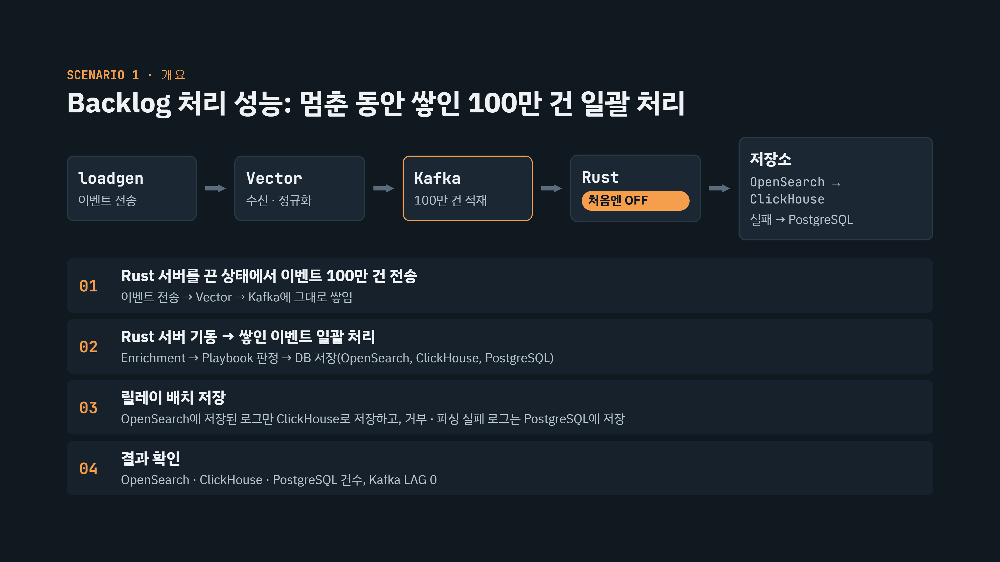

- Rust 서버를 끈 상태에서 100만 건의 이벤트를 Kafka에 쌓은 후 Rust 서버를 기동시켜 일괄처리하는 시나리오입니다.

#### 예상 결과
- 100만 건의 Kafka 이벤트가 유실 없이 처리되고,
- OpenSearch와 ClickHouse에는 동일한 이벤트 로그가 998,900건 저장
- PostgreSQL에는 처리 실패한 이벤트 로그가 1,100건 저장

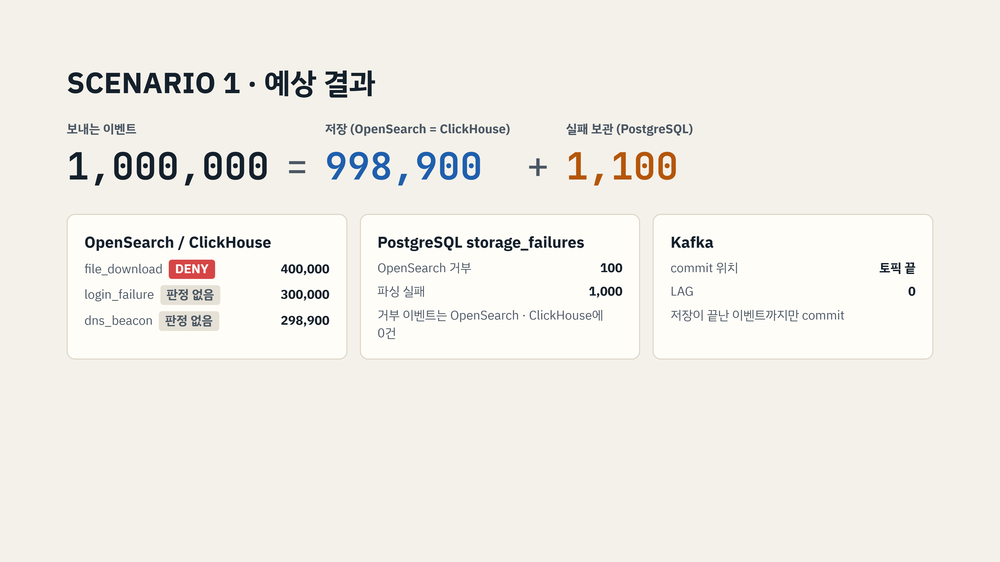

## 🎬 시연 영상

> ▶ 이미지를 클릭하면 영상(mp4) 시청 가능

<!--
./loadgen.exe file_download 1 400000 500 --fail 1000 --reject 100 &
./loadgen.exe login_failure 1000001 300000 400 --case safe &
./loadgen.exe dns_beacon 2000001 298900 400 --case safe &
wait
-->

| 처리 과정 | 결과 확인 |
|:---:|:---:|
| <a href="assets/scenario-1-demo.mp4">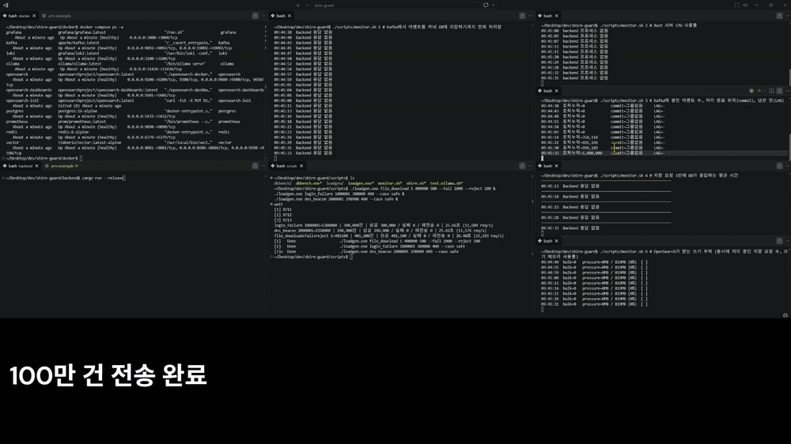</a> | <a href="assets/scenario-1-verification.mp4">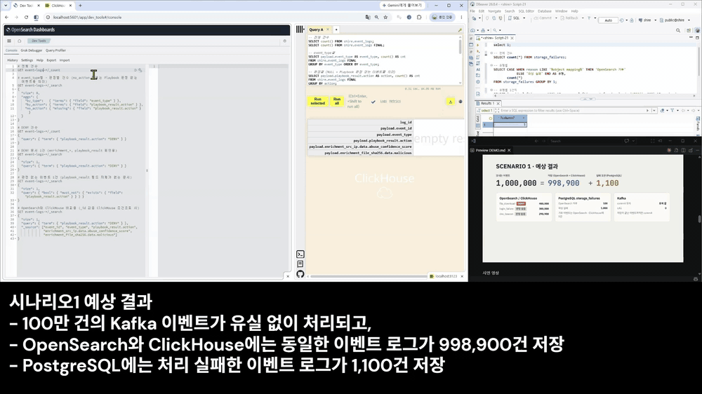</a> |

---

### 2. 장애 복구: Kafka · Rust 서버 중단 후 복구해도 유실 없음

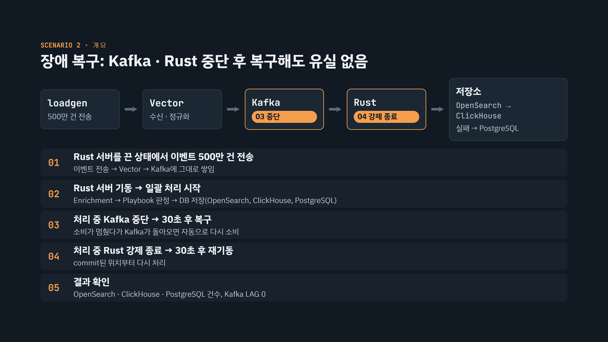

- Rust 서버를 끈 상태에서 500만 건의 이벤트를 Kafka에 쌓은 후 Rust 서버를 기동시켜 일괄처리합니다.

- 처리 도중 Kafka 서비스를 종료 후 복구 -> Rust 서버를 종료 후 복구하여 유실 없이 500만건 이벤트를 처리하는 시나리오입니다.

#### 예상 결과
- 500만 건의 Kafka 이벤트가 유실 없이 처리되고,
- OpenSearch와 ClickHouse에는 동일한 이벤트 로그가 4,994,500건 저장
- PostgreSQL에는 처리 실패한 이벤트 로그가 5,500건 저장

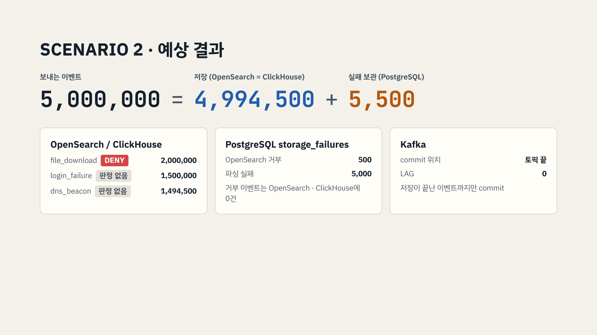

## 🎬 시연 영상

> ▶ 이미지를 클릭하면 영상(mp4) 시청 가능

<!--
./loadgen.exe file_download 1 2000000 500 --fail 5000 --reject 500 &
./loadgen.exe login_failure 10000001 1500000 400 --case safe &
./loadgen.exe dns_beacon 20000001 1494500 400 --case safe &
wait
-->

| 처리 과정 | 결과 확인 |
|:---:|:---:|
| <a href="assets/scenario-2-demo.mp4">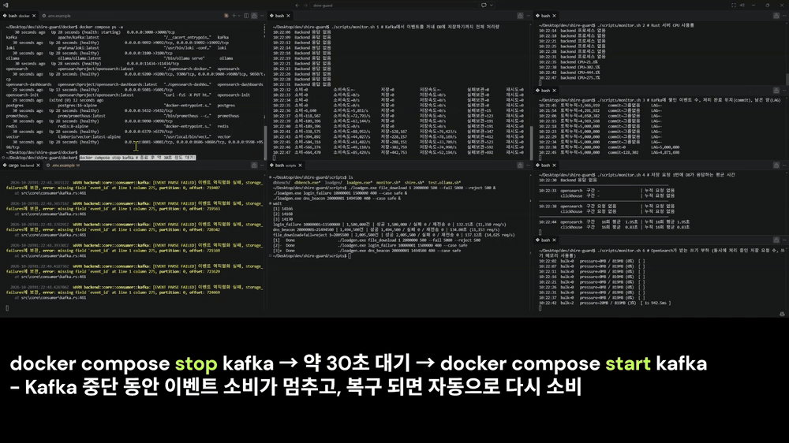</a> | <a href="assets/scenario-2-verification.mp4">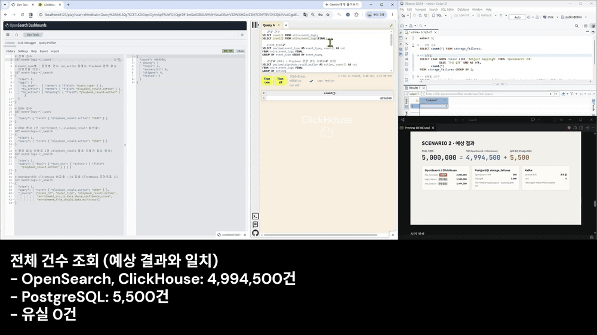</a> |

---

### 3. 실시간 처리: 수신 즉시 처리

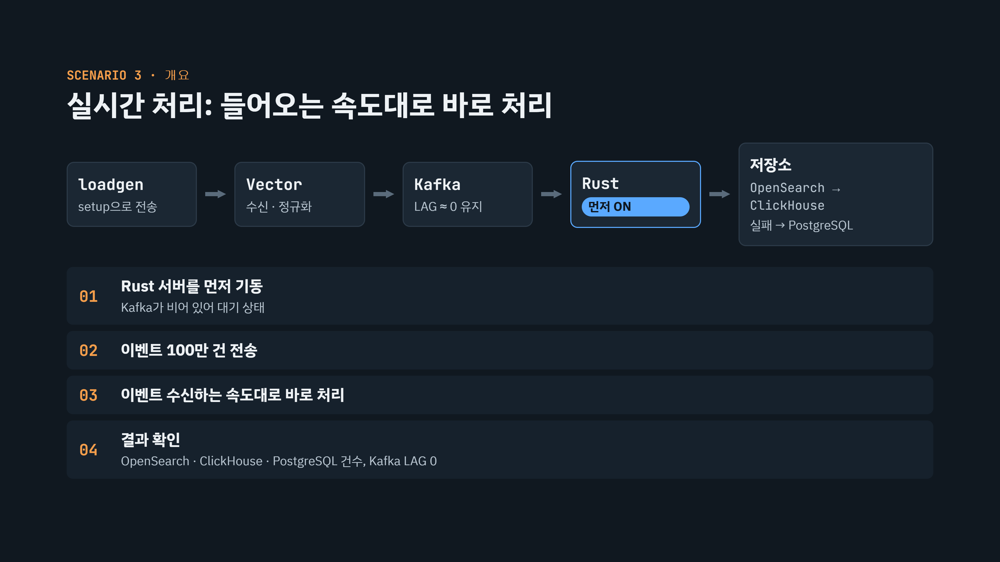

- Rust 서버를 기동한 상태에서 100만 건의 이벤트를 보내, 실시간 처리하는 시나리오입니다.

#### 예상 결과
- 100만 건의 Kafka 이벤트가 유실 없이 처리되고,
- OpenSearch와 ClickHouse에는 동일한 이벤트 로그가 998,900건 저장
- PostgreSQL에는 처리 실패한 이벤트 로그가 1,100건 저장


## 🎬 시연 영상

> ▶ 이미지를 클릭하면 영상(mp4) 시청 가능

<!--
./loadgen.exe setup
1        # [1] 이벤트 추가
1        # file_download
2        # 케이스: 위험
400000   # 건수
1        # [1] 이벤트 추가
2        # login_failure
1        # 케이스: 안전
300000   # 건수
1        # [1] 이벤트 추가
3        # dns_beacon
1        # 케이스: 안전
298900   # 건수
1        # [1] 이벤트 추가
4        # 실패 이벤트 (케이스 질문 없음)
1000     # 건수
1        # [1] 이벤트 추가
5        # 거부 이벤트 (케이스 질문 없음)
100      # 건수
3        # [3] 설정 완료
1300     # 동시성 (명령어 버전 500 + 400 + 400과 같은 값)
Enter    # 시작 번호: 기본값 1
Enter    # 반복 횟수: 기본값 1
1        # [1] 실행
-->

| 처리 과정 | 결과 확인 |
|:---:|:---:|
| <a href="assets/scenario-3-demo.mp4">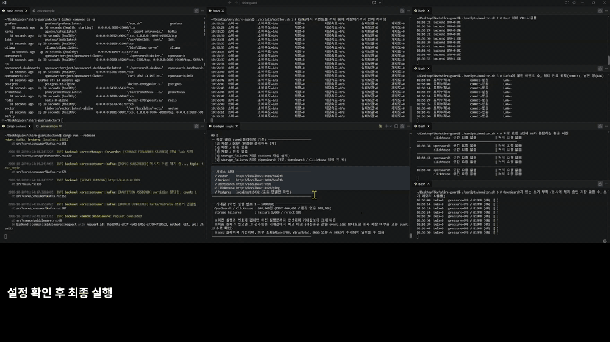</a> | <a href="assets/scenario-3-verification.mp4">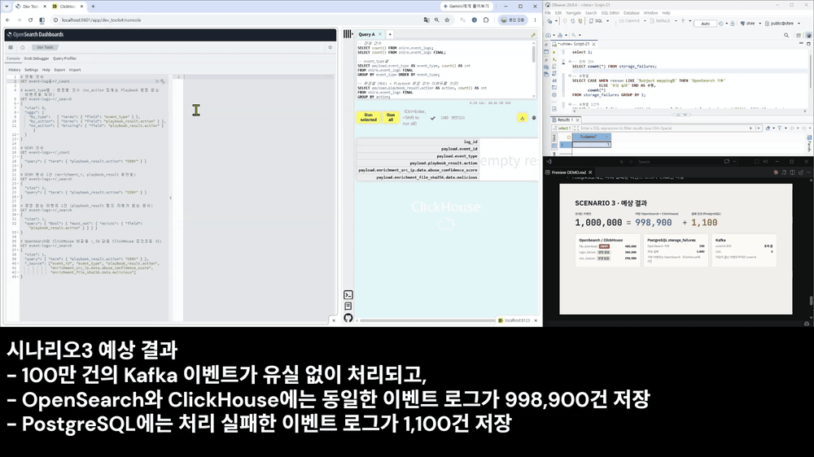</a> |
