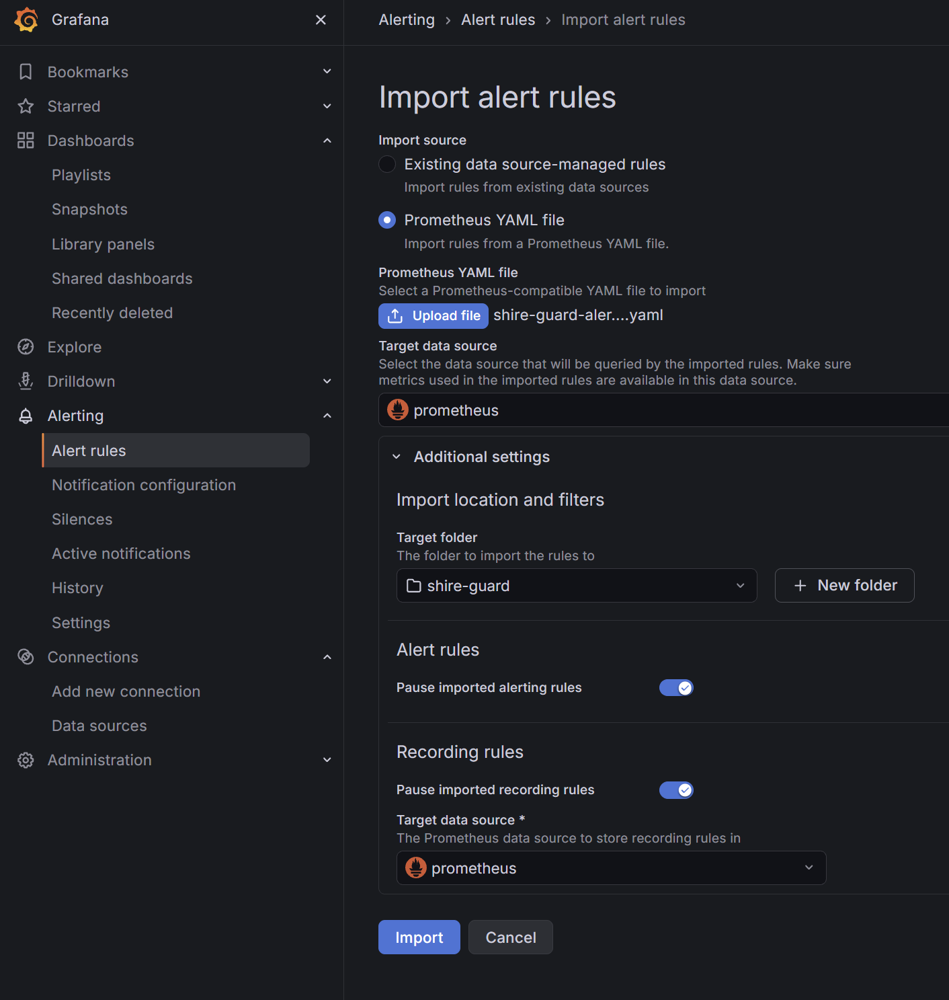
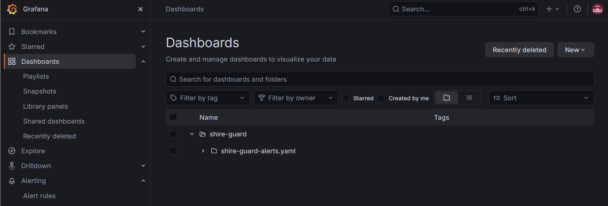

# Development Guide

Shire Guard를 로컬에서 실행하고, 의존성을 관리하고, 테스트하는 방법을 정리합니다.

> **명령어 실행 위치**
> - Docker Compose 명령어: `docker/`
> - Rust(cargo) 명령어: `backend/`
> - 그 외: 저장소 루트
> - 포트와 기본값은 `docker/.env.example` 기준 (변경했다면 실제 `.env` 값 확인)

---
## 1. 사전 요구사항

- [Rust 설치] https://www.rust-lang.org/tools/install

```bash
# Rust 컴파일러 버전 확인
rustc --version

# Cargo 버전 확인
cargo --version
```

- [Docker 설치] https://docs.docker.com/get-started/get-docker/

```bash
# Docker 버전 확인
docker --version

# Docker Compose 버전 확인
docker compose version
```

- CMake 설치
  - Rust 서버가 Kafka에서 이벤트를 읽어오는 기능을 빌드할 때 필요
  - 관련 의존성: `rdkafka` (Rust에서 Kafka를 사용하기 위한 라이브러리)

```bash
# Windows
winget install Kitware.CMake

# macOS
brew install cmake

# Linux (Ubuntu)
sudo apt install cmake

# CMake 버전 확인 (설치 후 터미널을 새로 열고 실행)
cmake --version
```

- NVIDIA GPU
  - AI 판정 기능(Ollama)을 사용할 때만 필요, GPU가 없으면 `ollama` 컨테이너가 실행되지 않음

```bash
# GPU 확인
nvidia-smi
```

---

## 2. 프로젝트 초기화

```bash
git clone https://github.com/1Tsw0rd/shire-guard.git
cd shire-guard

# 환경변수 파일 생성 후 값 입력 (항목 설명은 5. 환경변수)
cp docker/.env.example docker/.env
cp backend/.env.example backend/.env
```

- `docker/.env` 파일이 없으면 Docker 실행이 실패
- `Cargo.toml`과 `Cargo.lock`이 저장소에 포함되어 있으므로 별도의 `cargo add` 없이 `cargo build` 시 의존성을 내려받음

---

## 3. Docker Compose

### 3.1 메시지 브로커와 캐시 선택

Shire Guard는 아래 두 가지를 각각 **하나씩 골라서** 사용

| 구분 | 선택지 | 기본값 |
|---|---|---|
| 메시지 브로커 | Kafka / RedPanda | Kafka |
| 캐시 | Redis / Dragonfly | Redis |

- RedPanda는 Kafka와 같은 방식으로 동작하는 대체 프로그램이고, Dragonfly는 Redis와 같은 방식으로 동작하는 대체 프로그램
- 기본값(Kafka + Redis)을 사용한다면 아무것도 바꾸지 않아도 됨

#### 선택 방법

`docker/.env`에서 아래 값을 수정

```dotenv
# kafka 또는 redpanda
MESSAGE_BROKER=kafka

# redis 또는 dragonfly
CACHE_BACKEND=redis
```

#### RedPanda를 선택한 경우

`docker/vector/vector.toml`도 함께 수정해야 함

- Vector(이벤트 수집기)는 `MESSAGE_BROKER` 값과 관계없이 설정 파일에 적힌 브로커로 이벤트를 보내기 때문
- `[sinks.kafka_out]`, `[sinks.kafka_out.buffer]`, `[sinks.kafka_out.acknowledgements]` 부분을 주석 처리
- `[sinks.redpanda_out]`, `[sinks.redpanda_out.buffer]`, `[sinks.redpanda_out.acknowledgements]` 부분의 주석을 해제

### 3.2 실행

```bash
cd docker

# 설정 검증 (필수 환경변수 누락 등 확인, 문제 없으면 출력 없음)
docker compose config -q

# 전체 서비스 실행 (15개: Kafka와 RedPanda, Redis와 Dragonfly 모두 포함)
docker compose up -d

# 필요한 서비스만 실행하는 예시 (Kafka + Redis 조합)
# RedPanda나 Dragonfly를 선택했다면 kafka → redpanda, redis → dragonfly로 바꿔서 실행
docker compose up -d vector kafka redis postgres opensearch opensearch-init opensearch-dashboards clickhouse ollama prometheus grafana loki cadvisor

# 실행 상태 확인
docker compose ps
```

#### AI 모델 다운로드

Shire Guard > Playbook > AI 대응 노드를 사용할 때 필요

```bash
docker exec -it ollama ollama pull qwen2.5:14b-instruct
docker exec -it ollama ollama pull hf.co/fdtn-ai/Foundation-Sec-8B-Reasoning-Q8_0-GGUF

# 다운로드된 모델 확인
docker exec -it ollama ollama list

# NAME
# hf.co/fdtn-ai/Foundation-Sec-8B-Reasoning-Q8_0-GGUF:latest
# qwen2.5:14b-instruct
```

### 3.3 운영

#### 로그 확인

```bash
# 전체 로그 (최근 100줄부터)
docker compose logs -f --tail=100

# 서비스별 로그 (여러 개 지정 가능)
docker compose logs -f --tail=100 vector
docker compose logs -f --tail=100 kafka
docker compose logs -f --tail=100 grafana prometheus loki
```

#### 종료

```bash
# 컨테이너 중지·제거 (저장된 데이터는 유지)
docker compose down
```

#### 데이터 초기화 (필요한 경우)

- 데이터 폴더 위치: `docker/<서비스 이름>/data` (postgres, clickhouse, opensearch, kafka, redpanda 등)

```bash
# docker/ 디렉터리에서 실행 (Git Bash에서 실행)
docker compose down 서비스명
rm -rf 서비스명/data
docker compose up -d 서비스명
```

> 서비스별 참고 자료는 [note-docker-services.md](notes/note-docker-services.md) 확인

### 3.4 접속 주소

#### 웹 UI

| 서비스 | 주소 | 비고 |
|---|---|---|
| Grafana | http://localhost:3000 | 기본 계정 admin / admin |
| OpenSearch Dashboards | http://localhost:5601 | 로그인 없음 |
| Prometheus | http://localhost:9090 | Status → Targets에서 수집 상태 확인 |
| ClickHouse Play | http://localhost:8123/play | `CLICKHOUSE_USER` / `CLICKHOUSE_PASSWORD` |
| cAdvisor | http://localhost:8082 | 컨테이너별 CPU·메모리 |

#### API / 상태 확인

| 서비스 | 주소 | 비고 |
|---|---|---|
| Vector 이벤트 수신 | http://localhost:8081 | 이벤트 전송 대상 (POST, JSON) |
| Vector health | http://localhost:8686/health | |
| Vector metrics | http://localhost:9598/metrics | |
| OpenSearch REST | http://localhost:9200 | |
| Ollama API | http://localhost:11434 | |

- Loki는 별도 UI가 없으며 Grafana에서 조회
- PostgreSQL, Redis/Dragonfly, Kafka/RedPanda는 웹 UI가 없음

### 3.5 Grafana 설정 (선택)

Grafana를 사용하기 위해선 아래 2단계 진행해야 함

#### 1단계: 데이터소스 생성

대시보드 JSON은 데이터소스를 UID로 참조하므로, 아래 UID로 데이터소스를 생성해야 함

| 데이터소스 | UID | URL (Grafana 컨테이너 기준) |
|---|---|---|
| Prometheus | `afxri9wxzbzlsc` | `http://prometheus:9090` |
| Loki | `ffya6s2679edce` | `http://loki:3100` |

```bash
# UI에서는 UID를 지정할 수 없으므로 API로 생성 (Git Bash에서 실행)
curl -u admin:admin -X POST http://localhost:3000/api/datasources -H "Content-Type: application/json" -d '{"name":"prometheus","type":"prometheus","uid":"afxri9wxzbzlsc","url":"http://prometheus:9090","access":"proxy"}'

curl -u admin:admin -X POST http://localhost:3000/api/datasources -H "Content-Type: application/json" -d '{"name":"loki","type":"loki","uid":"ffya6s2679edce","url":"http://loki:3100","access":"proxy"}'
```

#### 2단계: 알림·대시보드 import

데이터소스를 생성한 뒤 Grafana(http://localhost:3000)에 접속하여 진행

**알림**

Grafana 왼쪽 메뉴 Alerting → Alert rules → 오른쪽 상단 More → Import alert rules → 아래처럼 설정 후 Import
- Upload file 경로: `shire-guard/docker/grafana/imports/shire-guard-alerts.yaml`



**대시보드**

Grafana 왼쪽 메뉴 Dashboards -> shire-guard -> shire-guard-alert.yaml 선택 (아래 스크린샷 참고) -> 오른쪽 상단 New -> Import dashboard -> Upload dashboard JSON file ->  `shire-guard/docker/grafana/imports/shire-guard-dashboards.json` 선택 후 Import



---

## 4. 서버 실행

Docker 서비스가 실행 중인 상태에서 진행

```bash
cd backend

# 최적화 빌드(--release)로 실행 (첫 실행은 빌드 시간이 오래 걸림)
cargo run --release
```

- 로그 레벨은 `backend/.env`의 `RUST_LOG`로 조정

```bash
# 서버 상태 (정상 응답: ok) / Metric 확인
curl http://localhost:3001/health
curl http://localhost:3001/metrics
```

---

## 5. 환경변수

| 파일 | 담당 |
|---|---|
| `docker/.env` | Docker 서비스 운영에 필요한 환경변수 파일로, Docker Compose와 Backend가 함께 사용 |
| `backend/.env` | Rust Backend 전용 |

### `docker/.env`

| 구역 | 변수 | 기본값 | 설명 |
|---|---|---|---|
| Ollama | `OLLAMA_PORT` | `11434` | Ollama 포트 |
| Vector | `VECTOR_PORT` | `8081` | 이벤트 수신 포트 |
| | `VECTOR_API_PORT` | `8686` | API·health 포트 |
| | `VECTOR_METRICS_PORT` | `9598` | Metric 포트 |
| Message Broker | `MESSAGE_BROKER` | `kafka` | Backend가 사용할 브로커: `kafka` 또는 `redpanda` |
| | `KAFKA_HOST` | `localhost` | Backend에서 Kafka 접속 호스트 |
| | `KAFKA_PORT` | `9092` | 컨테이너 간 통신용 Kafka 포트 (Vector → Kafka) |
| | `KAFKA_EXTERNAL_PORT` | `19092` | Backend에서 Kafka 접속 포트 |
| | `KAFKA_CONTROLLER_PORT` | `9093` | Kafka 내부 관리(컨트롤러) 포트 |
| | `KAFKA_TOPIC` | `test_topic` | 이벤트를 저장할 토픽 이름 |
| | `KAFKA_GROUP_ID` | `shire-guard-enrichment` | Backend Consumer Group ID |
| | `REDPANDA_HOST` | `localhost` | Backend에서 RedPanda 접속 호스트 |
| | `REDPANDA_PORT` | `29092` | Backend에서 RedPanda 접속 포트 |
| OpenSearch | `OPENSEARCH_PORT` | `9200` | REST API 포트 |
| | `OPENSEARCH_PERF_PORT` | `9600` | 성능 분석 API 포트 |
| | `OPENSEARCH_INITIAL_ADMIN_PASSWORD` | 직접 설정 | 초기 관리자 비밀번호 (OpenSearch 실행 필수 값) |
| | `OPENSEARCH_DASHBOARDS_PORT` | `5601` | OpenSearch Dashboards 포트 |
| ClickHouse | `CLICKHOUSE_HTTP_PORT` | `8123` | HTTP 포트 |
| | `CLICKHOUSE_NATIVE_PORT` | `9000` | 네이티브 포트 (CLI 접속용) |
| | `CLICKHOUSE_DB` | `shire` | 데이터베이스 이름 |
| | `CLICKHOUSE_USER` | `shire` | 사용자 |
| | `CLICKHOUSE_PASSWORD` | 직접 설정 | 비밀번호 |
| PostgreSQL | `POSTGRES_PORT` | `5432` | 포트 |
| | `POSTGRES_DB` | `shire` | 데이터베이스 이름 |
| | `POSTGRES_USER` | `shire` | 사용자 |
| | `POSTGRES_PASSWORD` | 직접 설정 | 비밀번호 |
| Key-Value Store | `CACHE_BACKEND` | `redis` | Backend가 사용할 캐시: `redis` 또는 `dragonfly` |
| | `REDIS_PORT` | `6379` | Redis 포트 |
| | `REDIS_PASSWORD` | 직접 설정 | Redis 비밀번호 |
| | `DRAGONFLY_PORT` | `6380` | Dragonfly 포트 |
| | `DRAGONFLY_PASSWORD` | 직접 설정 | Dragonfly 비밀번호 |
| Grafana | `GRAFANA_PORT` | `3000` | Grafana 포트 |
| Prometheus | `PROMETHEUS_PORT` | `9090` | Prometheus 포트 |
| cAdvisor | `CADVISOR_PORT` | `8082` | cAdvisor 포트 |
| Loki | `LOKI_PORT` | `3100` | Loki 포트 |

- Rust Backend는 OpenSearch, ClickHouse, Ollama 접속 정보도 `docker/.env`에서 읽음 → `backend/.env`에 중복 정의하지 않음

### `backend/.env`

| 변수 | 설명 |
|---|---|
| `DATABASE_URL` | PostgreSQL 접속 URL (비밀번호에 `@`, `:`, `/`가 있으면 URL 인코딩 필요) |
| `RUST_LOG` | 모듈별 로그 레벨 |
| `ABUSEIPDB_API_KEY` | AbuseIPDB API 키 |
| `VIRUSTOTAL_API_KEY` | VirusTotal API 키 |
| `DNS_RESOLVER_HOST` / `DNS_RESOLVER_PORT` | DNS 조회 서버 |

---

## 6. 사용된 Rust 의존성 추가 명령어

### 애플리케이션 의존성

```bash
# Cargo.toml의 버전 조건 안에서 의존성을 최신 버전으로 갱신
# 특정 패키지만 갱신할 경우 cargo update -p axum
cargo update

# 웹 프레임워크: /health, /metrics 엔드포인트
cargo add axum@0.8.9

# 비동기 런타임
# full: 네트워크, 타이머, 동기화 등 전체 기능
# test-util: 테스트에서 시간을 가상으로 제어하는 기능
cargo add tokio@1.53.1 --features full,test-util

# trait에 async fn을 정의하기 위한 매크로
cargo add async-trait@0.1.92

# 데이터 구조를 다른 형식으로 변환하는 직렬화 및 역직렬화를 지원
# derive: 필요한 변환 기능을 매크로로 자동 구현할 수 있게 함
cargo add serde@1.0.229 --features derive
cargo add serde_json@1.0.151

# 날짜와 시간을 처리 (serde: 날짜 및 시간 데이터를 직렬화하고 역직렬화할 수 있게 함)
cargo add chrono@0.4.45 --features serde

# .env 환경변수 로더
cargo add dotenvy@0.15.7

# tracing에서 생성한 로그를 출력하고 필터링 함
# fmt: 로그의 출력 형식을 설정
# env-filter: RUST_LOG 환경변수로 로그 레벨을 조정 가능
cargo add tracing@0.1.44
cargo add tracing-subscriber@0.3.23 --features fmt,env-filter

# HTTP 요청과 응답을 추적하는 미들웨어를 제공
# trace: 요청 처리 과정에서 추적 로그를 남길 수 있게 함
cargo add tower-http@0.7.1 --features trace

# Kafka 및 RedPanda와 통신하는 메시지 브로커 클라이언트
# cmake-build: 필요한 네이티브 라이브러리인 librdkafka를 CMake로 빌드
cargo add rdkafka@0.39.0 --features cmake-build

# Redis / Dragonfly 클라이언트
# tokio-comp: Tokio 기반 비동기 통신 지원 / connection-manager: 끊긴 연결 자동 재연결 지원
cargo add redis@1.7.0 --features tokio-comp,connection-manager

# HTTP 클라이언트
# json: JSON 본문 처리 / query: URL 쿼리 파라미터 설정 지원 / rustls: TLS 암호화 통신 지원
cargo add reqwest@0.13.5 --features json,query,rustls

# DNS 조회 수행 (기본 기능을 끄고 Tokio 기반 비동기 조회 기능만 사용)
cargo add hickory-resolver@0.26.3 --no-default-features --features tokio

# IP/CIDR 처리
cargo add ipnet@2.12.2

# SHA-256 해시 생성
cargo add sha2@0.11.0

# PostgreSQL 비동기 SQL 툴킷
# runtime-tokio: Tokio 런타임을 사용
# tls-rustls: Rustls 기반 TLS 연결 지원
# postgres: PostgreSQL 드라이버 활성화
# uuid, chrono, json: 해당 타입을 데이터베이스와 연동
# macros: query! 등의 매크로와 컴파일 시점 쿼리 검증 기능을 사용
cargo add sqlx@0.9.0 --features runtime-tokio,tls-rustls,postgres,uuid,chrono,macros,json

# UUID v4 생성
# v4: 무작위 기반 UUID v4 생성 지원
# serde: UUID 직렬화 및 역직렬화 지원
cargo add uuid@1.26.0 --features v4,serde

# Prometheus Metric 수집하고 노출
cargo add prometheus@0.14.0

# 요청 DTO 유효성 검증
cargo add validator@0.21.0 --features derive
```

### 테스트 전용 의존성

```bash
# 서버를 실제로 구동하지 않고 메모리상에서 HTTP 요청을 모의 시뮬레이션(.oneshot)하는 유틸 켬
cargo add tower@0.5.3 --dev --features util

# HTTP Body 수집·검증 유틸: Axum이 응답한 스트림 바이트 본문(Body) 데이터를 사람이 읽을 수 있는 JSON/텍스트로 수집하고 변환하는 도구
cargo add http-body-util@0.1.5 --dev

# 테스트 JSON 요청·응답 생성 및 검증
cargo add serde_json@1.0.151 --dev

```

---

## 7. 테스트

```bash
# 단위 테스트 전체 (CI와 동일, ignored 제외)
cargo test --lib

# 테스트 목록만 확인
cargo test --lib -- --list

# 출력 로그까지 확인
cargo test --lib -- --nocapture

# ignored 포함 전체 (아래 `#[ignore]` 테스트의 실행 조건이 모두 필요함)
cargo test --lib -- --include-ignored
```

### 모듈별 테스트

```bash
# 환경변수 해석
cargo test --lib config::tests

# Consumer
cargo test --lib core::consumer::event
cargo test --lib core::consumer::offset

# Enrichment
cargo test --lib core::enrichment::circuit_breaker
cargo test --lib core::enrichment::evidence
cargo test --lib core::enrichment::provider::tests
cargo test --lib core::enrichment::service
cargo test --lib core::enrichment::providers::dns

# Playbook
cargo test --lib core::playbook::condition
cargo test --lib core::playbook::nodes
cargo test --lib core::playbook::engine
cargo test --lib core::playbook::ai

# Storage
cargo test --lib core::storage::forwarder
cargo test --lib core::storage::record
cargo test --lib core::storage::retry

# OpenSearch
cargo test --lib common::clients::opensearch

# 테스트 함수 하나만 실행 (경로에 tests:: 포함)
cargo test --lib core::consumer::offset::tests::holds_position_until_earlier_offset_finishes
cargo test --lib core::playbook::engine::tests::majority_vote_two_thirds_wins
```

### `#[ignore]` 테스트

실제 API 요청이나 DB 쓰기를 수행하므로 로컬 개발 환경에서만 실행

```bash
# ClickHouse 컨테이너 실행 필요
cargo test --lib common::clients::clickhouse -- --ignored

# PostgreSQL 컨테이너 + backend/.env의 DATABASE_URL 필요
cargo test --lib core::storage::failures -- --ignored

# backend/.env의 API 키 필요, 실제 API 쿼터 사용
cargo test --lib core::enrichment::providers::abuseipdb -- --ignored
cargo test --lib core::enrichment::providers::virustotal -- --ignored

# 외부 DNS 서버(1.1.1.1) 접속 필요
cargo test --lib core::enrichment::providers::dns -- --ignored

# ignored 포함 전체
cargo test --lib -- --include-ignored
```

---

## 8. 브랜치와 커밋 규칙

`develop`을 통합 브랜치로 사용하고, 작업별 브랜치에서 변경한 뒤 Pull Request로 `develop`에 병합

```text
develop
└── feature / docs / bugfix 등 브랜치
```

커밋 메시지는 다음 형식을 사용

```text
type: 작업 내용
```

| 타입 | 용도 | 예시 |
|---|---|---|
| `feat` | 기능 추가 | `feat: 로깅 완료 후 Kafka commit 기능 추가` |
| `fix` | 버그 수정 | `fix: postgreSQL 초기화 sql 내 불필요한 쿼리 제거` |
| `docs` | 문서 작성·수정 | `docs: README 아키텍처·주요 기능·성능 문서 작성` |
| `chore` | 프로젝트 관리·주석 등 | `chore: 오탈자 수정 및 주석 제거` |
| `build` | 의존성·빌드 설정 | `build: release 빌드 LTO 설정 추가` |
| `test` | 테스트 추가·수정 | `test: offset 추적기 재전송 시나리오 추가` |
| `refactor` | 기능 변경 없는 구조 개선 | `refactor: ingested_at 필수 필드로 승격` |
| `style` | 포맷·공백 등 수정 | `style: cargo fmt 적용` |
| `perf` | 성능 개선 | `perf: 로그 저장 성능 튜닝` |

Rust 작업이 끝나면 `backend/`에서 아래를 실행한 뒤 커밋

```bash
cargo fmt
cargo clippy --all-targets --all-features -- -D warnings
cargo test --lib
```

- GitHub Actions CI는 `develop`, `main` 브랜치의 push / Pull Request에서 `fmt --check` → `clippy` → `build` → `test --lib`를 실행
- SQL 쿼리(`sqlx::query!`)를 수정했다면 아래 `cargo sqlx prepare`도 실행하고 `.sqlx/`를 함께 커밋 필요

### SQL 쿼리를 수정한 경우 (`.sqlx/`)

- `sqlx::query!` 매크로는 **컴파일할 때** DB에 접속해 SQL 문법과 컬럼 타입을 검사함
- GitHub CI에는 PostgreSQL이 없어서 SQL을 직접 검사할 수 없으므로, 로컬에서 미리 저장해 둔 검사 결과(`backend/.sqlx/`)를 대신 사용
- 따라서 쿼리를 추가·수정하면 로컬에서 검사 결과를 다시 만들어 함께 커밋해야 함 (안 하면 CI 빌드 실패)

```bash
# sqlx-cli 설치 (최초 1회, 프로젝트의 sqlx 버전·기능에 맞춤)
cargo install sqlx-cli --version 0.9.0 --no-default-features --features rustls,postgres

# PostgreSQL 실행 상태에서 backend/에서 실행
# --all-targets: 테스트 코드의 쿼리까지 포함
cargo sqlx prepare -- --all-targets
```

---

## 9. 테스트 도구

<!-- TODO 사용법 검증 후 정리 -->

### loadgen (부하 테스트)

Vector(`http://localhost:8081`)로 테스트 이벤트를 전송

```bash
# scripts/loadgen에서 빌드
cargo build --release

# 형식: loadgen <event_type> <시작 id> <Run당 건수> [동시 요청 수(기본 100)]
loadgen file_download 7100000 15000 1000 --case malicious
loadgen file_download 7100000 15000 1000 --reps 5 --cooldown 10 --case malicious
loadgen login_failure 1 100 1 --case safe

# 다수결 테스트 (DENY 2 + HOLD 1 → 최종 DENY 기대)
loadgen login_failure 4000000 10 10 --case safe --votes D1,D2,H1
```

| 옵션 | 설명 |
|---|---|
| `event_type` | `file_download` / `login_failure` / `dns_beacon` |
| `--case` | `safe` / `malicious`(기본) — 실제 API로 확인한 고정 IOC 사용 |
| `--reps` / `--cooldown` | 반복 횟수(기본 1) / 반복 사이 대기 초(기본 10) |
| `--url` | 이벤트 수신 주소 (기본 `http://localhost:8081`) |
| `--votes` | 다수결 테스트용 `test_votes` 필드 값 |

- loadgen의 성공 건수는 Vector가 요청을 받았다는 뜻이며, 저장까지 끝났는지는 Backend `/metrics`, Consumer lag, 저장소 건수로 확인

### dbbench (DB 저장 성능)

파이프라인 없이 OpenSearch / ClickHouse에 직접 대량 저장해 속도를 측정

```bash
# scripts/dbbench에서 빌드
cargo build --release

# OpenSearch 측정 전: 테스트 인덱스 생성 (없으면 실행 중단)
curl -X PUT http://localhost:9200/bench-os -H "Content-Type: application/json" --data-binary @bench-os.json

# 형식: dbbench <os|ch> <총 건수> [--batch 1000] [--concurrency 4]
dbbench os 500000 --batch 1000 --concurrency 4
dbbench os 500000 --batch 1000 --concurrency 4 --os-id false
dbbench ch 500000 --batch 10000 --concurrency 4
```

| 옵션 | 설명 |
|---|---|
| `--batch` / `--concurrency` | 요청 1번당 문서 수(기본 1000) / 동시 요청 수(기본 4) |
| `--sample` | 복제할 실제 문서 1건 (기본 `sample.json`) |
| `--os-id` | `false`면 OpenSearch 자동 ID 사용 |
| `--os-url` / `--os-index` | 기본 `http://localhost:9200` / `bench-os` |
| `--ch-url` / `--ch-table` | 기본 `http://localhost:8123` / `shire.bench_event_logs` |
| `--ch-user` / `--ch-password` | 환경변수 `CLICKHOUSE_USER` / `CLICKHOUSE_PASSWORD`로도 지정 가능 |